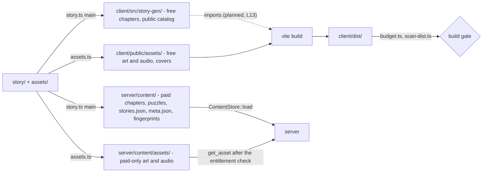
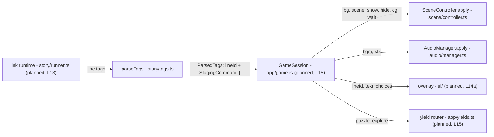
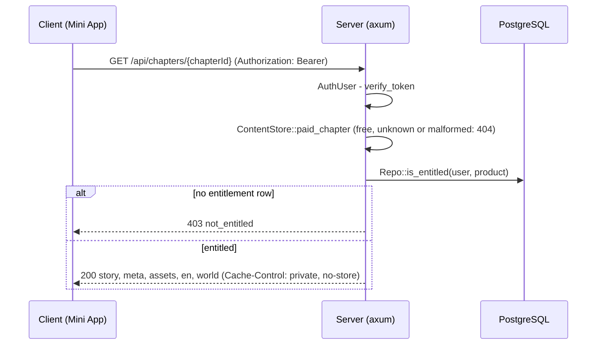
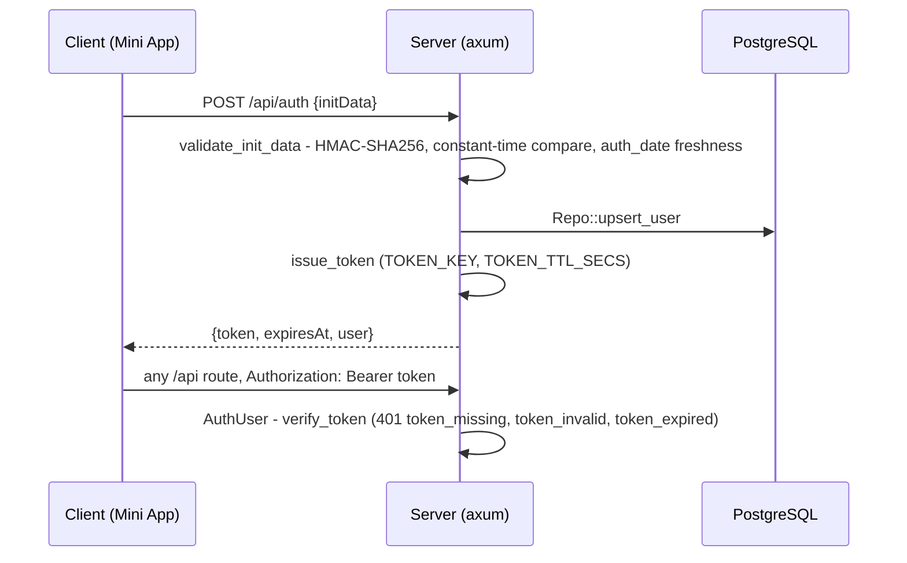
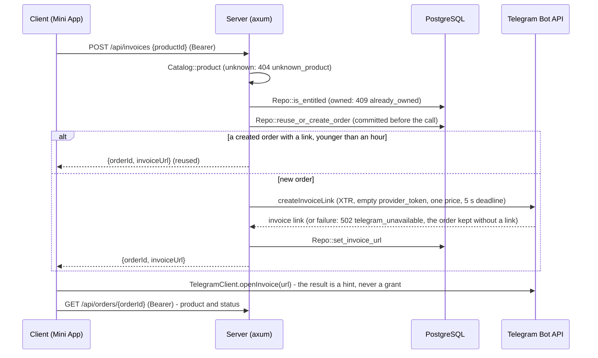

# Architecture

> The layers of tg-app-novel as merged at `4d8a9ec`, how data moves between them, and where each CLAUDE.md principle
> is enforced. First version; parts not built yet are marked **planned** with the lane and the plan section.

The design is in [PROTOTYPE-PLAN.md](PROTOTYPE-PLAN.md) (PP), [PUZZLES-PLAN.md](PUZZLES-PLAN.md) (PZ),
[STORIES-PLAN.md](STORIES-PLAN.md) (SP) and [META-PLAN.md](META-PLAN.md); this page describes what the tree does. Where
is a given file: [FEATURE_MAP.md](FEATURE_MAP.md). The ink tag language: [STAGING-DSL.md](STAGING-DSL.md).

## Overview

Three parts, joined at build time by generated files and at run time by one HTTP API:
- **`story/` + `assets/`** - hand-written sources: ink, the chapter and story lists, worlds, meta, locale tables, the
  asset catalog.
- **`client/`** - the Telegram Mini App (Svelte 5, PixiJS v8, inkjs runtime) and its Node build tools under
  `client/scripts/`. Its build splits the sources into a public half and a server-only half.
- **`server/`** - the axum server (crate `server`), the dev-only crate `server-dev` and the dev/test-only crate
  `pgdev`.

Each arrow is a function: `main` ([story.ts:530](../client/scripts/story.ts#L530)) routes every chapter through
`chapterPaths` ([emit.ts:133](../client/scripts/story/emit.ts#L133)); the asset tool's output directories are
`ASSET_OUT` ([manifest.ts:32](../client/scripts/assets/manifest.ts#L32)); the server loads `server/content/` in
`ContentStore::load` ([content.rs:229](../server/src/content.rs#L229)).

## Client modules

What exists under `client/src/` at `4d8a9ec`. The boundary column is enforced by
[arch.test.ts](../client/src/arch.test.ts) (rules `RULE_IDS`, scopes in `applies`), not by review.

| Module | Responsibility | Boundary |
|---|---|---|
| [main.ts](../client/src/main.ts) | entry: dev mock install (dev and e2e only), inset variables, `expand`, `disableVerticalSwipes`, mount `App`, `ready` | |
| [telegram/index.ts](../client/src/telegram/index.ts), [webapp.ts](../client/src/telegram/webapp.ts) | `TelegramClient`: the one Mini App facade, errors as values, version gates | only `webapp.ts` and `telegram/dev/` read `window.Telegram` |
| `telegram/{perf,viewport}.ts` | Android performance class; `--app-inset-*` CSS variables | |
| `telegram/dev/*` | mock transport and fake Stars sheet | only under `__TG_MOCK__`; production compiles it out ([vite.config.ts:33](../client/vite.config.ts#L33)) |
| `story/{tags,staging,catalog}.ts` | `parseTags`, the typed staging commands, catalog and manifest decoders | `tags.ts` is the only tag parser |
| `scene/*` | `SceneController` (Pixi application, layers, context-loss rebuild), executor (batch → GSAP timeline), texture registry with caps, loader, preload scheduler, layout | `pixi.js` only in `scene/`; `gsap` only in `scene/executor.ts`; textures created only in `loader.ts` / `registry.ts`; no `fetch` |
| `audio/*` | `unlockAudio` (in the gesture), the audio manager, two-deck BGM, SFX cache | `AudioContext` and `new Audio` only in `audio/`; no `fetch` |
| `world/*`, `puzzles/rules/*`, `explore/{state,reduce,project,reconcile}.ts` | world types and the one decoder; puzzle rules; the pure exploration reducer, reconcile and projection | the pure-world rule (`isPureWorld`, [arch.test.ts:123](../client/src/arch.test.ts#L123)): no DOM, network, storage, Svelte, clock or randomness; value imports stay inside these files and `story/{staging,catalog,tags}.ts` |
| [geom/cover.ts](../client/src/geom/cover.ts) | the cover transform and the room safe frame, shared by `scene/layout.ts`, `scene/executor.ts` and the story tool's world lint | none: no arch rule scopes `geom/` |
| `api/generated/api.ts` | ts-rs DTO types from the server | generated, committed |
| [ui/App.svelte](../client/src/ui/App.svelte) | the mounted shell | `ui/` imports no story, scene or audio module except types |

Forbidden anywhere in `src/` (arch rules): `vh` units, `window.open` and dialogs, `innerHTML` / `{@html`, Service
Workers, `document.cookie`, `<iframe`, `history` navigation, `localStorage` / `sessionStorage` outside
`telegram/dev/`, `initDataUnsafe`, `inkjs/full` and `inkjs/compiler`, `svelte-pixi`, and any import that resolves
outside `src/` (so neither `story/` nor `server/content/` can enter the bundle).

**Not wired yet.** No production module creates the scene controller or the audio manager, and none imports
`client/src/story-gen/`: the conductor, the story runtime and the API client are planned (GameSession
`app/game.ts`, L15; `story/runner.ts`, L13; `api/http.ts`, L10; PP "Module map"). The boot e2e
([boot.spec.ts](../client/e2e/boot.spec.ts)) covers what boot does today.

## Server modules

| Module | Responsibility |
|---|---|
| [main.rs](../server/src/main.rs) | `server serve` (the default): `Config::from_env`, `AppState::new`, bind `LISTEN_ADDR`, graceful shutdown |
| [lib.rs](../server/src/lib.rs) | `AppState` (one constructor, `AppState::new` :59; `with_clock` / `with_catalog` / `with_gateway` seams), `build_router` :114 (production routes only, under `/api`) |
| [config.rs](../server/src/config.rs) | `Config::from_env`: secrets and settings only from the environment; the committed placeholder secrets are refused unless `TELEGRAM_ENV` is `test` and `PUBLIC_APP_URL` is a local host (:173-187) |
| [api/mod.rs](../server/src/api/mod.rs) | the routes (:43): `/health`, `/auth`, `/entitlements`, `/chapters/{chapterId}`, `/assets/{file}`, `/saves`, `/saves/{storyId}/{slot}`, `/puzzles/{puzzleId}`, `/puzzles/{puzzleId}/attempts`, `/invoices`, `/orders/{orderId}`; a 16 KB body limit (300 KB for saves) and `Cache-Control: no-store` by default |
| `auth/*` | initData validation, the session token, the `AuthUser` extractor ([Auth](#auth-initdata-then-the-servers-own-token)) |
| `db/*` | `Repo`, the repository seam: every SQL statement; handlers never see `sqlx` |
| [content.rs](../server/src/content.rs) | `ContentStore`: the story index, paid chapters, the puzzle index and the gated asset index, loaded once at startup |
| [catalog.rs](../server/src/catalog.rs) | products: every paid chapter of the story index, priced by `server/catalog.json` (prices are server-only) |
| `puzzles/mod.rs` | answer check, attempt rate limit, puzzle status with the texts of unlocked hint tiers |
| [telegram/gateway.rs](../server/src/telegram/gateway.rs) | `BotGateway` (:49) and `FrankensteinGateway`: the Bot API through frankenstein types, no bot framework (principle 6) |
| `server/dev` (`server-dev`) | the production router plus `/dev/launch` (dev-signed initData) and `/dev/invoices/{slug}` on a fake gateway, on a fresh database per launch ([dev/src/lib.rs:33](../server/dev/src/lib.rs#L33)); never linked into `server` |
| `server/pgdev` | the local PostgreSQL 18 cluster per port and a database per test; a dependency of `server-dev` and a dev-dependency of `server`, never linked into the `server` binary ([server/Cargo.toml:31-33](../server/Cargo.toml#L31)) |

The configuration's variables, all read in `Config::from_env` ([config.rs:145-172](../server/src/config.rs#L145)):
`BOT_TOKEN`, `WEBHOOK_SECRET`, `TOKEN_KEY` (required secrets); `TELEGRAM_ENV`, `PUBLIC_APP_URL`, `CONTENT_DIR`,
`DATABASE_URL` (required); `TOKEN_TTL_SECS` (default 1800, 900-3600), `INITDATA_MAX_AGE_SECS` (default 86400,
1-86400), `ADMIN_TELEGRAM_IDS`, `STATIC_DIR`, `LISTEN_ADDR` (default `127.0.0.1:8787`).

**Startup refuses bad content.** `AppState::new` loads the content and builds the catalog and the gateway before it
opens the database pool, so a refusal opens no pool ([lib.rs:59-78](../server/src/lib.rs#L59)). Tests pin the
refusals: `startup_fails_without_story_index`, `startup_fails_when_first_chapter_paid`,
`startup_fails_when_world_carries_solution` (`server/tests/it/content.rs`).

## One-way staging

Principle 7: story runtime → staging commands → scene controller and overlay. The scene never reads story state; the
story never touches Pixi.

- **One parser.** `parseTags` ([tags.ts:360](../client/src/story/tags.ts#L360)) serves the story gate and the
  runtime alike; `TAG_KINDS` ([tags.ts:27](../client/src/story/tags.ts#L27)) is the tag list, and
  [dsl-doc.test.ts](../client/src/story/dsl-doc.test.ts) keeps it equal to STAGING-DSL §6.
- **The consumers are typed by command kind.** The scene controller takes the visual commands (`VisualCommand`,
  [executor.ts:35](../client/src/scene/executor.ts#L35)); the audio manager takes `AudioCommand`, the `bgm` / `sfx`
  kinds ([manager.ts:10](../client/src/audio/manager.ts#L10), `apply` :28).
- **The one channel back.** The world's outcomes reach ink only as declared projection variables (`pz_*`, `it_*`,
  `dc_*`) written before a knot is entered ([project.ts:15](../client/src/explore/project.ts#L15), PZ X2). The story
  gate's playthroughs write them the same way.
- **Literal tags, so the build sees every asset.** The story tool indexes each knot's assets and successors into
  `<ch>.meta.json` for preloading ([STAGING-DSL §8](STAGING-DSL.md#8-assets-and-preloading)).

## Build outputs and the gates

`npm --prefix client run build` is `story → assets → vite build → budget.ts → scan-dist.ts`
([package.json](../client/package.json)). The story tool writes only on a run with no error, and deletes stale
outputs first ([story.ts:728-752](../client/scripts/story.ts#L728)).

| Output | Written by | Read by | Public |
|---|---|---|---|
| `client/src/story-gen/catalog.json`, `free/<ch>.{story,meta,en,world}.json`, `free/<ch>.assets.json`, `covers.json` | story tool, asset tool | the client bundle (planned: the chapter loader, L13) | yes |
| `client/public/assets/` | asset tool | `vite build` copies it to `dist/assets/` | yes |
| `server/content/chapters/<ch>/{story,meta,en,world,assets}.json` | story tool, asset tool | `ContentStore` → `GET /api/chapters/{id}` | no |
| `server/content/assets/` | asset tool | `GET /api/assets/{file}` | no |
| `server/content/stories.json` | story tool | `ContentStore` (the story index) | no |
| `server/content/puzzles/<ch>.json` | story tool | `ContentStore` (solutions and hint texts) | no |
| `server/content/meta.json` | story tool | nobody yet (planned: LM2 meta-server) | no |
| `server/content/build/{fingerprints.lines,usage,fingerprints.assets}.json` | story tool, asset tool | asset tool, `budget.ts`, `scan-dist.ts` | no |

Paths: `OUT` ([emit.ts:28](../client/scripts/story/emit.ts#L28)) and `ASSET_OUT`
([manifest.ts:32](../client/scripts/assets/manifest.ts#L32)). All are git-ignored.

**Budgets** (principle 4) are enforced by `budget.ts`, `LIMITS` ([budget.ts:87](../client/scripts/budget.ts#L87)),
among them: the entry chunk ≤ 40 KB brotli, all JS ≤ 290 KB brotli, a chapter's story JSON ≤ 35 KB brotli, a knot's
working set (its stage plus its successors' assets, decoded) ≤ 32 MiB, images at most 2048 px a side. At run time the
texture registry holds a steady cap of 32 MiB and a hard cap of 48 MiB
([registry.ts:9-13](../client/src/scene/registry.ts#L9)), and the render resolution is at most 2× DPR, 1× on a
low-performance Android ([layout.ts:18-23](../client/src/scene/layout.ts#L18)). Rows whose input does not exist yet
(the engine chunk, a world) print `PENDING`.

**The leak scan** `scan-dist.ts` reads every file of `client/dist/` (with decoded `data:` URIs) against fingerprint
sections built from the sources: paid line IDs and paid line text samples, paid en values, paid asset names and
bytes, hint IDs and texts, paid world IDs and texts, and the meta texts. The trade-offs below give each section's
floor. Each section fails closed when its fingerprints
are empty while its sources exist ([scan-dist.ts:1-7](../client/scripts/scan-dist.ts#L1)).

The CLAUDE.md gate commands map to: `check` (svelte-check, tsc), `test` (vitest projects `unit` and `dom`,
[vite.config.ts:44-64](../client/vite.config.ts#L44)), `story`, `build` (above), `e2e` (Playwright on
`server-dev` and the mock), and the cargo `fmt`, `clippy` and `test` over the workspace (`server`, `server/dev`,
`server/pgdev`).

## Paid content and the entitlement check

Principle 0: paid content never reaches a client without an entitlement. It is held at three points.

**1. The build routes it.** A paid chapter's story, meta, en table and world go only to
`server/content/chapters/<ch>/` (`chapterPaths`, [emit.ts:133-139](../client/scripts/story/emit.ts#L133)). An asset
only paid chapters use goes only to `server/content/assets/` (`ASSET_OUT.paid`). Puzzle solutions and hint texts go
only to `server/content/puzzles/<ch>.json`; the public world carries the hint count (`toPublic`,
[decode.ts:660](../client/src/world/decode.ts#L660)). Meta texts go only to `server/content/meta.json`.

**2. The build checks the route.**
- The source lint rejects a free chapter that includes a paid chapter's file (`ink/include`,
  [lint.ts:691](../client/scripts/story/lint.ts#L691)).
- After the write, the story tool reads `story-gen/` back for paid line IDs, text samples and hint texts
  (`paid/leak`, `paidLeak` [emit.ts:451](../client/scripts/story/emit.ts#L451)).
- The leak scan checks `dist/` (above). Vite inlines nothing as a `data:` URI and ships no source map
  ([vite.config.ts:36-42](../client/vite.config.ts#L36)). The dev server refuses a `/@fs` path to paid content
  (`dev server refuses /@fs paid path`, [dev-server.test.ts](../client/scripts/dev-server.test.ts)).

**3. The server checks the entitlement per request.**

Participants: `get_chapter` ([api/content.rs:29-56](../server/src/api/content.rs#L29)), `AuthUser`
([extract.rs:20](../server/src/auth/extract.rs#L20)), `paid_chapter` ([content.rs:278](../server/src/content.rs#L278)),
`is_entitled` ([db/entitlements.rs:23](../server/src/db/entitlements.rs#L23)). `GET /api/assets/{file}`
(`get_asset` :59) does the same per file: a name the asset index lacks is 404 (the name is a map key, never a path),
and the file is served only if the user owns one of the chapter products whose manifests name it. The tests:
`paid_chapter_403_without_entitlement`, `paid_chapter_200_with_entitlement`, `free_chapter_not_served_by_api`,
`asset_path_traversal_404`, `paid_responses_private_no_store` (`server/tests/it/content.rs`). Puzzle attempts and
hint texts of a paid chapter need the same entitlement (`attempt_paid_chapter_403_without_entitlement`,
`hint_text_403_for_unowned_paid_chapter`, `server/tests/it/puzzles.rs`).

Only the `entitlements` table unlocks: its rows reference a payment by `charge_id`, UNIQUE
([0001_init.sql:52-60](../server/migrations/0001_init.sql#L52)). Nothing is ever unlocked from client state
(principle 1).

## Auth: initData, then the server's own token

Principle 3. The client sends the raw signed `initData` once; the server verifies it and answers with its own
short-lived token, which every later request carries in the `Authorization` header (WebView cookies are unreliable).

- **Verification** (`validate_init_data`, [initdata.rs:73-115](../server/src/auth/initdata.rs#L73)): decode, refuse
  duplicate keys, then the HMAC check before any field is read. The key is `secret_key` = HMAC-SHA256 keyed
  `WebAppData` over the bot token ([initdata.rs:136](../server/src/auth/initdata.rs#L136)); the data-check-string is
  every pair but `hash`, sorted, `key=value` joined by `\n` (:120); `verify_slice` compares in constant time. Then
  `auth_date`: older than `INITDATA_MAX_AGE_SECS` is `Expired`, more than 60 s ahead is `FromFuture`. initData over
  4 KB is refused (`post_auth`, [api/auth.rs:18](../server/src/api/auth.rs#L18)).
- **The user** comes only from the verified initData; anything else in the body is ignored
  (`auth_ignores_body_user_id`). `initDataUnsafe` is never trusted: the client may not even name it (arch rule
  `init-data-unsafe`).
- **The token** is `v1.<user_id>.<exp>.<hex HMAC-SHA256(TOKEN_KEY, "v1.<user_id>.<exp>")>`, not a JWT
  ([token.rs:1](../server/src/auth/token.rs#L1)); `AuthUser` reads it as a `Bearer` credential
  ([extract.rs:20-38](../server/src/auth/extract.rs#L20)).
- **Dev.** `server-dev`'s `/dev/launch` signs initData with the dev bot token through the same `data_check_string` and
  `secret_key` ([launch.rs:76](../server/dev/src/launch.rs#L76)).
- **Planned.** The client side (the token in memory, a single-flight re-auth on 401): L10 client-data,
  `api/{http,session}.ts` (PP "Module map").

Tests: `server/tests/it/auth.rs` (`initdata_tampered_field`, `initdata_expired`, `initdata_from_future`,
`initdata_duplicate_key`, `token_expired_401`, `auth_initdata_over_4k_400`).

## Payments as built

Principle 2: Stars only, correct or absent. Built so far: invoices and orders (L8a). The webhook, pre-checkout and the
grant are L8b's, running.

Participants: `post_invoice` ([api/orders.rs:53-107](../server/src/api/orders.rs#L53)), `reuse_or_create_order`
([db/orders.rs:110](../server/src/db/orders.rs#L110), `ORDER_REUSE_SECS` = 3600 :15), `invoice_params`
([gateway.rs:248-260](../server/src/telegram/gateway.rs#L248)), `CALL_DEADLINE`
([gateway.rs:33](../server/src/telegram/gateway.rs#L33)), `get_order` ([api/orders.rs:110](../server/src/api/orders.rs#L110)),
`openInvoice` ([telegram/index.ts:52](../client/src/telegram/index.ts#L52); its contract comment at :3).

- **Prices are server-only**: `server/catalog.json` prices every paid chapter of the story index
  ([catalog.rs:98](../server/src/catalog.rs#L98)); the invoice title is the chapter's title in the user's language,
  1-32 code points by the story gate (`catalog/stories` rule 9).
- **The schema is the idempotency.** `payments` has the primary key `telegram_payment_charge_id`; `orders.charge_id`
  and `entitlements.charge_id` are UNIQUE and reference it ([0001_init.sql:12-60](../server/migrations/0001_init.sql#L12),
  test `schema_charge_id_unique`). No grant code exists yet ([db/entitlements.rs:1](../server/src/db/entitlements.rs#L1)).
  Planned (L8b, PP "Payment flow"): a grant is one insert keyed by the charge id, not a check-then-insert.
- **The gateway** already has `answer_pre_checkout` and `refund_star_payment`
  ([gateway.rs:53-63](../server/src/telegram/gateway.rs#L53)); `CALL_DEADLINE` is 5 s so a pre-checkout answer
  meets Telegram's 10 s.
- **Planned (L8b webhook-grant, PP "Payment flow"):** the `/telegram/webhook` route with its secret check;
  `pre_checkout_query` answered within 10 s under the payer-row lock; the grant only on `successful_payment`; the
  dev `simulate` routes through the real handler. **Later:** refunds and `/terms`, `/support`, `/paysupport` (L9
  refunds-bot).

Tests: `server/tests/it/payments.rs` (`invoice_price_from_catalog`, `invoice_reuses_recent_order`,
`invoice_order_committed_before_gateway_call`, `invoice_gateway_error_502_order_kept`, `invoice_already_owned_409`,
`order_other_user_404`).

## WebView constraints

Principle 5, as far as it is built:

| Constraint | Where |
|---|---|
| height and safe areas from Telegram, never `100vh` | `applyInsetVars` ([viewport.ts:25](../client/src/telegram/viewport.ts#L25)); arch rule `vh-unit` |
| no vertical swipe-to-close | `disableVerticalSwipes` in `boot` ([main.ts:16](../client/src/main.ts#L16)) |
| audio only after a gesture | `unlockAudio` resumes the one `AudioContext` inside the tap ([unlock.ts:12](../client/src/audio/unlock.ts#L12)); the manager reports `needs-gesture` |
| pause on `deactivated`, check WebGL on `activated` | `TelegramClient.onLifecycle`; `AudioManager` suspend / resume; `SceneController.onActivated` rebuilds a context still lost after `CONTEXT_GRACE_MS` = 2000 ([controller.ts:50](../client/src/scene/controller.ts#L50)); wiring planned (L15) |
| `BackButton`, not browser history | `TelegramClient.backButton`; arch rule `history`; the screen stack is L14a's |
| no Service Worker, no `window.open` / `alert` | arch rules `service-worker`, `window-open`, `dialog`; e2e `no window.open or alert` |
| every SDK call from the main origin | the dev and preview servers proxy `/api/`, `/dev/`, `/telegram/` to `server-dev` on one origin ([vite.config.ts:26-28](../client/vite.config.ts#L26)) |

## Failure modes

| Case | Behaviour | Pinned by |
|---|---|---|
| content directory missing or inconsistent | the server does not start; no pool opened | `startup_fails_*` (`content.rs` tests) |
| Bot API slow or down at invoice time | 502 `telegram_unavailable`; the order stays `created` without a link and is never reused | `invoice_gateway_error_502_order_kept` |
| a repeat Buy after the first invoice link was stored | the newest linked order of the hour is handed out again | `invoice_reuses_recent_order` (sequential requests) |
| two Buy taps while the first link call is still running | an order without a link is never reused, so the second tap makes a second order and a second link ([db/orders.rs:107-109](../server/src/db/orders.rs#L107)); planned: pre-checkout refuses the double payment (L8b) | not pinned yet |
| expired or tampered token | 401 `token_expired` / `token_invalid` | `token_expired_401`, `token_rejects_tampered_parts` |
| WebGL context lost | rebuilt on `activated` after the grace period | `SceneController.onActivated` (wiring planned, L15) |
| a story edit that breaks a soft-lock proof | the story gate fails with the action path | `softlock:` tests, [AUTHORING.md](AUTHORING.md#world-lint-codes-and-soft-lock-counterexamples) |

## Trade-offs

- The free chapters' text ships in the bundle by design: only paid content is protected. Chapter titles, speaker
  names, story titles and teasers are public too, paid chapters' titles included (STAGING-DSL §4).
- The leak scan proves absence only for the fingerprints it builds, and the floor differs per section:
  - paid ink line texts are **samples**: every 10th eligible line of 24+ code points, plus each paid chapter's
    longest line (`SAMPLE_MIN_CODE_POINTS`, `SAMPLE_EVERY`, [emit.ts:115-117](../client/scripts/story/emit.ts#L115);
    `fingerprints` :361). Most paid lines have no ink-text needle: a paid line's ink text copied into the bundle without
    its `#id:` tag is caught only if it is a sample (its en value is a needle from 12 code points up, next item);
  - paid en values, world and hint texts and meta texts are needles from 12 code points up
    (`TEXT_NEEDLE_MIN_CODE_POINTS`, [world.ts:366](../client/scripts/story/world.ts#L366)); a shorter text has none;
  - line IDs, paid asset names and asset bytes are matched exactly.
- The session token has no revocation list: it lives at most `TOKEN_TTL_SECS` (≤ 1 h).

## See also

- [FEATURE_MAP.md](FEATURE_MAP.md) - every built feature with its files and tests, and what is not built yet.
- [AUTHORING.md](AUTHORING.md) - the writers' side of the story tool.
- [STAGING-DSL.md](STAGING-DSL.md) - the tag language and the lint table.
- [OPEN-QUESTIONS.md](OPEN-QUESTIONS.md) - open owner questions.
