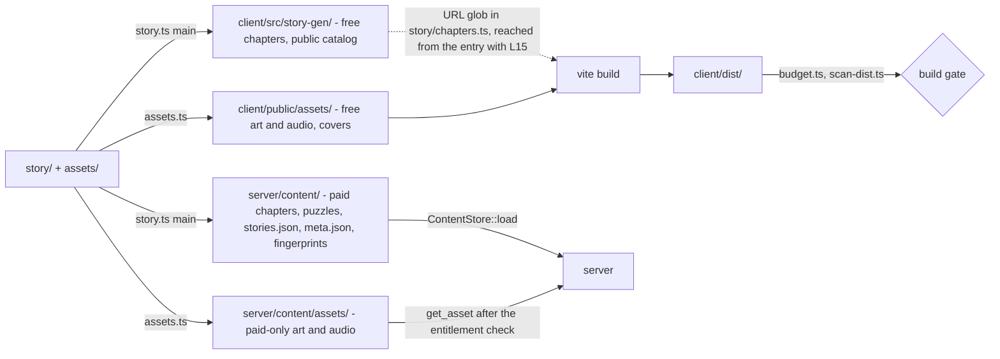
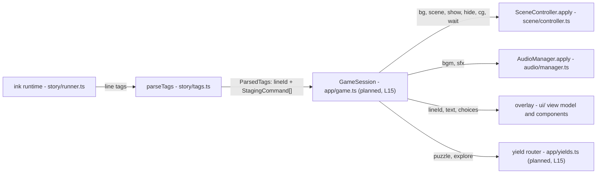
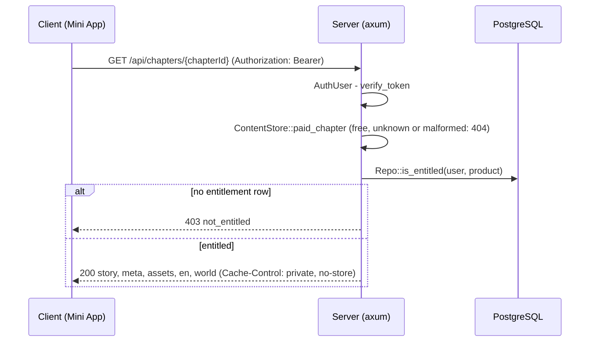
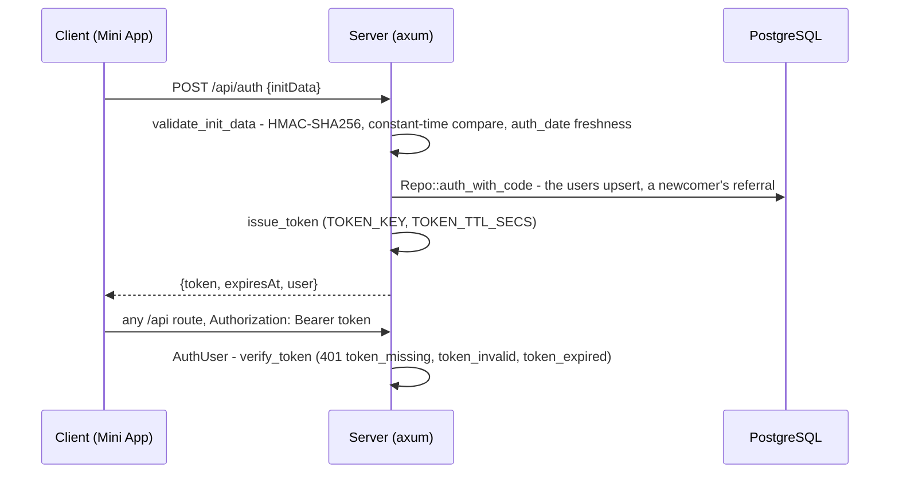
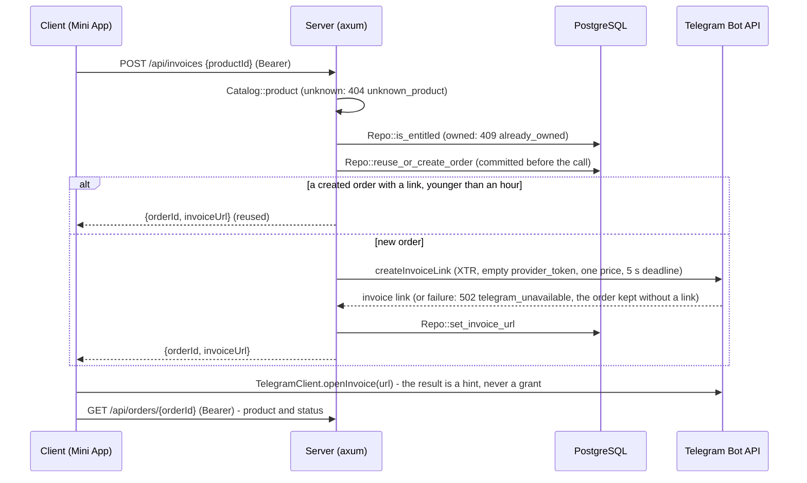
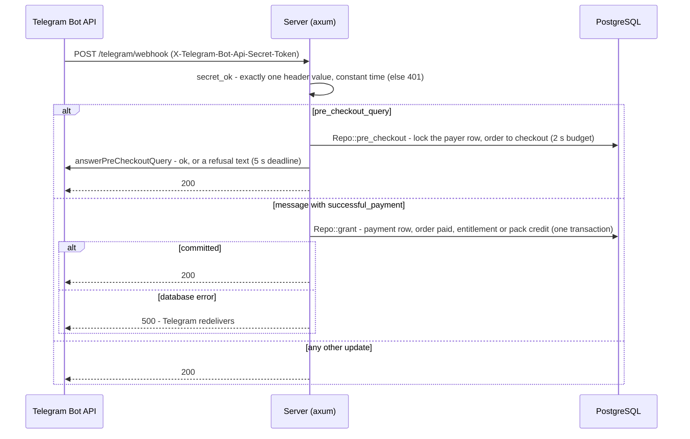
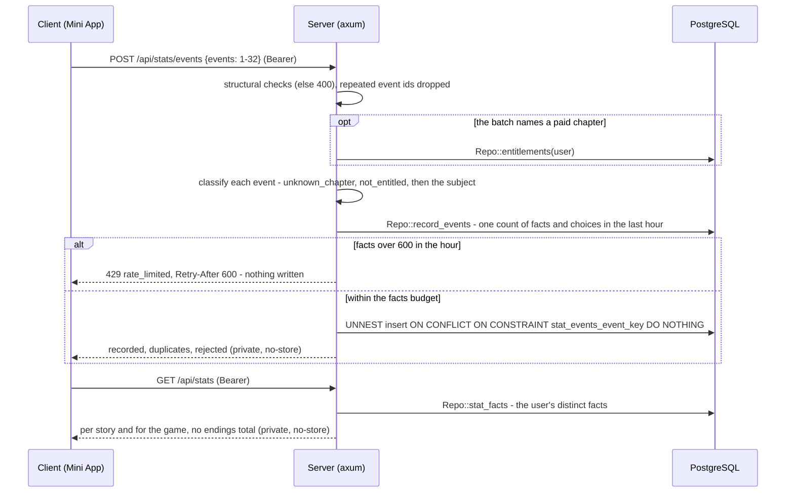

# Architecture

> The layers of tg-app-novel as merged at `22ed4d5`, how data moves between them, and where each CLAUDE.md principle
> is enforced. First version at `e5ce724`, with LS3 server-stats and LU1 meta-ui added at `6043941`, and L10, L14b,
> LE1, LP2, L13, LF1, LS4, LX and LM2 since; open at `22ed4d5`: L15 integration and LF2 share-profile. Parts not built
> yet are marked **planned** with the lane and the plan section.

The design is in [PROTOTYPE-PLAN.md](PROTOTYPE-PLAN.md) (PP), [PUZZLES-PLAN.md](PUZZLES-PLAN.md) (PZ),
[STORIES-PLAN.md](STORIES-PLAN.md) (SP) and [META-PLAN.md](META-PLAN.md); this page describes what the tree does. Where
is a given file: [FEATURE_MAP.md](FEATURE_MAP.md). The ink tag language: [STAGING-DSL.md](STAGING-DSL.md).

## Overview

Three parts, joined at build time by generated files and at run time by one HTTP API:
- **`story/` + `assets/`** - hand-written sources: ink, the chapter and story lists, worlds, meta, locale tables, the
  asset catalog.
- **`client/`** - the Telegram Mini App (Svelte 5, PixiJS v8, inkjs runtime) and its Node build tools under
  `client/scripts/`. Its build splits the sources into a public half and a server-only half.
- **`server/`** - the axum server (crate `server`), the dev-only crate `server-dev` and the dev/test-only crate
  `pgdev`.

Each arrow is a function: `main` ([story.ts:530](../client/scripts/story.ts#L530)) routes every chapter through
`chapterPaths` ([emit.ts:133](../client/scripts/story/emit.ts#L133)); the asset tool's output directories are
`ASSET_OUT` ([manifest.ts:32](../client/scripts/assets/manifest.ts#L32)); the server loads `server/content/` in
`ContentStore::load` ([content.rs:236](../server/src/content.rs#L236)).

## Client modules

What exists under `client/src/` at `22ed4d5`. The boundary column is enforced by
[arch.test.ts](../client/src/arch.test.ts) (rules `RULE_IDS`, scopes in `applies`), not by review.

| Module | Responsibility | Boundary |
|---|---|---|
| [main.ts](../client/src/main.ts) | entry: dev mock install (dev and e2e only), inset variables, `expand`, `disableVerticalSwipes`, mount `App`, `ready` | |
| [telegram/index.ts](../client/src/telegram/index.ts), [webapp.ts](../client/src/telegram/webapp.ts) | `TelegramClient`: the one Mini App facade, errors as values, version gates. Each TWA event, the BackButton press included, has one TWA registration and the facade's own dispatch over a snapshot of its subscribers: one added during a dispatch waits for the next event, one removed is skipped, a throwing one does not stop the others (`eventHub`, [webapp.ts:203-234](../client/src/telegram/webapp.ts#L203); the `facade:` tests in `telegram.test.ts`) | only `webapp.ts` and `telegram/dev/` read `window.Telegram` |
| `telegram/{perf,viewport}.ts` | Android performance class; `--app-inset-*` CSS variables | |
| `telegram/dev/*` | mock transport and fake Stars sheet | only under `__TG_MOCK__`; production compiles it out ([vite.config.ts:33](../client/vite.config.ts#L33)) |
| [api/http.ts](../client/src/api/http.ts), `api/{session,endpoints,decode}.ts` | the API client (L10): `createHttp` (:138) carries every `/api` call and asset byte; the token lives only in `session.ts`'s closure; a `401 token_*` re-auths once, single flight, and retries once; typed calls per route; one decoder per server DTO ([Auth](#auth-initdata-then-the-servers-own-token)) | only `api/` sets `Authorization` (arch rule `authorization`); the bearer goes to `/api/` URLs only |
| `saves/{service,pending}.ts` | saves per story (L10): one autosave PUT in flight, a retry replays its `writeId`, a foreign 409 pauses autosave; the unacknowledged body cached in DeviceStorage (`pending_<storyId>`) | a cache only: the server copy wins (principle 1) |
| [purchase/flow.ts](../client/src/purchase/flow.ts) | the purchase state machine (L10): the invoice, `openInvoice`, the order poll; `unlocked` only from server reads ([Payments](#payments-as-built)) | typed to `openInvoice` alone, so no storage value reaches the decision (principles 1-2) |
| [stats/reporter.ts](../client/src/stats/reporter.ts) | the statistics reporter (LS4): the event queue, batches of at most 32, a retry with the same event ids, the queue's DeviceStorage copy ([Player statistics](#player-statistics-as-built)) | grants nothing, never throws; the copy is a cache |
| `story/{runner,chapters,carry,resume,save-codec}.ts`, [i18n/lines.ts](../client/src/i18n/lines.ts) | the story runtime (L13): `StoryRunner` ([runner.ts:188](../client/src/story/runner.ts#L188)) turns ink's `Continue()` into steps; the chapter loader (a free chapter by its static URLs, a paid one only through `GET /api/chapters/{id}`); the carry of `g_` globals; resume at the exact step, the knot's top or the chapter start; the save body codec; the line text by language | `inkjs` only in `story/runner.ts` (arch rule `import-inkjs`); `runner.enter` only from `app/yields.ts` (`runner-enter`) |
| `story/{tags,staging,catalog}.ts` | `parseTags`, the typed staging commands, catalog and manifest decoders | `tags.ts` is the only tag parser |
| `scene/*` | `SceneController` (Pixi application, layers, context-loss rebuild), executor (batch → GSAP timeline), texture registry with caps, loader, preload scheduler, layout | `pixi.js` only in `scene/`; `gsap` only in `scene/executor.ts`; textures created only in `loader.ts` / `registry.ts`; no `fetch` |
| `audio/*` | `unlockAudio` (in the gesture), the audio manager, two-deck BGM, SFX cache | `AudioContext` and `new Audio` only in `audio/`; no `fetch` |
| `world/*`, `puzzles/rules/*`, `explore/{state,reduce,project,reconcile}.ts` | world types and the one decoder; puzzle rules; the pure exploration reducer, reconcile and projection | the pure-world rule (`isPureWorld`, [arch.test.ts:130](../client/src/arch.test.ts#L130)): no DOM, network, storage, Svelte, clock or randomness; value imports stay inside these files and `story/{staging,catalog,tags}.ts` |
| [geom/cover.ts](../client/src/geom/cover.ts) | the cover transform and the room safe frame, shared by `scene/layout.ts`, `scene/executor.ts` and the story tool's world lint | no module rule of its own: the pure-world rule does not cover it ([arch.test.ts:130](../client/src/arch.test.ts#L130)); the global rules below and `pixi.js` only in `scene/` apply ([arch.test.ts:152-181](../client/src/arch.test.ts#L152)) |
| `api/generated/api.ts` | ts-rs DTO types from the server | generated, committed |
| [ui/App.svelte](../client/src/ui/App.svelte) | the mounted shell: a placeholder glyph until L15 integration | `ui/` imports no story, scene or audio module except types (arch rule `ui-imports`) |
| [ui/screens.ts](../client/src/ui/screens.ts) | `createScreens` (:71): overlays over a root view (Home, the game, a Notice), no router; the one owner of the BackButton ([WebView constraints](#webview-constraints)) | the button only through the facade's `backButton` |
| [ui/state.svelte.ts](../client/src/ui/state.svelte.ts) | `createViewModel` (:147): the overlay's view model (the line, the choices, the play mode, the text speed, the screens view, the toasts); its `$state.raw` fields are replaced, never mutated | views only: never a Story, a runner or a Pixi object (principle 7) |
| `ui/{TapToStart,Stage,DialogueBox,Choices,QuickBar,Toast}.svelte`, [ui/typewriter.ts](../client/src/ui/typewriter.ts) | Home's frame, the stage host the scene mounts into, the dialogue box with the grapheme typewriter, the choices (no tap-through), the quick bar, the toast stack (its `dev` banner only under the mock) | presentational: props in, callbacks out; text through `t()`, `textContent` or Svelte text interpolation, never markup |
| [i18n/index.ts](../client/src/i18n/index.ts), `i18n/{ru,en}.ts` | the UI string tables and `t(lang, key, params)` (:18) | `ru.ts` defines the keys; `en.ts` is typed by them, so a missing or an extra key is a compile error ([en.ts:1-6](../client/src/i18n/en.ts#L1)) |
| `ui/{Menu,Paywall,ChapterSelect,StoryPicker,SaveLoad,Settings,Backlog,Notice,Terms}.svelte`, [settings/store.ts](../client/src/settings/store.ts) | the menus (L14b): the game menu, the paywall with the terms checkbox, chapter select per story, the story picker, save and load, settings, the backlog, notices, the terms; the settings and read-sets cached in CloudStorage | presentational, no I/O (`menus: components do no I/O`); the settings store is a cache that is never asked what is owned |
| `puzzles/{registry,session}.ts`, `puzzles/ui/*`, `ui/puzzles/*`, [ui/puzzle-view.svelte.ts](../client/src/ui/puzzle-view.svelte.ts) | the puzzle UI (LP2): one puzzle session with its hint ladder (hint texts from the server, in memory only), one dynamic chunk per puzzle type, the puzzle host | the lazy directories `puzzles/ui/`, `ui/puzzles/`, `ui/explore/` are imported from outside only by `import()` (arch rule `lazy-ui`, [arch.test.ts:142](../client/src/arch.test.ts#L142)) and budgeted per chunk |
| [explore/controller.ts](../client/src/explore/controller.ts), `ui/explore/*`, [ui/explore-view.svelte.ts](../client/src/ui/explore-view.svelte.ts), [ui/glyphs.ts](../client/src/ui/glyphs.ts) | the exploration UI (LX): the explore controller (hotspot views through the cover transform, 44 px minimum targets, the room path for Back, neighbour preloads), the hotspot layer, inventory, document reader and lock panel, one lazy chunk | the world only through `reduce` / `admitSection` (principle 7); a `lazy-ui` chunk |
| [ui/meta/index.ts](../client/src/ui/meta/index.ts), `ui/meta/*.svelte`, [i18n/meta.ts](../client/src/i18n/meta.ts) | the presentational meta overlays (completion card, friends and requests, a friend's profile, invite prompt, consent, wallet, gift) and their own string table (`mt` :140); `ui/meta/index.ts` is the one entry of one lazy chunk (META-PLAN M27) | **nothing imports the chunk yet, and nothing mounts it until LMI meta-integration**, whose `app/meta.ts` is the only module allowed to load `ui/meta/index.ts`, and only by a dynamic import. Outside `ui/meta/` a module may reach it only by `import type`, nothing outside the chunk loads `i18n/meta.ts`, and the chunk does no I/O (`meta: one entry, no I/O, the meta table stays in the chunk`, [meta.svelte.test.ts:872-930](../client/src/ui/meta/meta.svelte.test.ts#L872)) |

Forbidden anywhere in `src/` (arch rules): `vh` units, `window.open` and dialogs, `innerHTML` / `{@html`, Service
Workers, `document.cookie`, `<iframe`, `history` navigation, `localStorage` / `sessionStorage` outside
`telegram/dev/`, `initDataUnsafe`, `inkjs/full` and `inkjs/compiler`, `svelte-pixi`, and any import that resolves
outside `src/` (so neither `story/` nor `server/content/` can enter the bundle).

**Not wired yet** (as of `22ed4d5`). No module reachable from `main.ts` creates the scene controller, the audio
manager, the screen stack, the view model, the API client, the story runner, the saves, purchase or statistics
services, or a puzzle or explore session. The one reader of `client/src/story-gen/` is the chapter loader's URL glob
(`FREE_CHAPTER_FILES`, [chapters.ts:67](../client/src/story/chapters.ts#L67)), which nothing reachable from the entry
imports yet. `App.svelte` mounts none of the overlay or menu components until L15 integration (running), and none of
the meta overlays until LMI meta-integration. The conductor is planned (GameSession `app/game.ts` and the yield router
`app/yields.ts`, L15; PP "Module map"). The boot e2e ([boot.spec.ts](../client/e2e/boot.spec.ts)) covers what boot does
today; the overlay components are tested in the vitest `dom` project.

## Server modules

| Module | Responsibility |
|---|---|
| [main.rs](../server/src/main.rs) | `server serve` (the default): `Config::from_env`, `AppState::new`, bind `LISTEN_ADDR`, graceful shutdown |
| [lib.rs](../server/src/lib.rs) | `AppState` (one constructor, `AppState::new` :62; `with_clock` / `with_catalog` / `with_gateway` seams), `build_router` :118 (production routes only: `/api`, and `/telegram/webhook` outside it with its own 1 MiB body limit) |
| [config.rs](../server/src/config.rs) | `Config::from_env`: secrets and settings only from the environment; the committed placeholder secrets are refused unless `TELEGRAM_ENV` is `test` and `PUBLIC_APP_URL` is a local host (:173-187) |
| [api/mod.rs](../server/src/api/mod.rs) | the routes (:48): `/health`, `/auth`, `/entitlements`, `/chapters/{chapterId}`, `/assets/{file}`, `/saves`, `/saves/{storyId}/{slot}`, `/puzzles/{puzzleId}`, `/puzzles/{puzzleId}/attempts`, `/puzzles/{puzzleId}/hints/{tier}`, `/invoices`, `/orders/{orderId}`, `/stats`, `/stats/events`, `/stories/{storyId}/card`, `/wallet`, `/invites/{code}`, `/invites/{code}/request`, `/social`, `/friends/requests/{handle}/accept`, `/friends/{handle}`, `/invite/rotate`, `/consents/friends_profile`, and `/privacy` from `api/legal.rs`; a 16 KB body limit (300 KB for saves) and `Cache-Control: no-store` by default |
| `auth/*` | initData validation, the session token, the `AuthUser` extractor ([Auth](#auth-initdata-then-the-servers-own-token)) |
| `db/*` | `Repo`, the repository seam: every SQL statement; handlers never see `sqlx` |
| [content.rs](../server/src/content.rs) | `ContentStore`: the story index, paid chapters, the puzzle index, the gated asset index and the meta index (`load_meta` :719, LM2), loaded once at startup |
| [catalog.rs](../server/src/catalog.rs) | products: every paid chapter of the story index, priced by `server/catalog.json` (prices are server-only), and the hint packs of its `economy` section (`build_economy` :395, LE1) |
| `puzzles/mod.rs` | answer check, attempt rate limit, puzzle status with the texts of unlocked hint tiers |
| [api/stats.rs](../server/src/api/stats.rs), [db/stats.rs](../server/src/db/stats.rs) | the player statistics: the event batch, its classification and budgets, the read of distinct facts ([Player statistics](#player-statistics-as-built)) |
| [api/wallet.rs](../server/src/api/wallet.rs), [db/economy.rs](../server/src/db/economy.rs) | the economy (LE1): `GET /api/wallet` (the balances and the packs for sale); the append-only ledger and the balance rows, credited inside the grant, debited by `POST /api/puzzles/{puzzleId}/hints/{tier}` (`Repo::spend_hint`, `db/economy.rs` :305) |
| [api/social.rs](../server/src/api/social.rs), [db/social.rs](../server/src/db/social.rs), [api/legal.rs](../server/src/api/legal.rs) | friends (LF1): invite codes, requests the link's owner accepts, removal and blocks, consent rows, the referral recorded at login (`Repo::auth_with_code`, `db/social.rs` :124); the public, versioned `GET /api/privacy` |
| [meta.rs](../server/src/meta.rs), [api/cards.rs](../server/src/api/cards.rs), [db/achievements.rs](../server/src/db/achievements.rs) | story meta (LM2): the meta index and its rules, achievement conditions evaluated on the server (`met`, `meta.rs` :573), paid gates (`gate` :604, `visible` :637); `POST /api/stories/{storyId}/card` (`post_card`, `api/cards.rs` :48), whose unlocks are stored for display and grant nothing |
| [telegram/gateway.rs](../server/src/telegram/gateway.rs) | `BotGateway` (:49) and `FrankensteinGateway`: the Bot API through frankenstein types, no bot framework (principle 6) |
| [telegram/webhook.rs](../server/src/telegram/webhook.rs) | `POST /telegram/webhook` (`webhook` :50): the secret check, the decode into frankenstein's `Update`, the lenient payment probe, the dispatch ([Payments](#payments-as-built)) |
| [telegram/payments.rs](../server/src/telegram/payments.rs), [db/payments.rs](../server/src/db/payments.rs) | the pre-checkout decision and its answer under their deadlines; the grant on `successful_payment`; their SQL in `db/` |
| `server/dev` (`server-dev`) | the production router plus `/dev/launch` (dev-signed initData), `/dev/invoices/{slug}` on a fake gateway and `/dev/simulate-payment` through the production webhook handler, on a fresh database per launch ([dev/src/lib.rs:34](../server/dev/src/lib.rs#L34)); never linked into `server` |
| `server/pgdev` | the local PostgreSQL 18 cluster per port and a database per test; a dependency of `server-dev` and a dev-dependency of `server`, never linked into the `server` binary ([server/Cargo.toml:31-33](../server/Cargo.toml#L31)) |

The configuration's variables, all read in `Config::from_env` ([config.rs:145-172](../server/src/config.rs#L145)):
`BOT_TOKEN`, `WEBHOOK_SECRET`, `TOKEN_KEY` (required secrets); `TELEGRAM_ENV`, `PUBLIC_APP_URL`, `CONTENT_DIR`,
`DATABASE_URL` (required); `TOKEN_TTL_SECS` (default 1800, 900-3600), `INITDATA_MAX_AGE_SECS` (default 86400,
1-86400), `ADMIN_TELEGRAM_IDS`, `STATIC_DIR`, `LISTEN_ADDR` (default `127.0.0.1:8787`).

**Startup refuses bad content.** `AppState::new` loads the content and builds the catalog and the gateway before it
opens the database pool, so a refusal opens no pool ([lib.rs:62-81](../server/src/lib.rs#L62)). Tests pin the
refusals: `startup_fails_without_story_index`, `startup_fails_when_first_chapter_paid`,
`startup_fails_when_world_carries_solution`, and for the meta index (LM2) `startup_fails_when_meta_names_unknown_ending`,
`startup_fails_when_meta_too_large` (`server/tests/it/content.rs`).

## One-way staging

Principle 7: story runtime → staging commands → scene controller and overlay. The scene never reads story state; the
story never touches Pixi.

- **One parser.** `parseTags` ([tags.ts:360](../client/src/story/tags.ts#L360)) serves the story gate and the
  runtime alike; `TAG_KINDS` ([tags.ts:27](../client/src/story/tags.ts#L27)) is the tag list, and
  [dsl-doc.test.ts](../client/src/story/dsl-doc.test.ts) keeps it equal to STAGING-DSL §6.
- **The consumers are typed by command kind.** The scene controller takes the visual commands (`VisualCommand`,
  [executor.ts:35](../client/src/scene/executor.ts#L35)); the audio manager takes `AudioCommand`, the `bgm` / `sfx`
  kinds ([manager.ts:10](../client/src/audio/manager.ts#L10), `apply` :28).
- **The one channel back.** The world's outcomes reach ink only as declared projection variables (`pz_*`, `it_*`,
  `dc_*`) written before a knot is entered ([project.ts:15](../client/src/explore/project.ts#L15), PZ X2). The story
  gate's playthroughs write them the same way.
- **Literal tags, so the build sees every asset.** The story tool indexes each knot's assets and successors into
  `<ch>.meta.json` for preloading ([STAGING-DSL §8](STAGING-DSL.md#8-assets-and-preloading)).

## Build outputs and the gates

`npm --prefix client run build` is `story → assets → vite build → budget.ts → scan-dist.ts`
([package.json](../client/package.json)). The story tool writes only on a run with no error, and deletes stale
outputs first ([story.ts:728-752](../client/scripts/story.ts#L728)).

| Output | Written by | Read by | Public |
|---|---|---|---|
| `client/src/story-gen/catalog.json`, `free/<ch>.{story,meta,en,world}.json`, `free/<ch>.assets.json`, `covers.json` | story tool, asset tool | the chapter loader `story/chapters.ts` (the free files by URL); in the bundle once L15 integration imports it | yes |
| `client/public/assets/` | asset tool | `vite build` copies it to `dist/assets/` | yes |
| `server/content/chapters/<ch>/{story,meta,en,world,assets}.json` | story tool, asset tool | `ContentStore` → `GET /api/chapters/{id}` | no |
| `server/content/assets/` | asset tool | `GET /api/assets/{file}` | no |
| `server/content/stories.json` | story tool | `ContentStore` (the story index) | no |
| `server/content/puzzles/<ch>.json` | story tool | `ContentStore` (solutions and hint texts) | no |
| `server/content/meta.json` | story tool | `ContentStore` (the meta index, `load_meta`, [content.rs:719](../server/src/content.rs#L719)) → `POST /api/stories/{storyId}/card` and the stats choice vocabulary | no |
| `server/content/build/{fingerprints.lines,usage,fingerprints.assets}.json` | story tool, asset tool | asset tool, `budget.ts`, `scan-dist.ts` | no |

Paths: `OUT` ([emit.ts:28](../client/scripts/story/emit.ts#L28)) and `ASSET_OUT`
([manifest.ts:32](../client/scripts/assets/manifest.ts#L32)). All are git-ignored.

**Budgets** (principle 4) are enforced by `budget.ts`, `LIMITS` ([budget.ts:95](../client/scripts/budget.ts#L95)),
among them: the entry chunk ≤ 40 KB brotli, all JS ≤ 290 KB brotli, each lazy chunk (LP2: a puzzle type ≤ 8 KB, the
puzzle host ≤ 10 KB, the explore UI ≤ 16 KB brotli), a chapter's story JSON ≤ 35 KB brotli, a knot's
working set (its stage plus its successors' assets, decoded) ≤ 32 MiB, images at most 2048 px a side. At run time the
texture registry holds a steady cap of 32 MiB and a hard cap of 48 MiB
([registry.ts:9-13](../client/src/scene/registry.ts#L9)), and the render resolution is at most 2× DPR, 1× on a
low-performance Android ([layout.ts:18-23](../client/src/scene/layout.ts#L18)). Rows whose input does not exist yet
(the engine chunk; the lazy chunks until their importer `app/yields.ts` exists, L15) print `PENDING`.

**The leak scan** `scan-dist.ts` reads every file of `client/dist/` (with decoded `data:` URIs) against fingerprint
sections built from the sources: paid line IDs and paid line text samples, paid en values, paid asset names and
bytes, hint IDs and texts, paid world IDs and texts, and the meta texts. The trade-offs below give each section's
floor. Each section fails closed when its fingerprints
are empty while its sources exist ([scan-dist.ts:1-7](../client/scripts/scan-dist.ts#L1)).

The CLAUDE.md gate commands map to: `check` (svelte-check, tsc), `test` (vitest projects `unit` and `dom`,
[vite.config.ts:44-64](../client/vite.config.ts#L44)), `story`, `build` (above), `e2e` (Playwright on
`server-dev` and the mock), and the cargo `fmt`, `clippy` and `test` over the workspace (`server`, `server/dev`,
`server/pgdev`).

## Paid content and the entitlement check

Principle 0: paid content never reaches a client without an entitlement. It is held at three points.

**1. The build routes it.** A paid chapter's story, meta, en table and world go only to
`server/content/chapters/<ch>/` (`chapterPaths`, [emit.ts:133-139](../client/scripts/story/emit.ts#L133)). An asset
only paid chapters use goes only to `server/content/assets/` (`ASSET_OUT.paid`). Puzzle solutions and hint texts go
only to `server/content/puzzles/<ch>.json`; the public world carries the hint count (`toPublic`,
[decode.ts:660](../client/src/world/decode.ts#L660)). Meta texts go only to `server/content/meta.json`.

**2. The build checks the route.**
- The source lint rejects a free chapter that includes a paid chapter's file (`ink/include`,
  [lint.ts:691](../client/scripts/story/lint.ts#L691)).
- After the write, the story tool reads `story-gen/` back for paid line IDs, text samples and hint texts
  (`paid/leak`, `paidLeak` [emit.ts:451](../client/scripts/story/emit.ts#L451)).
- The leak scan checks `dist/` (above). Vite inlines nothing as a `data:` URI and ships no source map
  ([vite.config.ts:36-42](../client/vite.config.ts#L36)). The dev server refuses a `/@fs` path to paid content
  (`dev server refuses /@fs paid path`, [dev-server.test.ts](../client/scripts/dev-server.test.ts)).

**3. The server checks the entitlement per request.**

Participants: `get_chapter` ([api/content.rs:29-56](../server/src/api/content.rs#L29)), `AuthUser`
([extract.rs:20](../server/src/auth/extract.rs#L20)), `paid_chapter` ([content.rs:287](../server/src/content.rs#L287)),
`is_entitled` ([db/entitlements.rs:23](../server/src/db/entitlements.rs#L23)). `GET /api/assets/{file}`
(`get_asset` :59) does the same per file: a name the asset index lacks is 404 (the name is a map key, never a path),
and the file is served only if the user owns one of the chapter products whose manifests name it. The tests:
`paid_chapter_403_without_entitlement`, `paid_chapter_200_with_entitlement`, `free_chapter_not_served_by_api`,
`asset_path_traversal_404`, `paid_responses_private_no_store` (`server/tests/it/content.rs`). Puzzle attempts and
hint texts of a paid chapter need the same entitlement (`attempt_paid_chapter_403_without_entitlement`,
`hint_text_403_for_unowned_paid_chapter`, `server/tests/it/puzzles.rs`), and so does a hint bought from the balance
(LE1, `hint_spend_paid_chapter_403`, `server/tests/it/economy.rs`). The completion card (LM2) lists an ending title or
an achievement gated on a paid chapter only for a user who owns that chapter now (`visible`,
[meta.rs:637](../server/src/meta.rs#L637); `card_paid_titles_need_entitlement`, `server/tests/it/cards.rs`).

Only the `entitlements` table unlocks: its rows reference a payment by `charge_id`, UNIQUE
([0001_init.sql:52-60](../server/migrations/0001_init.sql#L52)). Nothing is ever unlocked from client state
(principle 1).

## Auth: initData, then the server's own token

Principle 3. The client sends the raw signed `initData` once; the server verifies it and answers with its own
short-lived token, which every later request carries in the `Authorization` header (WebView cookies are unreliable).

- **Verification** (`validate_init_data`, [initdata.rs:76-120](../server/src/auth/initdata.rs#L76)): decode, refuse
  duplicate keys, then the HMAC check before any field is read. The key is `secret_key` = HMAC-SHA256 keyed
  `WebAppData` over the bot token ([initdata.rs:141](../server/src/auth/initdata.rs#L141)); the data-check-string is
  every pair but `hash`, sorted, `key=value` joined by `\n` (:125); `verify_slice` compares in constant time. Then
  `auth_date`: older than `INITDATA_MAX_AGE_SECS` is `Expired`, more than 60 s ahead is `FromFuture`. initData over
  4 KB is refused (`post_auth`, [api/auth.rs:20](../server/src/api/auth.rs#L20)).
- **The user** comes only from the verified initData; anything else in the body is ignored
  (`auth_ignores_body_user_id`). So does a newcomer's referral (LF1): only the signed `start_param`, and only in an
  invite code's shape, reaches `Repo::auth_with_code` ([api/auth.rs:39-42](../server/src/api/auth.rs#L39)). `initDataUnsafe` is never trusted: the client may not even name it (arch rule
  `init-data-unsafe`).
- **The token** is `v1.<user_id>.<exp>.<hex HMAC-SHA256(TOKEN_KEY, "v1.<user_id>.<exp>")>`, not a JWT
  ([token.rs:1](../server/src/auth/token.rs#L1)); `AuthUser` reads it as a `Bearer` credential
  ([extract.rs:20-38](../server/src/auth/extract.rs#L20)).
- **Dev.** `server-dev`'s `/dev/launch` signs initData with the dev bot token through the same `data_check_string` and
  `secret_key` ([launch.rs:101](../server/dev/src/launch.rs#L101)).
- **The client side** (as merged, L10 `34b7f13`; not wired until L15): the token lives only in the session store's
  closure ([session.ts:38](../client/src/api/session.ts#L38)); `createHttp`
  ([http.ts:138](../client/src/api/http.ts#L138)) re-auths once on a `401 token_*`, single flight, with the same
  initData, and an `initdata_*` refusal ends the session for the page (`http: concurrent 401s share one auth`,
  `http: only a token 401 re-auths`, `http: initdata expired ends the session once`, `api/http.test.ts`).

Tests: `server/tests/it/auth.rs` (`initdata_tampered_field`, `initdata_expired`, `initdata_from_future`,
`initdata_duplicate_key`, `token_expired_401`, `auth_initdata_over_4k_400`).

## Payments as built

Principle 2: Stars only, correct or absent. Built: invoices and orders (L8a); the webhook, the pre-checkout and the
grant (L8b); hint packs, priced by the catalog's `economy` and credited inside the grant (LE1); the client's purchase
flow (L10, not wired until L15). Refunds and the bot commands are L9 refunds-bot's. The invoice:

Participants: `post_invoice` ([api/orders.rs:35-87](../server/src/api/orders.rs#L35)), `reuse_or_create_order`
([db/orders.rs:124](../server/src/db/orders.rs#L124), `ORDER_REUSE_SECS` = 3600 :16), `invoice_params`
([gateway.rs:248-260](../server/src/telegram/gateway.rs#L248)), `CALL_DEADLINE`
([gateway.rs:33](../server/src/telegram/gateway.rs#L33)), `get_order` ([api/orders.rs:92](../server/src/api/orders.rs#L92)),
`openInvoice` ([telegram/index.ts:52](../client/src/telegram/index.ts#L52); its contract comment at :3). On the client,
`createPurchaseFlow` ([purchase/flow.ts:66](../client/src/purchase/flow.ts#L66)) polls the order after the sheet, then
confirms a chapter through `GET /api/entitlements` (`chapterDelivered` :48); a pack's `paid` order is the confirmation
(`packDelivered` :59).

- **Prices are server-only**: `server/catalog.json` prices every paid chapter of the story index
  ([catalog.rs:286](../server/src/catalog.rs#L286)); the invoice title is the chapter's title in the user's language,
  1-32 code points by the story gate (`catalog/stories` rule 9).
- **The schema is the idempotency.** `payments` has the primary key `telegram_payment_charge_id`; `orders.charge_id`
  and `entitlements.charge_id` are UNIQUE and reference it ([0001_init.sql:12-60](../server/migrations/0001_init.sql#L12),
  test `schema_charge_id_unique`). The grant (below) writes through the primary keys `payments_pkey` and
  `entitlements_pkey` (user, product), never a check-then-insert; the UNIQUE charge-id columns back them.

Tests: `server/tests/it/payments.rs` (`invoice_price_from_catalog`, `invoice_reuses_recent_order`,
`invoice_order_committed_before_gateway_call`, `invoice_gateway_error_502_order_kept`, `invoice_already_owned_409`,
`order_other_user_404`).

The payment reaches the server only as Telegram's updates on the webhook:

Participants: `webhook` ([webhook.rs:50](../server/src/telegram/webhook.rs#L50)), `secret_ok` (:62), `dispatch`
(:141), `pre_checkout` (:197), `on_pre_checkout` ([telegram/payments.rs:36](../server/src/telegram/payments.rs#L36)),
`Repo::pre_checkout` ([db/payments.rs:102](../server/src/db/payments.rs#L102)), `answer_pre_checkout`
([telegram/payments.rs:66](../server/src/telegram/payments.rs#L66)), `message` (webhook.rs :156), `grant`
(webhook.rs :185), `Repo::grant` ([db/payments.rs:176](../server/src/db/payments.rs#L176)).

- **The route.** `POST /telegram/webhook` sits outside `/api` with its own body limit of 1 MiB
  (`WEBHOOK_BODY_LIMIT`, [webhook.rs:24](../server/src/telegram/webhook.rs#L24);
  [lib.rs:118-127](../server/src/lib.rs#L118)); one byte more is 413 before the handler runs. The handler answers 401
  unless exactly one `X-Telegram-Bot-Api-Secret-Token` value equals `WEBHOOK_SECRET`. It compares in constant time,
  before anything is parsed ([webhook.rs:60-69](../server/src/telegram/webhook.rs#L60)). Logs never carry the body,
  the headers or the secret; they carry the charge id, a body field that is no secret (webhook.rs :125, :160, :189).
- **Pre-checkout under the payer-row lock.** `Repo::pre_checkout` is one READ COMMITTED transaction
  ([db/payments.rs:90-162](../server/src/db/payments.rs#L90)). It locks the payer's `users` row
  (`FOR NO KEY UPDATE`), so one payer's pre-checkouts run one after another. Then one conditional UPDATE moves the
  order to `checkout`: the payer's own order, at its amount, in `XTR`, younger than 24 h, not owned, and no order of
  the payer for the product in `checkout` within the last 120 s (`CHECKOUT_LOCK_SECS`, :16), this one included. With
  no row back, one read classifies the refusal: unknown order, mismatch, already owned, in progress or expired
  (`classify` :274). The pre-checkout grants nothing.
- **Answered within its deadline.** The database step is cut at 2 s (`PRECHECKOUT_DB_DEADLINE`,
  [telegram/payments.rs:23](../server/src/telegram/payments.rs#L23)); running out of it is a `Temporary` refusal. The
  answer is cut at `CALL_DEADLINE`, 5 s ([gateway.rs:33](../server/src/telegram/gateway.rs#L33)). A compile-time
  assertion keeps the two below Telegram's 10 s (payments.rs :27). A refusal carries its text in the payer's Telegram
  language (`reject_text` :127, `payer_lang` :111). A failed or timed-out answer is logged, and the webhook still
  answers 200: Telegram cancels an unanswered checkout.
- **The grant only on `successful_payment`, in one transaction** (`Repo::grant`,
  [db/payments.rs:164-269](../server/src/db/payments.rs#L164)). First the payment row,
  `ON CONFLICT ON CONSTRAINT payments_pkey DO NOTHING`: no row back is `Duplicate`, so a redelivery or its concurrent
  twin changes nothing. Then the order turns `paid`, and a chapter product gets its entitlement
  (`ON CONFLICT ON CONSTRAINT entitlements_pkey DO NOTHING`). A pack (LE1) gets the credit of the kind and amount its
  order bound at invoice time, never the catalog's current values, keyed `pay:<charge>` in the ledger (`credit_in_tx`,
  [db/economy.rs:123](../server/src/db/economy.rs#L123)). The time recorded is the server's receipt time, never
  Telegram's message date.
- **Unapplied and unknown products are recorded.** Every outcome commits, and a payment that cannot be applied is
  still a payment row, logged with its charge id (`GrantOutcome`,
  [db/payments.rs:66-83](../server/src/db/payments.rs#L66); `on_successful_payment`,
  [telegram/payments.rs:85-107](../server/src/telegram/payments.rs#L85)). `OrderMismatch`: no payable order of this
  payer at this amount in `XTR`. `UnknownProduct`: the order is paid, with no entitlement and no credit. `AlreadyEntitled`: the
  payer owned the product already.
- **The lenient payment probe.** A body that frankenstein's `Update` does not decode is read again as plain JSON
  (`probe`, [webhook.rs:79-137](../server/src/telegram/webhook.rs#L79)). A present `message.successful_payment`
  whose money fields and payer read goes through the same grant; one that does not read is 500, never acknowledged
  away. Anything else is acknowledged (200). An undecodable pre-checkout stays unanswered, so Telegram cancels it and
  no money moves.
- **Database failures are redelivered or refused.** A grant that fails on the database is 500, so Telegram
  redelivers and the idempotent grant runs again (`grant`,
  [webhook.rs:183-193](../server/src/telegram/webhook.rs#L183)). A pre-checkout whose database step fails is answered
  as a `Temporary` refusal (:195-206).
- **Telegram strings** are bound through `without_nul` ([db/mod.rs:48](../server/src/db/mod.rs#L48)): PostgreSQL
  `text` cannot hold U+0000, so it becomes U+FFFD, the same key on every redelivery.
- **Dev: simulated payments take the production path.** `server-dev`'s `POST /dev/simulate-payment` builds
  Telegram's update JSON: the `pre_checkout_query` and, when that was answered ok, the `successful_payment`. It feeds
  each through the production `webhook` handler with the configured secret header (`run`, `feed`,
  [simulate.rs:150-245](../server/dev/src/simulate.rs#L150)).
- **Refunds are not handled yet.** A `refunded_payment` message is acknowledged and logged
  ([webhook.rs:175-179](../server/src/telegram/webhook.rs#L175)), and no handler calls the gateway's
  `refund_star_payment` ([gateway.rs:58-63](../server/src/telegram/gateway.rs#L58)). Refunds and `/terms`,
  `/support`, `/paysupport` are L9 refunds-bot's.

Tests: `server/tests/it/webhook.rs` (`webhook_missing_secret_401`, `webhook_wrong_secret_401`,
`webhook_undecodable_200`, `webhook_body_over_1mb_413`, `webhook_payment_undecodable_by_frankenstein_still_recorded`,
`webhook_payment_fields_unreadable_500`, `webhook_database_error_retries_payment_and_refuses_precheckout`);
`server/tests/it/payments.rs` (`precheckout_ok`, `precheckout_wrong_payer`, `precheckout_other_order_in_checkout`,
`precheckout_same_order_twice_refused`, `precheckout_concurrent_two_orders_one_passes`,
`precheckout_answer_times_out_at_5s`, `precheckout_lock_timeout_temporary`, `precheckout_grants_nothing`,
`successful_payment_grants_once`, `successful_payment_duplicate_concurrent`,
`successful_payment_unknown_order_recorded_no_grant`, `successful_payment_unapplied_recorded_no_grant`,
`successful_payment_nul_in_strings_recorded_replaced`); `server/tests/it/economy.rs`
(`precheckout_pack_refusal_in_query_language`, `pack_grant_credits_in_the_grant_transaction`,
`pack_credit_once_on_duplicate_payment`, `pack_credit_uses_amount_bound_at_order`); `server/dev/tests/dev.rs`
(`simulate_payment_goes_through_webhook_handler`, `simulate_paid_twice_grants_once`,
`simulate_payment_delay_answers_first`).

## Player statistics as built

STORIES-PLAN Y8-Y12 and META-PLAN M1-M3, built by LS3 server-stats, with the choice vocabulary check of LM2
meta-server. The server records what a player did (a chapter started or completed, an ending reached, a puzzle ended,
a choice made) and reads it back as distinct facts. No client sends events yet: the reporter is built (LS4
stats-client, `createStatsReporter`, [stats/reporter.ts:229](../client/src/stats/reporter.ts#L229)), and L15
integration adds the event points.

Participants: `post_events` ([api/stats.rs:65-147](../server/src/api/stats.rs#L65)), `check_event` (:219),
`classify` (:278), `Repo::record_events` ([db/stats.rs:174](../server/src/db/stats.rs#L174)), `get_stats`
([api/stats.rs:151](../server/src/api/stats.rs#L151)), `Repo::stat_facts` ([db/stats.rs:282](../server/src/db/stats.rs#L282)).

- **The classify order.** Per event: a chapter outside the story index is `unknown_chapter`; a paid chapter whose
  product the user does not own is `not_entitled`; only then is the subject judged (`unknown_ending`,
  `unknown_puzzle`, or `unknown_choice` for a choice whose chapter part is not the event's chapter or whose option
  is outside the chapter's vocabulary in the meta index, LM2: `MetaIndex::is_option`,
  [meta.rs:114](../server/src/meta.rs#L114)). So an unowned
  chapter's ending names are never confirmed or denied (`stats_not_entitled_hides_ending_check`; the unit test
  `classify_order`). A rejected event is answered in `rejected`. The server derives the story; the
  request never names it.
- **Two budgets per rolling hour** (`StatCaps`, [db/stats.rs:122](../server/src/db/stats.rs#L122); 600 each,
  [api/stats.rs:40-43](../server/src/api/stats.rs#L40)), counted in one statement. Facts: a batch carrying a fact that
  would pass 600 fact rows is 429, and nothing of it is written. Choices: past 600 choice rows only a first pick of an
  option is written; a repeat pick is rejected `rate_limited`, and a choice-only batch is never a 429
  ([db/stats.rs:197](../server/src/db/stats.rs#L197)). Both budgets are soft by up to one batch per concurrent
  request: the statements are autocommit, with no row lock ([db/stats.rs:6](../server/src/db/stats.rs#L6)).
- **Idempotent on the event key.** `stat_events_event_key` is UNIQUE (user, event id)
  ([0003_stats.sql:22](../server/migrations/0003_stats.sql#L22)); the insert skips a known id, so a resent batch
  counts as duplicates and changes nothing (`stats_event_replay_counts_once`, `stats_replayed_batch_answers_duplicates`).
  The table's CHECKs mirror the structural checks, so a malformed event is a 400 before any SQL
  (`stats_malformed_event_400`).
- **Statistics never unlock (ST4, principle 1).** Only `db/stats.rs` and `api/stats.rs` name the statistics
  repository, in `server` and `server-dev` alike (`stats_repo_called_only_from_stats_api`). The one other reader of
  `stat_events` is the completion card's display read in `db/achievements.rs` (LM2), which names the table and no
  item of the repository. Rows saying a paid chapter was played leave it 403 and unowned
  (`stats_do_not_unlock_paid_chapter`).
- **No endings total.** `GET /api/stats` gives each story's started flag, completed chapters (a reached ending
  completes its chapter), chapter total and the endings reached, and the game's stories started, stories total and
  endings reached; there is no endings total at either level (META-PLAN M8; `stats_response_has_no_endings_total`).
  A fact counts only while the current index holds it (`stats_retired_ending_not_counted`).
- **The choice vocabulary** (as merged, LM2 `5a33183`). A choice is checked against the chapter's option vocabulary
  in `server/content/meta.json`, so a first pick past the choice budget is written only for an option of that
  vocabulary (`stats_unknown_choice_rejected`, `stats_first_picks_bounded_by_vocabulary`).

## WebView constraints

Principle 5, as far as it is built:

| Constraint | Where |
|---|---|
| height and safe areas from Telegram, never `100vh` | `applyInsetVars` ([viewport.ts:25](../client/src/telegram/viewport.ts#L25)); arch rule `vh-unit` |
| no vertical swipe-to-close | `disableVerticalSwipes` in `boot` ([main.ts:16](../client/src/main.ts#L16)) |
| audio only after a gesture | `unlockAudio` resumes the one `AudioContext` inside the tap ([unlock.ts:12](../client/src/audio/unlock.ts#L12)); the manager reports `needs-gesture`; `TapToStart` calls back first and synchronously inside the click, so the caller's `unlockAudio()` runs in the tap ([TapToStart.svelte:1-4](../client/src/ui/TapToStart.svelte#L1)); wiring planned (L15) |
| pause on `deactivated`, check WebGL on `activated` | `TelegramClient.onLifecycle`; `AudioManager` suspend / resume; `SceneController.onActivated` rebuilds a context still lost after `CONTEXT_GRACE_MS` = 2000 ([controller.ts:50](../client/src/scene/controller.ts#L50)); wiring planned (L15) |
| `BackButton`, not browser history | the screen stack `createScreens` ([screens.ts:71](../client/src/ui/screens.ts#L71)) owns `TelegramClient.backButton`: visible iff an overlay is open or, at the game root, a root-back is set; a press pops the top overlay, else runs the root-back. Arch rule `history`. Mounted by L15 |
| no Service Worker, no `window.open` / `alert` | arch rules `service-worker`, `window-open`, `dialog`; e2e `no window.open or alert` |
| every SDK call from the main origin | the dev and preview servers proxy `/api/`, `/dev/`, `/telegram/` to `server-dev` on one origin ([vite.config.ts:26-28](../client/vite.config.ts#L26)) |

## Failure modes

| Case | Behaviour | Pinned by |
|---|---|---|
| content directory missing or inconsistent | the server does not start; no pool opened | `startup_fails_*` (`content.rs` tests) |
| Bot API slow or down at invoice time | 502 `telegram_unavailable`; the order stays `created` without a link and is never reused | `invoice_gateway_error_502_order_kept` |
| a repeat Buy after the first invoice link was stored | the newest linked order of the hour is handed out again | `invoice_reuses_recent_order` (sequential requests) |
| two Buy taps while the first link call is still running | an order without a link is never reused, so the second tap makes a second order and a second link ([db/orders.rs:120-123](../server/src/db/orders.rs#L120)). Paying the second is refused `InProgress` at pre-checkout while the first is in `checkout` (120 s); a payment past that window is recorded as `AlreadyEntitled`, not applied | the two orders: not pinned; the refusal: `precheckout_other_order_in_checkout`, `precheckout_concurrent_two_orders_one_passes`; the record: `successful_payment_unapplied_recorded_no_grant` |
| one order paid from two devices | the second pre-checkout within 120 s is refused `InProgress` | `precheckout_same_order_twice_refused`, `precheckout_concurrent_same_order_one_passes` |
| the same `successful_payment` delivered twice, or twice at once | `Duplicate`: one payment, one entitlement | `successful_payment_grants_once`, `successful_payment_duplicate_concurrent` |
| the database fails during a payment update, or is slow at pre-checkout | a failed grant answers 500 and Telegram redelivers; the pre-checkout is refused `Temporary`, at the latest when its 2 s database budget runs out | `webhook_database_error_retries_payment_and_refuses_precheckout`, `precheckout_lock_timeout_temporary` |
| the Bot API hangs on `answerPreCheckoutQuery` | the call is cut at 5 s, the webhook answers 200, and the order stays `checkout` | `precheckout_answer_times_out_at_5s` |
| an update the pinned types cannot decode | a payment is still granted through the probe, or answered 500; anything else is acknowledged | `webhook_payment_undecodable_by_frankenstein_still_recorded`, `webhook_payment_fields_unreadable_500`, `webhook_undecodable_200` |
| expired or tampered token | 401 `token_expired` / `token_invalid` | `token_expired_401`, `token_rejects_tampered_parts` |
| WebGL context lost | rebuilt on `activated` after the grace period | `SceneController.onActivated` (wiring planned, L15) |
| a story edit that breaks a soft-lock proof | the story gate fails with the action path | `softlock:` tests, [AUTHORING.md](AUTHORING.md#world-lint-codes-and-soft-lock-counterexamples) |

## Trade-offs

- The free chapters' text ships in the bundle by design: only paid content is protected. Chapter titles, speaker
  names, story titles and teasers are public too, paid chapters' titles included (STAGING-DSL §4).
- The leak scan proves absence only for the fingerprints it builds, and the floor differs per section:
  - paid ink line texts are **samples**: every 10th eligible line of 24+ code points, plus each paid chapter's
    longest line (`SAMPLE_MIN_CODE_POINTS`, `SAMPLE_EVERY`, [emit.ts:115-117](../client/scripts/story/emit.ts#L115);
    `fingerprints` :361). Most paid lines have no ink-text needle: a paid line's ink text copied into the bundle without
    its `#id:` tag is caught only if it is a sample (its en value is a needle from 12 code points up, next item);
  - paid en values, world and hint texts and meta texts are needles from 12 code points up
    (`TEXT_NEEDLE_MIN_CODE_POINTS`, [world.ts:366](../client/scripts/story/world.ts#L366)); a shorter text has none;
  - line IDs, paid asset names and asset bytes are matched exactly.
- The session token has no revocation list: it lives at most `TOKEN_TTL_SECS` (≤ 1 h).

## See also

- [FEATURE_MAP.md](FEATURE_MAP.md) - every built feature with its files and tests, and what is not built yet.
- [AUTHORING.md](AUTHORING.md) - the writers' side of the story tool.
- [STAGING-DSL.md](STAGING-DSL.md) - the tag language and the lint table.
- [OPEN-QUESTIONS.md](OPEN-QUESTIONS.md) - open owner questions.
