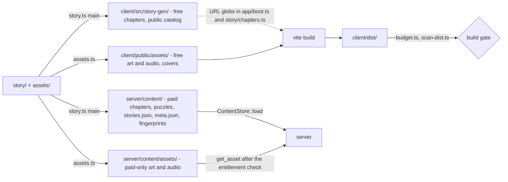
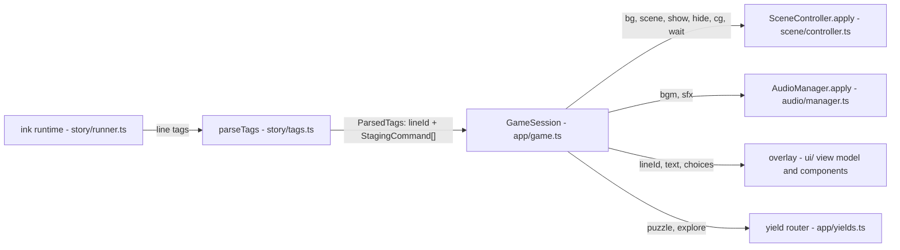
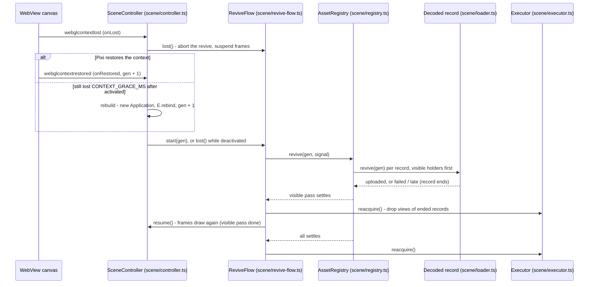
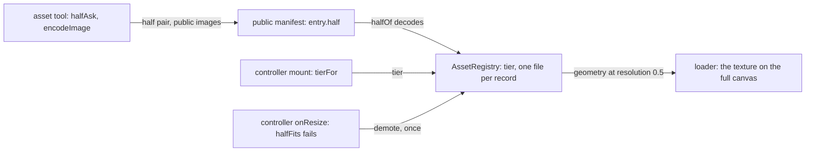
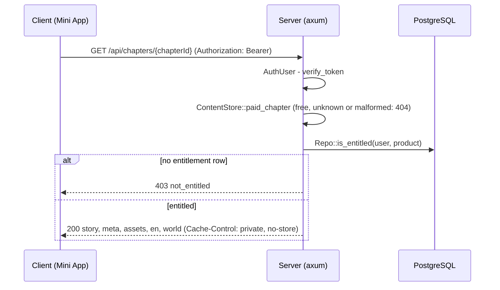
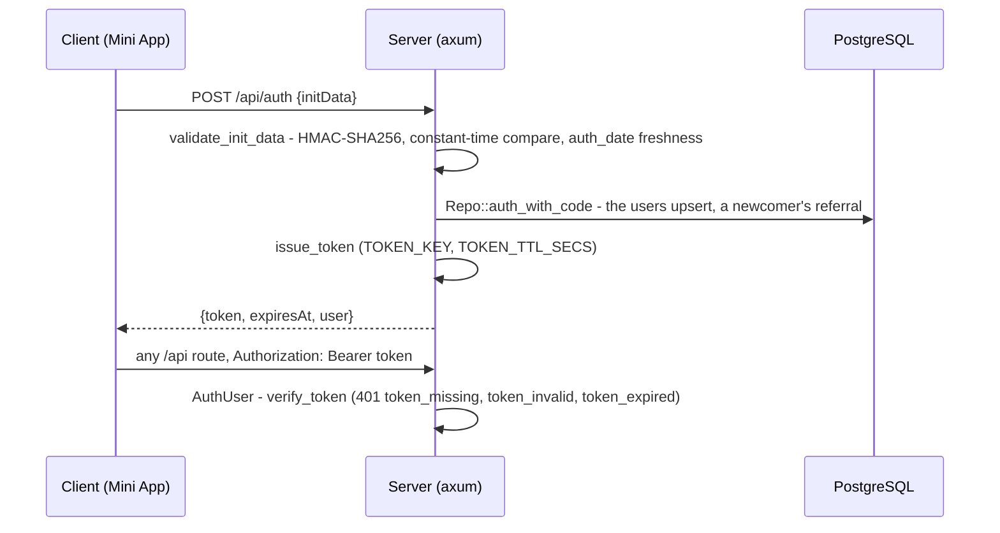
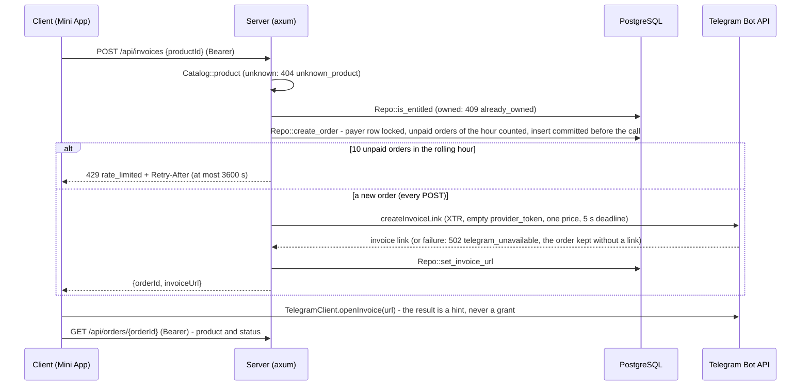
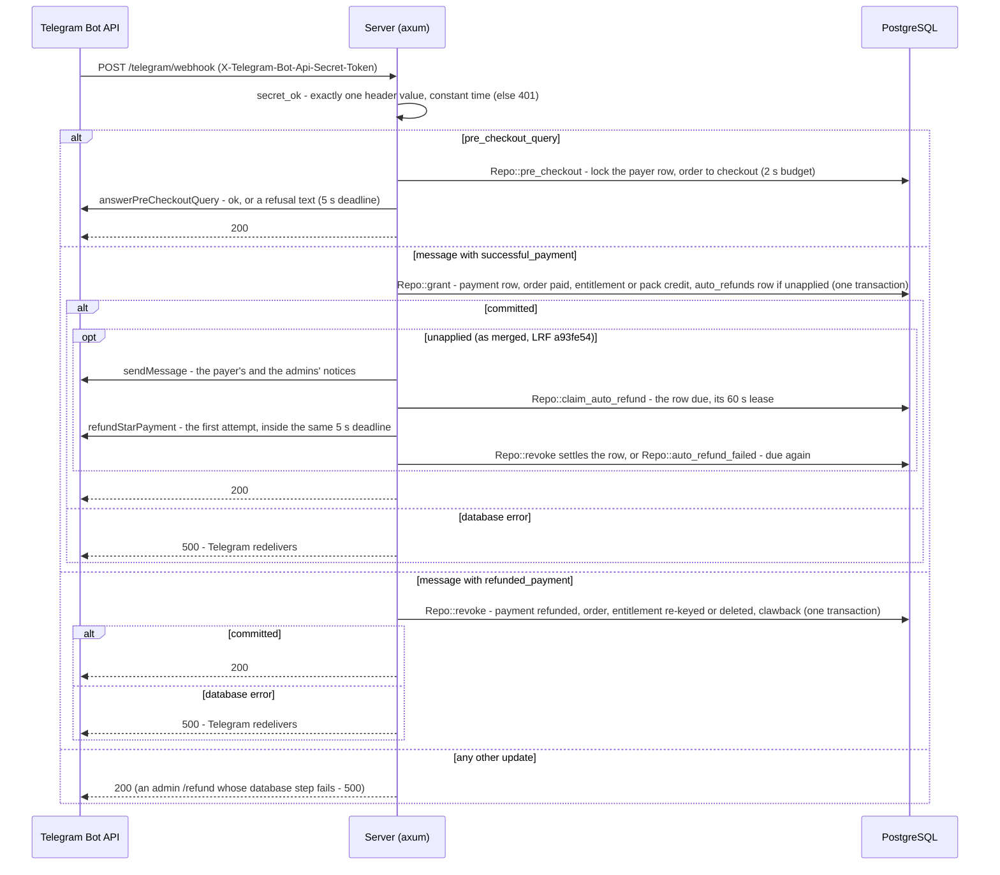
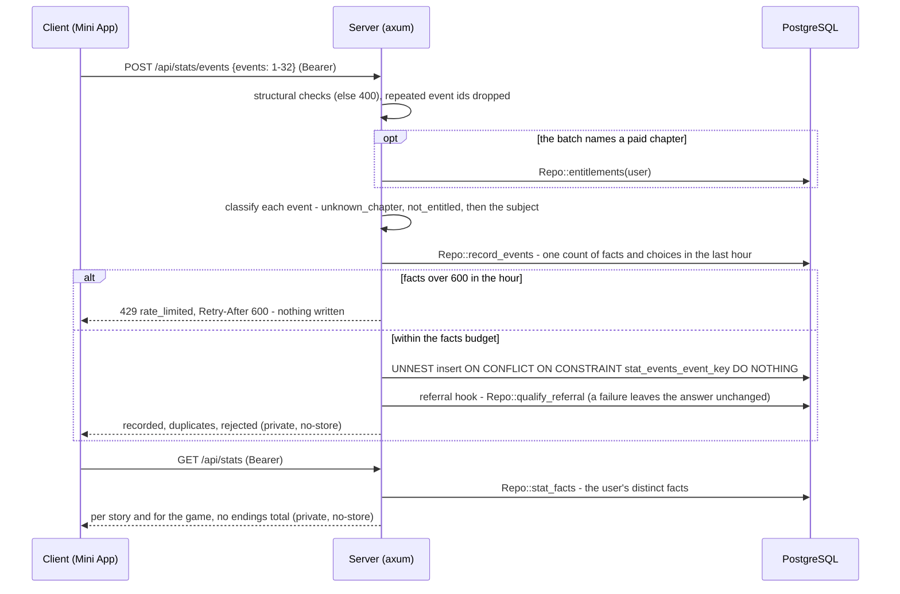

# Architecture

> The layers of tg-app-novel as merged at `9a83251`, how data moves between them, and where each CLAUDE.md principle
> is enforced. First version at `e5ce724`, with LS3 server-stats and LU1 meta-ui added at `6043941`, L10, L14b, LE1,
> LP2, L13, LF1, LS4, LX and LM2 since, LF2 share-profile, LE2 gifts-referrals, L15a engine-wiring and LMD
> meta-data at `48abfaf`, LPO privacy-operator, L15b app-e2e, L9 refunds-bot, LFU1 engine-followups and LFU2
> client-followups at `6d77329`, LPH payments-hardening at `a4d53ef` (merged `d423cb3`), LMI meta-integration at
> `3e35a7b`, and M1 memory-trim (merged `f1b707d`) and M2 memory-cpu-copy (merged `385d52f`) at `385d52f`, by D2
> docs-final (MEMORY-PLAN section 11), and LFU3 client-followups (merged `48bc82a`) and M3c memory-half-tier (merged
> `a6365a8`) at `a6365a8`, by docs-errata-8 (RULINGS 125, 127), and LRF auto-refund (merged `a93fe54`) at
> `805f382`, by docs-errata-9 (RULINGS 130, 131), and LEL entry-lever (merged `7b37278`), LBI build-skew (merged
> `fe996a0`), LHJ handover-join (merged `972f773`), M3s memory-half-paid (merged `a5f887b`), LFL first-line (merged
> `cec347c`) and LRB reload-bounds (merged `3c62a86`) at `3c62a86`, by docs-adopt (RULINGS 158), and L1 entry-summary
> (merged `eec24fe`), GM6k puzzle-keys (merged `fd62933`), GM1a mech-run-split (merged `ef8b4dc`), GM6s1
> values-domain (merged `81a15b0`) and GM1b mech-registry (merged `03a00bc`) at `9a83251`, by docs-errata-10 (RULINGS
> 172, 173); open at `805f382`:
> docs-errata-9 (RULINGS 131) and the `design-animation` and `design-mechanics` rounds, superseded since (RULINGS 132
> stopped the character half of `design-animation`, and `design-shots` and `design-mechanics` became the adopted plans,
> RULINGS 143, 152, 158); open at `3c62a86`: this docs lane `docs-adopt` (RULINGS 158), the client lane L1
> `l1-entry-summary`, and the planned lanes of the adopted plans ([docs/plans/README.md](plans/README.md)), of which
> GM1a and GM6k were launched from the frozen designs (RULINGS 160); open at `9a83251`: the server lane GM6s2
> `gm6s2-values-routes` (RULINGS 169, 170) and this docs lane `docs-errata-10` (RULINGS 173). Parts not
> built yet are marked **planned** with the lane and the plan section. Operating the bot and the server: the
> runbooks, indexed in the [README](../README.md#documentation).

The design is in [PROTOTYPE-PLAN.md](PROTOTYPE-PLAN.md) (PP), [PUZZLES-PLAN.md](PUZZLES-PLAN.md) (PZ),
[STORIES-PLAN.md](STORIES-PLAN.md) (SP) and [META-PLAN.md](META-PLAN.md), and the adopted plans,
[docs/plans/README.md](plans/README.md) (planned, not built); this page describes what the tree does. Where
is a given file: [FEATURE_MAP.md](FEATURE_MAP.md). The ink tag language: [STAGING-DSL.md](STAGING-DSL.md).

## Overview

Three parts, joined at build time by generated files and at run time by one HTTP API:
- **`story/` + `assets/`** - hand-written sources: ink, the chapter and story lists, worlds, meta, locale tables, the
  asset catalog.
- **`client/`** - the Telegram Mini App (Svelte 5, PixiJS v8, inkjs runtime) and its Node build tools under
  `client/scripts/`. Its build splits the sources into a public half and a server-only half.
- **`server/`** - the axum server (crate `server`), the dev-only crate `server-dev` and the dev/test-only crate
  `pgdev`.

Each arrow is a function: `main` ([story.ts:530](../client/scripts/story.ts#L530)) routes every chapter through
`chapterPaths` ([emit.ts:133](../client/scripts/story/emit.ts#L133)); the asset tool's output directories are
`ASSET_OUT` ([manifest.ts:39](../client/scripts/assets/manifest.ts#L39)); the server loads `server/content/` in
`ContentStore::load` ([content.rs:239](../server/src/content.rs#L239)).

## Client modules

What exists under `client/src/` at `9a83251`. The boundary column is enforced by
[arch.test.ts](../client/src/arch.test.ts) (rules `RULE_IDS`, scopes in `applies`), not by review.

| Module | Responsibility | Boundary |
|---|---|---|
| [main.ts](../client/src/main.ts) | entry: dev mock install (dev and e2e only), inset variables, `expand`, `disableVerticalSwipes`, `startApp` (L15a), mount `App` with `startApp`'s handle (L15b, [main.ts:25](../client/src/main.ts#L25)), `ready` | |
| [app/boot.ts](../client/src/app/boot.ts) | the entry's half of the two-stage boot (L15a): `startApp` (:404) creates the view model, the screen stack, the API client and the settings store; runs the boot reads in parallel (auth, the public catalog and covers, the saves list, the entitlements, the settings), retried after `BOOT_RETRY_MS` (:74); imports the engine chunk beside them; creates the stats reporter after auth; as merged (LMI `3e35a7b`, RULINGS 105), then imports the meta controller's chunk beside the engine, never awaited before the first line, through the meta gate `createMetaGate` (:195; as merged, LFL `cec347c`, RULINGS 149, 155: not after auth any more, the gate requests it at the session's first step, a meta tap, an ending, a hint use, a launch parameter or Home idle, `HOME_IDLE_MS` 2 s after both Home and the engine import settled, [boot.ts:189-194](../client/src/app/boot.ts#L189), :153, and boot hands the gate its own stats read before Home, :736): one import in flight, and a failed one is imported again only by the next meta tap or ending, never on a timer (as merged, LFL `cec347c`: or by the next hint use, whose port's `use` awaits the import, :192, :260, :319); a tap before the chunk lands runs once it does, except the policy tap, which only starts the import (F28); an ending waits for the import in flight; as merged (LFU3 `48bc82a`, RULINGS 121), a waiting tap is dropped when the screen stack's root changed before the chunk landed, and an ending left meanwhile still marks its card (the gate's `root`, :201, :291-293, :361); the Game gets the gate's port before it is published (`attachMeta`, :590) and App the gate's taps (`metaTaps`, :696); owns the lifecycle, `pagehide` and session-expiry subscriptions; Home's actions unlock audio first, inside the tap; as merged (LBI `fe996a0`, RULINGS 145), it lends the Game the reload port (`page` :762: `location.replace` of the URL with the latch, then `location.reload()`), hands the Game each skew `http` reports (:769) and one the boot reads saw before the Game existed (:592-595), and probes `/api/health` on `vite:preloadError`, a lazy chunk a deploy removed (:772-774) | no Pixi, inkjs or GSAP: the engine is reached only through `import('./engine.ts')` (:556), budgeted by the engine and first-line rows; the meta controller only through `import('./meta.ts')` (:431, LMI), budgeted by the `meta controller chunk (br)` row and counted in the first-line row (as merged, LFL `cec347c`: not counted there any more) |
| [app/engine.ts](../client/src/app/engine.ts) | the engine chunk's composition root (L15a): `createEngine` (:73) builds the scene controller, one chapter loader per role, the SaveService factory, the explore and puzzle views and the Game; the audio manager at the first start, after a Home tap; hands the overlay the in-play components (`EngineUi`, :38) | the only path to Pixi, inkjs and GSAP; `ENGINE_SRC` ([budget.ts:139](../client/scripts/budget.ts#L139)) |
| [app/game.ts](../client/src/app/game.ts), [app/yields.ts](../client/src/app/yields.ts) | GameSession (L15a, `createGame` :426): runner steps to staging batches for the scene and the audio, views for the overlay, autosaves; one intent at a time; chapter change and the next-chapter preload, endings and the chapter reports, the ink-error floor, the autosave conflict prompt, the read-sets, the resume toasts, the chapter purchase and exit to stories. The yields (`createYields` :188): linear puzzles and exploration sections, every `import()` of the lazy families (`LAZY_CHUNKS` :65) and their prefetch after a chapter's first line. GameSession's failure model as merged (LFU1 `f637bac`; PP F3): no autosave while the session `mixes` two steps (`mixes` :660), a failed "Load it" read shows the error notice (`adoptFailed` :1616), "Return to last save" with no save exits to the stories (`returnToSave` :859), a manual save waits for a step in flight (`writeManual` :1706), and a 409's conflict ask is held until `CONFLICT_HOLD_MS` (500 ms, :261) after the tap ([Failure modes](#failure-modes)). As merged (LFU3 `48bc82a`, RULINGS 121): a resume records the body it runs from as the last save (`resumeBody` :958); each manual slot keeps its own 409, the ask shown is the slot asked first, and an answer or a No applies to its own slot only (`conflicts` :395, `shownAsk` :593, `dropConflict` :603); the reopen notice of an ended session closes the Mini App through the facade (:1291, :1622); a take fades its prop out of the picture at once (B-001, `takeBatch` in yields.ts :402, `TAKE_FADE_MS` 300 ms). As merged (LMI `3e35a7b`, RULINGS 105): boot's meta port (`GameMeta` :167, attached by `attachMeta` :2070) is read when called, so a session runs the same before and after the meta controller's chunk lands: a declared ending's END shows `the_end` with its card action and asks the port for the card (`onEnding`, after the stats settle; `chapterEnd` :1215), a revealed line calls its `lineShown`, an exit closes the meta overlays (`exitNow` :1512), and each new puzzle session takes the port's `hintPort()` (game.ts :1372, yields.ts :579), null until the chunk lands, so the ladder spends a usable tier only through the wallet's port. As merged (LFL `cec347c`, RULINGS 149): that port is boot's forwarding port, never null, whose use waits for the chunk (HP), and a step on screen tells the port `stepShown` (T1, game.ts :777; also D11's paywall over the empty stage, which no step follows, :983), the chunk's request on the path that taps Start as soon as it can. As merged (LBI `fe996a0`, RULINGS 145), the build-skew recovery: `skewed` (:2073) waits for a safe point (`reloadBlocker` :1751: no intent, not in the background, no invoice being created, open or confirmed, no attempt awaiting its answer, no manual save or gift in flight), then autosaves the step on screen, covers every control with the update notice and, once the autosave is flushed, reloads into the new build through boot's port, the build id it reloaded for kept in the URL's fragment, so a tab reloads once per build (`reloadTick` :1782, `withReloadedFor` :118); a chapter file that fails to load probes `/api/health` (:1296). As merged (LRB `3c62a86`, RULINGS 157), a wallet pack flow the player left (`MetaView.purchaseLeft`, the meta row below) holds nothing (:1761), and a gift holds only while its dialog shows it sending ([deploy.md](runbooks/deploy.md#clients-open-during-a-deploy)) | the scene, the audio and the explore controller only through their types (fakes in tests); `runner.enter` only in `yields.ts` (arch rule `runner-enter`) |
| [telegram/index.ts](../client/src/telegram/index.ts), [webapp.ts](../client/src/telegram/webapp.ts) | `TelegramClient`: the one Mini App facade, errors as values, version gates. Each TWA event, the BackButton press included, has one TWA registration and the facade's own dispatch over a snapshot of its subscribers: one added during a dispatch waits for the next event, one removed is skipped, a throwing one does not stop the others (`eventHub`, [webapp.ts:229-260](../client/src/telegram/webapp.ts#L229); the `facade:` tests in `telegram.test.ts`). A CloudStorage / DeviceStorage call whose callback has not come within `STORAGE_TIMEOUT_MS` (5 s, [webapp.ts:83](../client/src/telegram/webapp.ts#L83), L15a) settles as a `timeout` error, and a later callback changes nothing (the `storage:` tests). As merged (LFU2 `6d77329`): `close()` closes the Mini App through `WebApp.close` (a no-op in the inert client, never throwing; [index.ts:43-44](../client/src/telegram/index.ts#L43)), and the facade exports the one CloudStorage value limit `CLOUD_VALUE_MAX` (4096, [webapp.ts:78](../client/src/telegram/webapp.ts#L78)) that the settings store re-exports | only `webapp.ts` and `telegram/dev/` read `window.Telegram` |
| `telegram/{perf,viewport}.ts` | Android performance class; `--app-inset-*` CSS variables | |
| `telegram/dev/*` | mock transport and fake Stars sheet | only under `__TG_MOCK__`; production compiles it out ([vite.config.ts:47](../client/vite.config.ts#L47)) |
| [api/http.ts](../client/src/api/http.ts), `api/{session,endpoints,decode,meta}.ts` | the API client (L10): `createHttp` (:159) carries every `/api` call and asset byte; the token lives only in `session.ts`'s closure; a `401 token_*` re-auths once, single flight, and retries once; typed calls per route; one decoder per server DTO ([Auth](#auth-initdata-then-the-servers-own-token)); created by `startApp` since L15a. The meta calls (LMD): `createMetaEndpoints`, the meta error table `metaError`, `DELETE` in the request method union for unfriend and decline. As merged (LMI `3e35a7b`): the gift call `postGift` (`POST /api/gifts`, the four fields of `GiftRequest` only; [meta.ts:317-321](../client/src/api/meta.ts#L317)) and its decoder `decodeGiftResponse` ([meta.ts:134](../client/src/api/meta.ts#L134)); the meta routes and their decoders live in `api/meta.ts`, which only the meta controller's chunk imports (as merged, LEL `7b37278`; the guard `arch: the entry closure holds no meta module`). As merged (LBI `fe996a0`, RULINGS 145): every response's `x-build-id` (`api/http.ts`: `BUILD_ID_HEADER` :24, `noteBuild` :174), the auth exchange's, the JSON calls' and the asset fetches' alike, is compared with the page's own build id, the `__BUILD_ID__` define, and a build other than the page's is reported once per id (`skew()`, `onSkew`, :77-79) to boot, which hands it to the Game (the game row above) | only `api/` sets `Authorization` (arch rule `authorization`); the bearer goes to `/api/` URLs only |
| `saves/{service,pending}.ts` | saves per story (L10): one autosave PUT in flight, a retry replays its `writeId`, a foreign 409 pauses autosave, a `Retry-After` past an hour waits an hour (LFU1, K24; `RETRY_AFTER_MAX_MS`, [service.ts:72](../client/src/saves/service.ts#L72)); the unacknowledged body cached in DeviceStorage (`pending_<storyId>`); as merged, L1 `eec24fe` (RULINGS 159): the two load with the engine chunk, and the entry holds only boot's lookup `summaryOf` ([saves/summary.ts:8](../client/src/saves/summary.ts#L8)), held by the guards `arch: the entry closure holds no save service module` and `arch: entry closure save service fixtures` | a cache only: the server copy wins (principle 1) |
| [purchase/flow.ts](../client/src/purchase/flow.ts) | the purchase state machine (L10): the invoice, `openInvoice`, the order poll; `unlocked` only from server reads ([Payments](#payments-as-built)); as merged (LFU3 `48bc82a`), a 429 on the invoice is its own state `limited`, the server's wait counted down to `idle` | typed to `openInvoice` alone, so no storage value reaches the decision (principles 1-2) |
| [stats/reporter.ts](../client/src/stats/reporter.ts) | the statistics reporter (LS4): the event queue, batches of at most 32, a retry with the same event ids, the queue's DeviceStorage copy ([Player statistics](#player-statistics-as-built)) | grants nothing, never throws; the copy is a cache |
| `story/{runner,chapters,carry,resume,save-codec}.ts`, [i18n/lines.ts](../client/src/i18n/lines.ts) | the story runtime (L13): `StoryRunner` ([runner.ts:188](../client/src/story/runner.ts#L188)) turns ink's `Continue()` into steps; the chapter loader (a free chapter by its static URLs, a paid one only through `GET /api/chapters/{id}`); the carry of `g_` globals; resume at the exact step, the knot's top or the chapter start; the save body codec; the line text by language | `inkjs` only in `story/runner.ts` (arch rule `import-inkjs`); `runner.enter` only from `app/yields.ts` (`runner-enter`) |
| `story/{tags,staging,catalog}.ts` | `parseTags`, the typed staging commands, catalog and manifest decoders | `tags.ts` is the only tag parser |
| `scene/*` | `SceneController` (Pixi application, layers, context-loss rebuild), executor (batch → GSAP timeline), texture registry with caps, loader, preload scheduler, layout; as merged (M1 `f1b707d`, M2 `385d52f`): the texture laid out as its canvas, the kept file, the revive and its flow `scene/revive-flow.ts` ([Texture memory](#texture-memory-and-the-context-loss-revive)); as merged (M3c `a6365a8`, RULINGS 127): the session's size tier, the half files on a LOW phone whose largest stage fits, chosen at mount and demoted one way on a resize past the bound; as merged (LHJ `972f773`, RULINGS 143 QO19, 150), a preload item whose record is live or in flight joins it at once, outside the two fetch slots, as the registry's pure read `state(id)` says ([preload.ts:152-176](../client/src/scene/preload.ts#L152), [registry.ts:112](../client/src/scene/registry.ts#L112)), so a next-chapter image in flight at the handover is fetched once | `pixi.js` only in `scene/`; `gsap` only in `scene/executor.ts`; textures created only in `loader.ts` / `registry.ts`; no `fetch` |
| `audio/*` | `unlockAudio` (in the gesture), the audio manager, two-deck BGM, SFX cache | `AudioContext` and `new Audio` only in `audio/`; no `fetch` |
| `world/*`, `puzzles/rules/*`, `explore/{state,reduce,project,reconcile}.ts` | world types and the one decoder; puzzle rules; the pure exploration reducer, reconcile and projection | the pure-world rule (`isPureWorld`, [arch.test.ts:134](../client/src/arch.test.ts#L134)): no DOM, network, storage, Svelte, clock or randomness; value imports stay inside these files and `story/{staging,catalog,tags}.ts` |
| [geom/cover.ts](../client/src/geom/cover.ts) | the cover transform and the room safe frame, shared by `scene/layout.ts`, `scene/executor.ts` and the story tool's world lint | no module rule of its own: the pure-world rule does not cover it ([arch.test.ts:134](../client/src/arch.test.ts#L134)); the global rules below and `pixi.js` only in `scene/` apply ([arch.test.ts:171-200](../client/src/arch.test.ts#L171)) |
| `api/generated/api.ts` | ts-rs DTO types from the server | generated, committed |
| [ui/App.svelte](../client/src/ui/App.svelte) | the overlay's root (as merged, L15b `fbcfd38`): it routes `startApp`'s `AppHandle` (the view model, Home's actions, the game) to the components and their callbacks back, and decides nothing itself. Home, the notices, the chapter list and the toasts ship in the entry; every other component is the engine's `vm.ui` and renders once that chunk is in. The Stage mounts with the engine and stays for the page's life (one Pixi Application; the scene mounts at the first start), under the opaque Home and notice layers (D5′). Every layer is full-bleed, and each below the top overlay is `inert` (D6′; the overlays it renders, `OWN`, [App.svelte:24](../client/src/ui/App.svelte#L24)). A tap in play resumes sound that needs a gesture, in the capture phase (D12′, :46-59). As merged (LMI `3e35a7b`): the meta overlays render from the meta chunk once the controller has loaded it (`vm.meta.ui`, the set `META`, :26), as layers that make the ones below inert like `OWN`'s (:34); Home's card action, Friends and Wallet, the Menu's Friends and Wallet and the Terms' privacy link call boot's gate (`app.metaTaps`, :131-133, :165-166, :198), so they are given before the chunk lands | `ui/` imports no story, scene or audio module except types (arch rule `ui-imports`) |
| [ui/screens.ts](../client/src/ui/screens.ts) | `createScreens` (:71): overlays over a root view (Home, the game, a Notice), no router; the one owner of the BackButton ([WebView constraints](#webview-constraints)) | the button only through the facade's `backButton` |
| [ui/state.svelte.ts](../client/src/ui/state.svelte.ts) | `createViewModel` (:198): the overlay's view model (the line, the choices, the play mode, the text speed, the screens view, the toasts; since L15a also Home's cards, the notice, the chapters, the backlog, the settings, the saves, the paywall, `paused` and the engine's `ui`; as merged, LMI `3e35a7b`, `meta`, what the meta overlays render, written by the meta controller, :89), written by the boot and the game session; its `$state.raw` fields are replaced, never mutated | views only: never a Story, a runner or a Pixi object (principle 7) |
| `ui/{TapToStart,Stage,DialogueBox,Choices,QuickBar,Toast}.svelte`, [ui/typewriter.ts](../client/src/ui/typewriter.ts) | Home's frame, the stage host the scene mounts into, the dialogue box with the grapheme typewriter (by code point where `Intl.Segmenter` is missing, L15b), the choices (no tap-through), the quick bar, the toast stack (its `dev` banner only under the mock) | presentational: props in, callbacks out; text through `t()`, `textContent` or Svelte text interpolation, never markup |
| [i18n/index.ts](../client/src/i18n/index.ts), `i18n/{ru,en}.ts` | the UI string tables and `t(lang, key, params)` (:18) | `ru.ts` defines the keys; `en.ts` is typed by them, so a missing or an extra key is a compile error ([en.ts:1-6](../client/src/i18n/en.ts#L1)) |
| `ui/{Menu,Paywall,ChapterSelect,StoryPicker,SaveLoad,Settings,Backlog,Notice,Terms}.svelte`, [settings/store.ts](../client/src/settings/store.ts) | the menus (L14b): the game menu, the paywall with the terms checkbox, chapter select per story, the story picker, save and load, settings, the backlog, notices, the terms; the settings and read-sets cached in CloudStorage; as merged (LFU3 `48bc82a`, RULINGS 121), the reopen notice's one action is Close, which its producers pass as `() => tg.close()` (the facade's `close`), and the paywall shows a 429's wait in minutes with Buy disabled; as merged (LBI `fe996a0`), the `update` notice, with no action, covers every control while the page reloads into a new build ([Notice.svelte:54-55](../client/src/ui/Notice.svelte#L54)) | presentational, no I/O (`menus: components do no I/O`); the settings store is a cache that is never asked what is owned |
| `puzzles/{registry,session}.ts`, `puzzles/ui/*`, `ui/puzzles/*`, [ui/puzzle-view.svelte.ts](../client/src/ui/puzzle-view.svelte.ts) | the puzzle UI (LP2): one puzzle session with its hint ladder (hint texts from the server, in memory only), one dynamic chunk per puzzle type, the puzzle host; as merged (LFU3 `48bc82a`, K46), an `order` piece shows its item's world glyph beside its name, from the yields producer (`PuzzleUiProps.item`, [puzzles/registry.ts:22](../client/src/puzzles/registry.ts#L22)) | the lazy directories `puzzles/ui/`, `ui/puzzles/`, `ui/explore/` are imported from outside only by `import()` (arch rule `lazy-ui`, [arch.test.ts:150](../client/src/arch.test.ts#L150)) and budgeted per chunk |
| [explore/controller.ts](../client/src/explore/controller.ts), `ui/explore/*`, [ui/explore-view.svelte.ts](../client/src/ui/explore-view.svelte.ts), [ui/glyphs.ts](../client/src/ui/glyphs.ts) | the exploration UI (LX): the explore controller (hotspot views through the cover transform, 44 px minimum targets, the room path for Back, neighbour preloads), the hotspot layer, inventory, document reader and lock panel, one lazy chunk | the world only through `reduce` / `admitSection` (principle 7); one lazy chunk, guarded per file: `ui/explore/*` by the arch rule `lazy-ui` ([arch.test.ts:150](../client/src/arch.test.ts#L150) `LAZY_DIRS`), the controller as a root of the budget row `explore-ui chunk (br)` ([budget.ts:176-182](../client/scripts/budget.ts#L176), measured since `app/yields.ts` exists, L15a); the view store and `ui/glyphs.ts` are statically importable (their module comments); as merged (GM1a `ef8b4dc`), the controller is the one importer of the rules half (the `mechanics/*` row below) |
| [mechanics/contract.ts](../client/src/mechanics/contract.ts), `mechanics/data/*`, `mechanics/rules/*` | the mechanics engine (as merged, GM1a `ef8b4dc`, RULINGS 165, and GM1b `03a00bc`, RULINGS 171; engine plan §3): the module contract (types and constants only), the data registry `MECHANIC_DATA` (the engine half: decode, normalize), the rules registry `MECHANIC_RULES` (the explore-ui half: actions, apply, the tap and arrival hooks, the reads `sectionKey` is derived from), the explore rules and the searches (`reduce`, `admitSection`, `successors`, `sectionKey`) and the fact writer; module core alone today. The kernel stays in the engine (`explore/reduce.ts`, whose `runReduce` writes a linear puzzle's run with the same run rules) | pure: the pure-world rule covers the whole directory (`isPureWorld`, [arch.test.ts:139](../client/src/arch.test.ts#L139)); the rules half is imported by value, `import()` included, only from inside it and by the explore controller (arch rule `rules-lazy`, [arch.test.ts:164-165](../client/src/arch.test.ts#L164), a bare directory specifier included since GM1b), so it loads with the explore-ui chunk |
| [ui/meta/index.ts](../client/src/ui/meta/index.ts), `ui/meta/*.svelte`, [i18n/meta.ts](../client/src/i18n/meta.ts) | the presentational meta overlays (completion card, friends and requests, a friend's profile, invite prompt, consent, wallet, gift) and their own string table (`mt` :142); `ui/meta/index.ts` is the one entry of one lazy chunk (META-PLAN M27). As merged (LMI `3e35a7b`): Friends gained the new invite link, which revokes the link already sent (M10), and its Accept, Decline and new link follow rule (b) of `Choices.svelte`, as the gift dialog's Send does: a pointer click counts only after a pointerdown on that button while the list is shown, so the tap that opened Friends decides nothing; a keyboard click counts ([Friends.svelte:2-8](../client/src/ui/meta/Friends.svelte#L2)) | as merged (LMI `3e35a7b`), `app/meta.ts` is the only module that loads `ui/meta/index.ts`, only by a dynamic import, prefetched once after the first line ([meta.ts:179](../client/src/app/meta.ts#L179), `lineShown` :786), and `ui/App.svelte` renders it from `vm.meta.ui`. Outside `ui/meta/` a module may reach it only by `import type`, nothing outside the chunk loads `i18n/meta.ts`, and the chunk does no I/O (`meta: one entry, no I/O, the meta table stays in the chunk`, [meta.svelte.test.ts:956-1014](../client/src/ui/meta/meta.svelte.test.ts#L956)); the build's budget gate also refuses the chunk in a static closure (`budget: meta ui in entry closure fails`; RULINGS 113), beside the arch rule `lazy-ui`, whose `LAZY_DIRS` holds `ui/meta/` since LFU3 `48bc82a` ([arch.test.ts:150](../client/src/arch.test.ts#L150)) |
| `meta/{card,social,wallet}.ts` | the meta data services (LMD): the completion card, one `POST /api/stories/{storyId}/card` per open and no copy kept; friends, invites, consent, a friend's profile (the first name from the friend list) and the share, the state being the last applied `SocialResponse`; the wallet with `maxPerGift` from each wallet answer, and the hint port. Social and wallet guard against a stale answer: an older response never replaces a newer state | a cache of server answers only, persisted nowhere (principle 1); as merged (LMI `3e35a7b`), only `app/meta.ts` imports them, so they load in the meta controller's chunk |
| [app/meta.ts](../client/src/app/meta.ts) | the meta controller (as merged, LMI `3e35a7b`; META-PLAN "Module API", M27; RULINGS 105): `createMetaController` (:174), one per page, made by boot's meta gate after auth (as merged, LFL `cec347c`, RULINGS 149: when the gate's import lands; the boot row above). It owns the LMD services, what the overlays render (`MetaView` :38, written to `vm.meta`) and the overlays' chunk. Its `boot` (:514) reads the friends, the wallet and the stats, none awaited by the first line (as merged, LFL: the stats are boot's own read, handed over by the gate, `stats` :126, :517; LRB `3c62a86` pins it, the arch guard `metaStatsGaps`); the stats give a story card its card action (`hasCard` :540), and a `startParam` invite in the `open` state the invite prompt, over Home only. At an ending (`onEnding` :575) it waits for the stats to settle, at most `CARD_SETTLE_MS` (3 s, :168), then opens the card; a timeout shows `meta.card_later`. One refresh per service is in flight and none while one of its mutations is (`syncOf` :257); Accept, Decline and Remove run one at a time, and a 404 reads the friends again (`friendCall` :357); a gift is single flight, with one request id kept across a network retry (`gift` :643), and as merged (LFU3 `48bc82a`, RULINGS 121) its success closes only the dialog opened for its own friend (:668); one pack purchase flow serves the wallet (`buyPack` :752), whose Buy is held while a 429's wait lasts (`purchased` :471, LFU3); as merged (LRB `3c62a86`, RULINGS 157), `MetaView.purchaseLeft` (:49) says the player left that flow: the wallet is not open and the flow is `delayed`, or `sheet` after the player's Back on the wallet (`purchaseLeft` :468, `popped` :157, `sheetLeft` :217), so the Game's build-skew reload does not wait for it (the game row above); the share sends a prepared message through `shareMessage` when supported, prepares it once more on `expired`, and otherwise opens `t.me/share/url` through `openTelegramLink` (M14, `shareOnce` :406); the policy opens through `openLink` (`openPolicy` :764). An epoch, bumped by `closeOverlays`, a root change and `dispose`, drops an answer that would push an overlay over a later screen (:1-6) | an overlay renders a service's state, never a call's own answer, and nothing here unlocks anything (principle 1); its own lazy chunk, loaded only by boot's `import('./meta.ts')` ([boot.ts:431](../client/src/app/boot.ts#L431)) and budgeted by the `meta controller chunk (br)` row ([budget.ts:185](../client/scripts/budget.ts#L185)), whose gate refuses a static import (`budget: meta controller imported statically fails`; RULINGS 113), as the arch rule `lazy-ui` does since LFU3 `48bc82a` (`LAZY_ROOT_FILES`, [arch.test.ts:151](../client/src/arch.test.ts#L151)); `boot.ts` and `ui/state.svelte.ts` import only its types |

Forbidden anywhere in `src/` (arch rules): `vh` units, `window.open` and dialogs, `innerHTML` / `{@html`, Service
Workers, `document.cookie`, `<iframe`, `history` navigation, `localStorage` / `sessionStorage` outside
`telegram/dev/`, `initDataUnsafe`, `inkjs/full` and `inkjs/compiler`, `svelte-pixi`, and any import that resolves
outside `src/` (so neither `story/` nor `server/content/` can enter the bundle).

**Wired and rendered** (as of `6d77329`; L15a, L15b; LMI as merged at `3e35a7b`). `main.ts` calls `startApp`, which creates the view model, the
screen stack, the API client, the settings store and, after auth, the statistics reporter, and runs the boot reads.
The engine chunk (`app/engine.ts`) is imported beside the boot reads and created ahead of a tap: the scene
controller, the chapter loaders, the SaveService factory and GameSession, whose yields open the puzzle and explore
sessions. As merged (LMI `3e35a7b`, RULINGS 105), once the boot reads are in (auth among them; RULINGS 113)
`startApp` also imports the meta controller's chunk (`app/meta.ts`) beside the engine, never awaited before the first
line; boot's meta gate is the one way to it. As merged (LFL `cec347c`, RULINGS 149, 155), the gate requests it no longer
after auth but at the session's first step, a meta tap, an ending, a hint use, a launch parameter or Home idle, so the
engine download has the link to itself; after auth boot hands the gate its stats read and the launch parameter
([boot.ts:735-739](../client/src/app/boot.ts#L735)).
The readers of `client/src/story-gen/` are boot's URL glob for the catalog and the covers (`PUBLIC_JSON`,
[boot.ts:80](../client/src/app/boot.ts#L80)) and the chapter loader's in the engine chunk (`FREE_CHAPTER_FILES`,
[chapters.ts:67](../client/src/story/chapters.ts#L67)). Since L15b (`fbcfd38`) `App.svelte` renders Home, the play
surface and the overlay and menu components from `startApp`'s handle, so a story starts from Home's tap; as merged
(LMI `3e35a7b`) it also renders the meta overlays from the meta chunk, and a story card's card action shows once the
controller says the story has a card (as merged, LFL `cec347c`: the gate's `hasCard`, the controller's once it is in,
else the endings of boot's own stats read, [boot.ts:477](../client/src/app/boot.ts#L477), :329; the action
[App.svelte:131](../client/src/ui/App.svelte#L131)). The e2e suite runs the app on `server-dev` and the mock: the boot
spec ([boot.spec.ts](../client/e2e/boot.spec.ts)) and, since L15b, the smoke, stories, purchase, perf and puzzles
specs, 35 names in all (with M1's `memory.spec.ts`, 36; FEATURE_MAP "App shell and the app e2e"); as merged (LMI
`3e35a7b`), with the meta and social specs ([meta.spec.ts](../client/e2e/meta.spec.ts),
[social.spec.ts](../client/e2e/social.spec.ts)), 47 names in nine specs; as merged (M2 `385d52f`), + 3 in
`memory.spec.ts`, 50 names (RULINGS 117); as merged (M3c `a6365a8`), + 4 in `memory.spec.ts`, 54 names (RULINGS
127); as merged since, LBI's and LRB's
[build-skew.spec.ts](../client/e2e/build-skew.spec.ts) (3), LHJ's [handover.spec.ts](../client/e2e/handover.spec.ts)
(1) and M3s's + 1 in `memory.spec.ts`: 59 names in eleven specs at `3c62a86` (RULINGS 157); the overlay
components are tested in the vitest `dom` project.

## Server modules

| Module | Responsibility |
|---|---|
| [main.rs](../server/src/main.rs) | `server serve` (the default): `Config::from_env`, `AppState::new`, bind `LISTEN_ADDR`, graceful shutdown. As merged (L9 `d837c8b`): before `AppState::new`, a set `STATIC_DIR` passes `static_files::check` or the start is refused, and the built client is served beside the API (`with_static`; [main.rs:93-167](../server/src/main.rs#L93)); `server setup` (`bot_setup` :60) registers the bot with Telegram and opens no database. As merged (LPH `d423cb3`, RULINGS 106): both subcommands check the bot texts right after the configuration (`bot_texts_ok` :38), so a text file that does not parse, or a draft under `TELEGRAM_ENV=prod`, refuses the start before anything is opened ("Startup refuses bad content", below the table). As merged (LRF `a93fe54`, RULINGS 130): `run` (:147) spawns the automatic refund sweep, the server's one background task, once the listener is bound; when serving ends it aborts the sweep and awaits it (:156-165), before `serve` closes the pool (:134) ([Payments](#payments-as-built)). As merged (LBI `fe996a0`, RULINGS 145): the check also reads the client build's id, which `serve` logs (`static dir checked`, :112) and `run` hands to the app (`server::app`, :153) |
| [lib.rs](../server/src/lib.rs) | `AppState` (one constructor, `AppState::new` :72; `with_clock` / `with_catalog` / `with_gateway` seams; `share_limit` :61, the in-memory share window, LF2), `build_router` :134 (production routes only: `/api`, and `/telegram/webhook` outside it with its own 1 MiB body limit); as merged (LBI `fe996a0`), `app` :140, `server serve`'s app: the same routes with the served `STATIC_DIR`'s build id on every response of an `/api` route, then the built client behind them (`routes` :149) |
| [config.rs](../server/src/config.rs) | `Config::from_env`: secrets and settings only from the environment; the committed placeholder secrets are refused unless `TELEGRAM_ENV` is `test` and `PUBLIC_APP_URL` is a local host (:186-200) |
| [api/mod.rs](../server/src/api/mod.rs) | the routes (:62): `/health`, `/auth`, `/entitlements`, `/chapters/{chapterId}`, `/assets/{file}`, `/saves`, `/saves/{storyId}/{slot}`, `/puzzles/{puzzleId}`, `/puzzles/{puzzleId}/attempts`, `/puzzles/{puzzleId}/hints/{tier}`, `/invoices`, `/orders/{orderId}`, `/stats`, `/stats/events`, `/stories/{storyId}/card`, `/wallet`, `/gifts` (LE2), `/invites/{code}`, `/invites/{code}/request`, `/social`, `/friends/requests/{handle}/accept`, `/friends/{handle}`, `/friends/{handle}/profile` (LF2), `/invite/rotate`, `/consents/friends_profile`, `/share` (LF2), and `/privacy` from `api/legal.rs`; a 16 KB body limit (300 KB for saves) and `Cache-Control: no-store` by default; as merged (LBI `fe996a0`, RULINGS 145), with a build id `router` (:43) adds one header layer, `x-build-id` on every response of every route, its 4xx, 405 and 413 included; an unknown `/api/*` path (no route matched) is answered outside this router, without it (:38-42) |
| `auth/*` | initData validation, the session token, the `AuthUser` extractor ([Auth](#auth-initdata-then-the-servers-own-token)) |
| `db/*` | `Repo`, the repository seam: every SQL statement; handlers never see `sqlx`. As merged (GM6k `fd62933`, RULINGS 163): every puzzle row and the hint spend's ledger keys are stored under the puzzle's storage key (`PuzzleKey`, [ids.rs:76](../server/src/ids.rs#L76)), and the erasure order is data, `ERASURE_ORDER` ([db/mod.rs:296](../server/src/db/mod.rs#L296)), held to the migrated schema by the four erasure gates of `server/tests/it/schema.rs`; as merged (GM6s1 `81a15b0`, RULINGS 168), `puzzle_values` is one of its steps (:310) |
| [content.rs](../server/src/content.rs) | `ContentStore`: the story index, paid chapters, the puzzle index, the gated asset index and the meta index (`load_meta` :736, LM2), loaded once at startup; as merged (M3s `a5f887b`, RULINGS 151), the gated asset index holds the half-tier files too, and a manifest-named file missing on disk refuses the start (`index_assets` :675; [Paid content](#paid-content-and-the-entitlement-check)); as merged (GM6k `fd62933`, RULINGS 163), the puzzle index reads format 1 and format 2 (the optional `key`; the `type` an opaque label, `is_type_label` :425) and refuses two puzzles on one key or a key that is another live puzzle's id (`check_keys` :809) |
| [catalog.rs](../server/src/catalog.rs) | products: every paid chapter of the story index, priced by `server/catalog.json` (prices are server-only), and the hint packs of its `economy` section (`build_economy` :405, LE1), whose gift and referral rules are bounded at startup (`GiftRules` :118, `ReferralRules` :131, LE2) |
| `puzzles/mod.rs` | answer check, attempt rate limit, puzzle status with the texts of unlocked hint tiers; as merged (GM6k `fd62933`), its rows read and written under the puzzle's `PuzzleKey`; as merged (GM6s1 `81a15b0`), an answer of at most `MAX_ANSWER_LEN` entries, 64 (:28) |
| [puzzles/values.rs](../server/src/puzzles/values.rs) | per-player puzzle values (as merged, GM6s1 `81a15b0`, RULINGS 168): a puzzle's domain as the server holds it (`Domain::parse` :100), one uniform draw from it (`draw` :272), the renderer of the `$code(..)` placeholders (`render` :317) and the `puzzle_values` row (`ValueRow` :376, `0008_puzzle_values.sql`); pure apart from `os_rng` (:302); no route reads it yet ([per-player §3.2](plans/per-player/03-server-half.md#32-the-domain-and-the-draw)) |
| [api/stats.rs](../server/src/api/stats.rs), [db/stats.rs](../server/src/db/stats.rs) | the player statistics: the event batch, its classification and budgets, the read of distinct facts, and the referral hook after every batch answered 200 (`referral_hook` :156, LE2) ([Player statistics](#player-statistics-as-built)) |
| [api/wallet.rs](../server/src/api/wallet.rs), [db/economy.rs](../server/src/db/economy.rs) | the economy (LE1): `GET /api/wallet` (the balances and the packs for sale); the append-only ledger and the balance rows, credited inside the grant, debited by `POST /api/puzzles/{puzzleId}/hints/{tier}` (`Repo::spend_hint`, `db/economy.rs` :385); moved between two friends by a gift (`Repo::transfer` :474, LE2) and credited by the referral grant (below) |
| [api/social.rs](../server/src/api/social.rs), [db/social.rs](../server/src/db/social.rs), [api/legal.rs](../server/src/api/legal.rs) | friends (LF1): invite codes, requests the link's owner accepts, removal and blocks, consent rows, the referral recorded at login (`Repo::auth_with_code`, `db/social.rs` :153); a friend's profile by handle (LF2, `get_friend_profile`, `api/social.rs` :333): 404 unless a friend, `visible: false` without the friend's consent grant, counts from the two grouped reads of `db/achievements.rs` (`progress` :102), titles gated as on the card; the referral's qualification (LE2, `Repo::qualify_referral`, `db/social.rs` :217); the public, versioned `GET /api/privacy`, whose page `Policy::load` fills once at startup from the operator file `PRIVACY_OPERATOR_FILE` (as merged, LPO `90e1226`; `legal.rs` :93; under `TELEGRAM_ENV=prod` a placeholder left refuses the start) |
| [api/share.rs](../server/src/api/share.rs), [server/locales/meta.json](../server/locales/meta.json) | sharing (LF2): `POST /api/share` (`post_share` :208) answers the sharer's invite link and a text of the story title and the sharer's own counts, never a title of an ending or an achievement; with `native`, a prepared inline message's id (a failed prepare answers a null id). At most `SHARES_PER_HOUR` (:37) per user, counted in memory in `AppState.share_limit`; the texts compiled in from `server/locales/meta.json` (`SHARE_TEXTS_JSON`, `api/share.rs` :43) |
| [api/gifts.rs](../server/src/api/gifts.rs) | gifts (LE2): `POST /api/gifts` (`post_gift` :37), units of a resource to a friend by handle; the friendship, the daily caps, the balance and the replay are one transaction of `Repo::transfer` ([db/economy.rs:474](../server/src/db/economy.rs#L474)); one's own handle, a non-friend and an unknown handle answer the same 404 |
| [meta.rs](../server/src/meta.rs), [api/cards.rs](../server/src/api/cards.rs), [db/achievements.rs](../server/src/db/achievements.rs) | story meta (LM2): the meta index and its rules, achievement conditions evaluated on the server (`met`, `meta.rs` :573), paid gates (`gate` :604, `visible` :637); `POST /api/stories/{storyId}/card` (`post_card`, `api/cards.rs` :48), whose unlocks are stored for display and grant nothing |
| [telegram/gateway.rs](../server/src/telegram/gateway.rs) | `BotGateway` (:54) and `FrankensteinGateway` (built by `from_config` :208 on the base of `TELEGRAM_ENV`, LF2): the Bot API through frankenstein types, no bot framework (principle 6); since LF2 also `savePreparedInlineMessage` and the bot username from `getMe`, cached after the first success (`save_prepared_inline_message` :76, `bot_username` :82) |
| [telegram/webhook.rs](../server/src/telegram/webhook.rs) | `POST /telegram/webhook` (`webhook` :63): the secret check, the decode into frankenstein's `Update`, the lenient payment probe, the dispatch ([Payments](#payments-as-built)). As merged (L9 `d837c8b`): the handler takes the raw `Body` and checks the secret before it reads the body; a `refunded_payment` goes to the revoke (also through the lenient probe), and a text message to the bot commands |
| [telegram/payments.rs](../server/src/telegram/payments.rs), [db/payments.rs](../server/src/db/payments.rs) | the pre-checkout decision and its answer under their deadlines; the grant on `successful_payment`; their SQL in `db/`. As merged (L9 `d837c8b`): the unapplied-charge notice (`notify_unapplied` :176), the admin refund (`admin_refund` :489) and the revoke (`revoke` :460, `Repo::revoke` [db/payments.rs:402](../server/src/db/payments.rs#L402)). As merged (LRF `a93fe54`, RULINGS 130): the automatic refund of an unapplied charge: `after_grant` ([telegram/payments.rs:150](../server/src/telegram/payments.rs#L150): the notice, then the first attempt), `attempt` (:245), the sweep (`sweep_auto_refunds` :407, `run_auto_refund_sweep` :432), the admins' alert (`alert_given_up` :357) and `refund_unrecorded` (:520); their SQL: the row in the grant's transaction (`schedule_auto_refund`, db/payments.rs :705), the claim (`Repo::claim_auto_refund` :515) and the failure write (`Repo::auto_refund_failed` :542) |
| [telegram/commands.rs](../server/src/telegram/commands.rs), [telegram/texts.rs](../server/src/telegram/texts.rs), [telegram/setup.rs](../server/src/telegram/setup.rs) | the bot (L9 `d837c8b`): the commands, answered in private chats only (`on_text`, [commands.rs:82](../server/src/telegram/commands.rs#L82)); the bot texts of `server/locales/bot.{ru,en}.json`, compiled in and bounded (`LangTexts::entries`, texts.rs :161; as merged, LPH `d423cb3`: checked at startup, `startup_check` :375); `server setup`'s one `BotGateway::setup` call (`run`, setup.rs :80); as merged (LRF `a93fe54`): `/refund <charge> <payer>` (`refund_args`, commands.rs :238) and `/paysupport`'s being-refunded state (`charge_text` :168) ([Payments](#payments-as-built)) |
| [api/static_files.rs](../server/src/api/static_files.rs) | the built client next to the API when `STATIC_DIR` is set (L9 `d837c8b`, PP K27): `check` (:219) at startup, before the pool opens (as merged, LPH `d423cb3`: it also refuses a dot-entry, the root's `.vite` directory excepted), and `with_static` (:329), `/assets/*` immutable for a year and everything else `no-cache` ([Paid content](#paid-content-and-the-entitlement-check)); as merged (LBI `fe996a0`, RULINGS 145), `check` reads the client build's id from `build-id.txt` (`BUILD_ID_FILE` :34, `read_build_id` :266) into `BuildId` (:46) and refuses a missing or malformed one (`BuildIdMissing` :177, `BuildIdInvalid` :183) |
| `server/dev` (`server-dev`) | the production router plus `/dev/launch` (dev-signed initData), `/dev/invoices/{slug}` and `/dev/prepared/{id}` (LF2: what a prepared share would send) on a fake gateway and `/dev/simulate-payment` through the production webhook handler (L9: also `/dev/refund`, the admin refund on the fake gateway, and `/dev/refunded-update`, Telegram's `refunded_payment` through the same handler), on a fresh database per launch ([dev/src/lib.rs:37](../server/dev/src/lib.rs#L37)); as merged (LBI `fe996a0`), `POST /dev/build-id` claims a build id that every `/api/` answer then names in `x-build-id`, as a deploy would ([dev/src/deploy.rs:1-5](../server/dev/src/deploy.rs#L1), `stamp` :87); never linked into `server` |
| `server/pgdev` | the local PostgreSQL 18 cluster per port and a database per test; a dependency of `server-dev` and a dev-dependency of `server`, never linked into the `server` binary ([server/Cargo.toml:31-33](../server/Cargo.toml#L31)) |

The configuration's variables, all read in `Config::from_env` (as merged, LPO `90e1226`: through `from_lookup`,
[config.rs:143-184](../server/src/config.rs#L143)):
`BOT_TOKEN`, `WEBHOOK_SECRET`, `TOKEN_KEY` (required secrets); `TELEGRAM_ENV`, `PUBLIC_APP_URL`, `CONTENT_DIR`,
`DATABASE_URL` (required); `TOKEN_TTL_SECS` (default 1800, 900-3600), `INITDATA_MAX_AGE_SECS` (default 86400,
1-86400), `ADMIN_TELEGRAM_IDS`, `STATIC_DIR`, `LISTEN_ADDR` (default `127.0.0.1:8787`), `PRIVACY_OPERATOR_FILE`
(LPO; required under `TELEGRAM_ENV=prod`, [config.rs:177-184](../server/src/config.rs#L177)).

**Startup refuses bad content.** `AppState::new` loads the content and builds the catalog and the gateway before it
opens the database pool, so a refusal opens no pool (as merged, LPO `90e1226`: in the order content, catalog, privacy
policy (`Policy::load`, a refusal is `StartupError::Privacy`), gateway, pool;
[lib.rs:72-94](../server/src/lib.rs#L72)). Tests pin the
refusals: `startup_fails_without_story_index`, `startup_fails_when_first_chapter_paid`,
`startup_fails_when_world_carries_solution`, and for the meta index (LM2) `startup_fails_when_meta_names_unknown_ending`,
`startup_fails_when_meta_too_large` (`server/tests/it/content.rs`).

As merged (LPH `d423cb3`, RULINGS 106; LPH critique O3, O6), `server serve` runs in the order configuration, bot
texts, `STATIC_DIR`, `AppState::new` ([main.rs:93-130](../server/src/main.rs#L93)). The bot texts come first
(`bot_texts_ok` :38, `texts::startup_check`, [texts.rs:375](../server/src/telegram/texts.rs#L375)): a file that does
not parse refuses the start, and so does a non-empty `drafts` list under `TELEGRAM_ENV=prod`; under `test` the drafts
are a warning. `server setup` checks them too, right after the configuration (`bot_setup` :60). Tests:
`startup_checks_bot_texts_first`, `prod_start_refuses_draft_bot_texts` (`server/tests/it/main.rs`),
`bot_texts_startup_check_refuses_drafts_in_prod` (`server/tests/it/bot.rs`).

## One-way staging

Principle 7: story runtime → staging commands → scene controller and overlay. The scene never reads story state; the
story never touches Pixi.

- **One parser.** `parseTags` ([tags.ts:360](../client/src/story/tags.ts#L360)) serves the story gate and the
  runtime alike; `TAG_KINDS` ([tags.ts:27](../client/src/story/tags.ts#L27)) is the tag list, and
  [dsl-doc.test.ts](../client/src/story/dsl-doc.test.ts) keeps it equal to STAGING-DSL §6.
- **GameSession routes the batch** (as merged, L15a): `splitBatch` ([game.ts:303](../client/src/app/game.ts#L303))
  splits a step's commands into the visual and the audio half; a `yield` goes to `app/yields.ts`, the one module that
  re-enters the story (`runner.enter`, [yields.ts:431](../client/src/app/yields.ts#L431); arch rule `runner-enter`).
- **The consumers are typed by command kind.** The scene controller takes the visual commands (`VisualCommand`,
  [executor.ts:35](../client/src/scene/executor.ts#L35)); the audio manager takes `AudioCommand`, the `bgm` / `sfx`
  kinds ([manager.ts:10](../client/src/audio/manager.ts#L10), `apply` :28).
- **The one channel back.** The world's outcomes reach ink only as declared projection variables (`pz_*`, `it_*`,
  `dc_*`) written before a knot is entered ([project.ts:15](../client/src/explore/project.ts#L15), PZ X2). The story
  gate's playthroughs write them the same way.
- **Literal tags, so the build sees every asset.** The story tool indexes each knot's assets and successors into
  `<ch>.meta.json` for preloading ([STAGING-DSL §8](STAGING-DSL.md#8-assets-and-preloading)).

## Texture memory and the context-loss revive

> What a texture costs, which copies of an image the client keeps, and how the scene comes back after the WebView
> loses its GPU context (as merged, M1 `f1b707d` and M2 `385d52f`; the half tier of a LOW phone as merged, M3c
> `a6365a8`; the design: [MEMORY-PLAN.md](MEMORY-PLAN.md)).

### The memory problem

Principle 4 makes texture memory the budget: steady memory under 150 MB (a target), the registry's caps of 32 MiB
(preload) and 48 MiB (visible). A WebView may drop the WebGL context at any time, most often while the Mini App is in
the background; every GPU texture is gone then, and the scene must come back without drawing a texture that is not on
the new context yet, and without keeping a decoded copy of every image just in case.

### The memory design

- **Smaller files (M1).** The asset tool cuts every `char` and `prop` image to its alpha box plus 2 px, widened to even
  sides ([encode.ts:13](../client/scripts/assets/encode.ts#L13), `encodeImage` :169). The manifest keeps the canvas it
  was cut from (`trim`, [catalog.ts:723](../client/src/story/catalog.ts#L723)), and `textureGeometry`
  ([layout.ts:35-46](../client/src/scene/layout.ts#L35)) gives Pixi the canvas as `orig` and the stored box as `trim`, so
  a trimmed sprite is sized, anchored and drawn where the full image would be. The asset tool refuses odd canvas sides
  and a character whose expressions use different canvases ([manifest.ts:249-273](../client/scripts/assets/manifest.ts#L249)).
- **One CPU copy (M2).** The loader uploads each texture at once to the renderer current at the call. When the upload
  reports a GPU generation, the decoded bitmap is closed, and the fetched file (a Blob, never given a URL) is the only
  CPU copy; on a lost context or a renderer without GL the bitmap stays open
  ([loader.ts:22-70](../client/src/scene/loader.ts#L22)). The caps count the decoded bytes plus the kept file of every
  record, in flight included ([registry.ts:1-16](../client/src/scene/registry.ts#L1)).
- **The revive.** Every upload is tagged with the controller's generation: 1 at mount, one more at each
  `webglcontextrestored` and at each rebuild ([controller.ts:228-269](../client/src/scene/controller.ts#L228)). After a
  change, `registry.revive(gen)` brings every live record to it, one at a time, the records with a visible holder
  first: a kept bitmap is uploaded, a closed one is decoded again from its file. The visible pass has one deadline of
  `REVIVE_DEADLINE_MS` = 3000 ms from its start; a record that fails or is late ends
  ([registry.ts:19-23](../client/src/scene/registry.ts#L19), :113-119, `revive` :528).
- **Frames wait for the visible pass.** The revive flow owns the running revive's AbortController and the frame
  suspension. Each pass that settles calls the executor's `reacquire`, and only the current revive's visible pass
  settling `done` resumes frames ([revive-flow.ts:1-5](../client/src/scene/revive-flow.ts#L1), `createReviveFlow` :34).
  `reacquire` removes at once a view bound to an ended record and takes its slot again; a handle is the record's
  identity, so a view never builds on an ended record's handle
  ([executor.ts:76-86](../client/src/scene/executor.ts#L76), `reacquire` :814; [registry.ts:102-106](../client/src/scene/registry.ts#L102)).
- **The rebuild.** A context still lost `CONTEXT_GRACE_MS` = 2000 ms after `activated` gets a new Application on the
  same host in one synchronous block; the registry's textures stay, the executor rebinds the stage, and the revive
  starts under the next generation ([controller.ts:335-372](../client/src/scene/controller.ts#L335)). The stage is sized
  only by the controller's ResizeObserver, not Pixi's `resizeTo`, whose resize could render outside the gate
  ([controller.ts:117-121](../client/src/scene/controller.ts#L117)).
- **The half tier (M3c, as merged `a6365a8`; RULINGS 127).** A LOW Android phone whose largest stage fits loads each
  public scene image's half-size file. The asset tool asks the encoder for a half pair of every public bg, cg and
  prop image and of a char on the 1536-px canvas, never of a gated image or a cover (`halfAsk`,
  [manifest.ts:129](../client/scripts/assets/manifest.ts#L129); the call, [assets.ts:133-134](../client/scripts/assets.ts#L133));
  the half is the 2 × 2 premultiplied mean of the stored file (`halfRgba`, [encode.ts:112](../client/scripts/assets/encode.ts#L112)).
  The public manifest carries it as the entry's `half`, decoded by `halfOf`
  ([catalog.ts:864](../client/src/story/catalog.ts#L864)): bg, cg, char and prop only, exactly half per side, a char's
  only on the 1536-px canvas, its files under its entry's prefix, so a gated image has none until M3s. As merged (M3s
  `a5f887b`, RULINGS 151), a gated scene image has its half too, a gated file beside its full one under its entry's
  prefix ([manifest.ts:369](../client/scripts/assets/manifest.ts#L369)), which the server indexes under the chapter's
  product and serves from `/api/assets/` only after the entitlement check
  ([content.rs:691](../server/src/content.rs#L691)); only a cover has none. At mount the
  controller fixes the session's tier: `half` only on a LOW device whose largest reachable stage passes `halfFits`,
  so no half is drawn above its stored px (`tierFor` over `stageBound(screenSize(), host)`,
  [controller.ts:413-414](../client/src/scene/controller.ts#L413); [layout.ts:56-82](../client/src/scene/layout.ts#L56)).
  The registry resolves each record's file once, the entry's half where it has one, and the record's geometry keeps
  the full file's canvas, orig and trim at resolution 0.5, so the layout does not depend on the tier
  ([registry.ts:495](../client/src/scene/registry.ts#L495), :309; `textureGeometry`, [layout.ts:37](../client/src/scene/layout.ts#L37)).
  A resize past the bound demotes the registry once: records started later load the full file, and live and
  in-flight ones keep theirs until they end ([controller.ts:243-248](../client/src/scene/controller.ts#L243); `demote`,
  [registry.ts:586](../client/src/scene/registry.ts#L586)). The flow is drawn below the revive's.

Participants: `onLost` / `onRestored` ([controller.ts:251-269](../client/src/scene/controller.ts#L251)), `rebuild`
(:340), `activated` (:374), the flow's `lost` / `start` ([revive-flow.ts:44-78](../client/src/scene/revive-flow.ts#L44)),
`AssetRegistry.revive` ([registry.ts:528](../client/src/scene/registry.ts#L528)), `Decoded.revive`
([loader.ts:80-113](../client/src/scene/loader.ts#L80)), `Executor.rebind` / `reacquire`
([executor.ts:765](../client/src/scene/executor.ts#L765), :814).

The half tier's path (as merged, M3c `a6365a8`):

Participants: `halfAsk` ([manifest.ts:129](../client/scripts/assets/manifest.ts#L129)), `encodeImage`
([encode.ts:169](../client/scripts/assets/encode.ts#L169)), `halfOf` ([catalog.ts:864](../client/src/story/catalog.ts#L864)),
`createAssetRegistry` and its `tier` ([registry.ts:181](../client/src/scene/registry.ts#L181)), `tierFor`
([layout.ts:80](../client/src/scene/layout.ts#L80), called at [controller.ts:414](../client/src/scene/controller.ts#L414)),
`onResize` ([controller.ts:236](../client/src/scene/controller.ts#L236)), the record's geometry
([registry.ts:309](../client/src/scene/registry.ts#L309)).

### Memory decisions

- **Keep the encoded file, not the bitmap** (MEMORY-PLAN 4.A): a file is a fraction of its decoded size, and a revive
  pays one decode per image instead of a second network fetch.
- **Trim on the canvas, not a new layout** (MEMORY-PLAN 4.B): the manifest and the texture keep the canvas, so the
  staging DSL and the layout code see the same image sizes as before; even sides keep a later halving exact (the half
  tier, M3c, planned; only the hook exists: `TextureGeometry.resolution`, always 1 on `385d52f`; as merged, M3c
  `a6365a8`: the half files are exact halves at resolution 0.5).
- **One tier per session, demoted one way** (MEMORY-PLAN 4.C; as merged, M3c `a6365a8`): the tier is fixed at mount
  from the largest stage the screen allows, so a session never swaps files under a live record; a resize past the
  bound only stops new half loads, and the layout is the same on both tiers.
- **One owner per revive** (MEMORY-PLAN section 8): the next `start`, `lost()`, `abort()` or `destroy()` aborts the
  current one, so two revives never interleave.

### Memory failure modes

| Case | Behaviour | Pinned by |
|---|---|---|
| the context is lost and restored | the generation moves, the revive runs, frames resume when the visible pass is done | `revive-flow: frames resume when the visible pass is done, before all settles`; e2e `context loss recovers` |
| the context is never restored | after the grace on `activated`, the stage is rebuilt and the textures revived on it | e2e `scene: an unrestored context loss rebuilds the stage` |
| a record's revive fails or misses the deadline | the record ends; its views leave the stage, and the next batch acquires the image again | `registry: a revive that misses its deadline ends the record`, e2e `scene: a failed revive re-acquires the visual` |
| a loss while deactivated | the revive waits for `activated` (the generation still moves) | [controller.ts:258-269](../client/src/scene/controller.ts#L258) |
| a decoded bitmap after its upload | closed; the e2e finds none open | e2e `scene: no decoded bitmap outlives its upload` |
| a LOW phone's host grows past the half bound (as merged, M3c `a6365a8`) | the registry is demoted once: later records load the full files, what is on stage keeps its half until released | `registry: demote applies to records started later`, e2e `scene: a resize past the half bound loads full-tier files` |
| the WebView reports no usable screen size (M3c) | the stage is unbounded, so the tier is full | `layout: a screen of unknown size takes the full tier` |

`SceneController.stats()` reports the counters behind these (`SceneStats`,
[controller.ts:27-49](../client/src/scene/controller.ts#L27)), and under `__TG_MOCK__` the debug hook forces a
`'restorable'` or a `'hard'` loss (`debugForceContextLoss`, :72-77).

### Memory trade-offs

A revive costs one decode per live image, visible ones first; on a slow phone the visible pass may take most of its
3000 ms, and the latency is not measured on a device yet (MEMORY-PLAN section 14). A host resize during a rebuild's
`app.init` leaves the new renderer at the old size until the next resize (M2 review r1 M1, carried to the next holder of
`controller.ts`). The half tier (M3c `a6365a8`) costs a half pair (AVIF and WebP) per public scene image in
`dist/assets/` (as merged, M3s `a5f887b`: and per gated one in `server/content/assets/`), and it is verified under
emulation only: there is no LOW Android test device (owner Q54).

## Build outputs and the gates

`npm --prefix client run build` is `story → assets → vite build → budget.ts → scan-dist.ts`
([package.json](../client/package.json)). The story tool writes only on a run with no error, and deletes stale
outputs first ([story.ts:728-752](../client/scripts/story.ts#L728)).

| Output | Written by | Read by | Public |
|---|---|---|---|
| `client/src/story-gen/catalog.json`, `free/<ch>.{story,meta,en,world}.json`, `free/<ch>.assets.json`, `covers.json` | story tool, asset tool | `app/boot.ts` (the catalog and the covers by URL) and the chapter loader `story/chapters.ts` in the engine chunk (the free files by URL), both since L15a | yes |
| `client/public/assets/` | asset tool (as merged, M3c `a6365a8`: also the half pair of each public scene image, `<ns>-<id parts>-half-<hash8>.<ext>`, `assetFileName`, [manifest.ts:293](../client/scripts/assets/manifest.ts#L293)) | `vite build` copies it to `dist/assets/` | yes |
| `client/dist/build-id.txt` (as merged, LBI `fe996a0`, RULINGS 145) | `vite build` (`buildIdFile`, [build-id.ts:69](../client/scripts/build-id.ts#L69)): the id the bundle compiles in as `__BUILD_ID__`, a hash of the build's inputs ([build-id.ts:44](../client/scripts/build-id.ts#L44)) | `server serve` (`static_files::check`, then the `x-build-id` of every response of an `/api` route) | yes |
| `server/content/chapters/<ch>/{story,meta,en,world,assets}.json` | story tool, asset tool | `ContentStore` → `GET /api/chapters/{id}` | no |
| `server/content/assets/` | asset tool (as merged, M3s `a5f887b`: also the half pair of each gated scene image) | `GET /api/assets/{file}` | no |
| `server/content/stories.json` | story tool | `ContentStore` (the story index) | no |
| `server/content/puzzles/<ch>.json` | story tool | `ContentStore` (solutions and hint texts) | no |
| `server/content/meta.json` | story tool | `ContentStore` (the meta index, `load_meta`, [content.rs:736](../server/src/content.rs#L736)) → `POST /api/stories/{storyId}/card` and the stats choice vocabulary | no |
| `server/content/build/{fingerprints.lines,usage,fingerprints.assets}.json` | story tool, asset tool | asset tool, `budget.ts`, `scan-dist.ts` | no |

Paths: `OUT` ([emit.ts:28](../client/scripts/story/emit.ts#L28)) and `ASSET_OUT`
([manifest.ts:39](../client/scripts/assets/manifest.ts#L39)). All are git-ignored.

**Budgets** (principle 4) are enforced by `budget.ts`, `LIMITS` ([budget.ts:108](../client/scripts/budget.ts#L108)),
among them: the entry chunk ≤ 40 KB brotli, the engine closure ≤ 230 KB, the JS before the first line ≤ 270 KB,
all JS ≤ 290 KB brotli (as merged, LMI `3e35a7b`: 305 KB), each lazy chunk (LP2: a puzzle type ≤ 8 KB, the
puzzle host ≤ 10 KB, the explore UI ≤ 16 KB brotli; as merged, LMI `3e35a7b`, RULINGS 105: the meta UI ≤ 14 KB and the
meta controller ≤ 5 KB, whose JS the JS before the first line counts, since boot requests it beside the engine; as
merged, LEL `7b37278` (RULINGS 141): the meta controller ≤ 6 KB, [budget.ts:116](../client/scripts/budget.ts#L116); as
merged, LFL `cec347c` (RULINGS 149, 155): the JS before the first line is the entry and engine closures again, without
the controller's chunk, which boot's gate no longer requests on the path that taps Start as soon as it can
([budget.ts:466-503](../client/scripts/budget.ts#L466))), a chapter's story JSON ≤ 35 KB brotli, a knot's
working set (its stage plus its successors' assets, decoded; as merged, M2 `385d52f`: plus each image's larger file,
the copy the client keeps, and the limit is the registry's steady cap, [budget.ts:128-129](../client/scripts/budget.ts#L128))
≤ 32 MiB, images at most 2048 px a side, judged on the canvas of a trimmed file (M1). At run time the
texture registry holds a steady cap of 32 MiB and a hard cap of 48 MiB, counting decoded bytes and kept files (M2)
([registry.ts:13-16](../client/src/scene/registry.ts#L13)), and the render resolution is at most 2× DPR, 1× on a
low-performance Android ([layout.ts:20-26](../client/src/scene/layout.ts#L20)). A row whose input does not exist
prints `PENDING`; since L15a none does: the engine root `ENGINE_SRC` and the lazy chunks' importer `YIELDS_SRC` exist
([budget.ts:139-141](../client/scripts/budget.ts#L139)), and since LMI the meta rows' importer `META_SRC` (:143). Measured at the L15a merge (RULINGS 85): 82 rows, 82 PASS,
0 PENDING; the entry closure 29.1 / 40.0 KB br, the engine closure 214.5 / 230.0, the JS before the first line
243.6 / 270.0. LMD's merge read the entry closure at 29.1 KB again (RULINGS 87). Measured at the LMI merge (RULINGS
110): 84 rows, 0 PENDING; the entry closure 38.9 / 40.0 KB br, the engine closure 212.2 / 230.0, the JS before the
first line 255.1 / 270.0 with the meta controller counted, the meta UI 6.4 / 14.0, the meta controller 4.0 / 5.0, all
JS 267.6 / 305. Measured at the M2 merge (RULINGS 117): 84 rows, 84 PASS, 0 PENDING; the entry closure 38.9 / 40.0 KB br,
the meta controller 4.0 / 5.0. M1's merge moved the busiest knot-set from 30.4 to 27.3 MiB of 32 (merge `f1b707d`). As merged (M3c `a6365a8`,
RULINGS 127): each image row also checks the entry's half files, present, within the kind's file limits, and
counting no more than the full file (I2; [budget.ts:728-744](../client/scripts/budget.ts#L728)), and each chapter
gets a `transfer <ch> (half)` row, what a LOW phone on the half tier downloads (`transferHalfRow`, :940). Measured at
the M3c merge: 88 rows, 88 PASS, 0 PENDING; the entry closure 39.4 / 40.0 KB br. After LEL (RULINGS 142) the entry
closure read 38.4 / 40.0 KB br. Measured on main `3c62a86` (RULINGS 158; 88 rows, 88 PASS at the LRB merge check,
RULINGS 157): the entry closure 38,988 B br of 40,000, the engine closure 215,087 of 230,000, the JS before the first
line 254,075 of 270,000, the meta controller chunk 5,242 of 6,000, all JS 272,130 of 305,000. As merged, L1 `eec24fe`
(RULINGS 159): the entry closure 37,338 B br of 40,000 (the save service left the entry), the JS before the first line
254,288. As merged, GM1a `ef8b4dc` (RULINGS 165): the entry closure 37,278 B, the engine closure 215,042 B
(-1,908), the JS before the first line 252,320 B (-1,968), the explore-ui chunk 7,205 B of 16,000 (the rules half
moved in, from 4,912), all JS 272,628 B; as merged, GM1b `03a00bc` (RULINGS 171): the entry closure 37,245 B, the
engine closure 215,004 B, the JS before the first line 252,249 B, the explore-ui chunk 8,395 B of 16,000 (+1,190),
all JS 273,747 B of 305,000; 88 rows, 88 PASS at both merges (exact bytes, main before -> after each merge).

**The leak scan** `scan-dist.ts` reads every file of `client/dist/` (with decoded `data:` URIs) against fingerprint
sections built from the sources: paid line IDs and paid line text samples, paid en values, paid asset names and
bytes, hint IDs and texts, paid world IDs and texts, and the meta texts. The trade-offs below give each section's
floor. Each section fails closed when its fingerprints
are empty while its sources exist ([scan-dist.ts:1-7](../client/scripts/scan-dist.ts#L1)).
As merged (LFU2 `6d77329`, RULINGS 103): a text is also found inside a JS string literal (Vite's `JSON.parse("…")` of
a JSON module, a requoted literal), in its escaped forms: each base needle and its JSON escape as the body of a `"`,
`'` and backtick literal, with quotes, backslashes, backticks and `${` escaped. The forms are computed once per
section, from the base needles only; such a finding is `via: 'js-string'`
([scan-dist.ts:148-182](../client/scripts/scan-dist.ts#L148)).

The CLAUDE.md gate commands map to: `check` (svelte-check, tsc), `test` (vitest projects `unit` and `dom`,
[vite.config.ts:58-78](../client/vite.config.ts#L58)), `story`, `build` (above), `e2e` (Playwright on
`server-dev` and the mock), and the cargo `fmt`, `clippy` and `test` over the workspace (`server`, `server/dev`,
`server/pgdev`).

## Paid content and the entitlement check

Principle 0: paid content never reaches a client without an entitlement. It is held at three points.

**1. The build routes it.** A paid chapter's story, meta, en table and world go only to
`server/content/chapters/<ch>/` (`chapterPaths`, [emit.ts:133-139](../client/scripts/story/emit.ts#L133)). An asset
only paid chapters use goes only to `server/content/assets/` (`ASSET_OUT.paid`). Puzzle solutions and hint texts go
only to `server/content/puzzles/<ch>.json`; the public world carries the hint count (`toPublic`,
[decode.ts:660](../client/src/world/decode.ts#L660)). Meta texts go only to `server/content/meta.json`.

**2. The build checks the route.**
- The source lint rejects a free chapter that includes a paid chapter's file (`ink/include`,
  [lint.ts:691](../client/scripts/story/lint.ts#L691)).
- After the write, the story tool reads `story-gen/` back for paid line IDs, text samples and hint texts
  (`paid/leak`, `paidLeak` [emit.ts:451](../client/scripts/story/emit.ts#L451)).
- The leak scan checks `dist/` (above). Vite inlines nothing as a `data:` URI and ships no source map
  ([vite.config.ts:50-56](../client/vite.config.ts#L50)). The dev server refuses a `/@fs` path to paid content
  (`dev server refuses /@fs paid path`, [dev-server.test.ts](../client/scripts/dev-server.test.ts)).

**3. The server checks the entitlement per request.**

Participants: `get_chapter` ([api/content.rs:29-56](../server/src/api/content.rs#L29)), `AuthUser`
([extract.rs:20](../server/src/auth/extract.rs#L20)), `paid_chapter` ([content.rs:290](../server/src/content.rs#L290)),
`is_entitled` ([db/entitlements.rs:23](../server/src/db/entitlements.rs#L23)). `GET /api/assets/{file}`
(`get_asset` :59) does the same per file: a name the asset index lacks is 404 (the name is a map key, never a path),
and the file is served only if the user owns one of the chapter products whose manifests name it. As merged (M3s
`a5f887b`, RULINGS 151), the asset index holds each gated image's half-tier files under the same rules as its full
file, and a manifest-named file missing on disk, a half included, refuses the start
([content.rs:675-719](../server/src/content.rs#L675); `startup failed: content: cannot read <path>: ...`, :37). So the
server binary and the build's `server/content/` ship together: a pre-M3s binary given newer content answers 404 for a
gated half on a LOW phone, where that image fails and nothing leaks (M3s cut Q4;
[deploy.md "Steps"](runbooks/deploy.md#steps), step 1). M3s's tests: `half_tier_gated_file_served_to_owner`,
`half_tier_gated_file_refused_without_entitlement`, `startup_fails_when_manifest_names_missing_half_file`. The tests:
`paid_chapter_403_without_entitlement`, `paid_chapter_200_with_entitlement`, `free_chapter_not_served_by_api`,
`asset_path_traversal_404`, `paid_responses_private_no_store` (`server/tests/it/content.rs`). Puzzle attempts and
hint texts of a paid chapter need the same entitlement (`attempt_paid_chapter_403_without_entitlement`,
`hint_text_403_for_unowned_paid_chapter`, `server/tests/it/puzzles.rs`), and so does a hint bought from the balance
(LE1, `hint_spend_paid_chapter_403`, `server/tests/it/economy.rs`). The completion card (LM2) lists an ending title or
an achievement gated on a paid chapter only for a user who owns that chapter now (`visible`,
[meta.rs:637](../server/src/meta.rs#L637); `card_paid_titles_need_entitlement`, `server/tests/it/cards.rs`). A
friend's profile (LF2) shows a title only when both found it and the viewer owns every chapter it is gated on
(`friend_profile_paid_titles_need_viewer_entitlement`, `server/tests/it/social.rs`), and a share's text holds no title
at all (`share_text_has_no_titles`, `server/tests/it/share.rs`).

**The served client holds no paid content** (as merged, L9 `d837c8b`; PP K27). With `STATIC_DIR` set, `server serve`
serves the built client next to the API, and `static_files::check` runs first, before the pool opens
([static_files.rs:219-283](../server/src/api/static_files.rs#L219); [main.rs:106-120](../server/src/main.rs#L106)). It
refuses the start when `STATIC_DIR` and `CONTENT_DIR` are the same tree or one lies inside the other, and when an
entry of `STATIC_DIR` (a link or a junction) resolves outside it (`walk` :291). As merged (LPH `d423cb3`, RULINGS 106;
LPH critique O9): the walk also refuses any dot-entry before it resolves it, since `GET /.env` would serve a host
file; only the root's `.vite` directory, a real directory where the build writes its manifest, is let through
(`StaticDirError::DotEntry` :162, `VITE_DIR` :286, :302-308). `/assets/*` is cached for a year and
everything else is revalidated; an unknown path is 404, with no SPA fallback (`with_static` :329). Tests:
`static_dir_must_not_contain_content_dir`, `static_dir_serves_client_with_cache_headers`, LPH's
`static_dir_refuses_dot_entries` (`server/tests/it/main.rs`), unit
`api::static_files::tests::static_dir_disjoint_rules`.

Only the `entitlements` table unlocks: its rows reference a payment by `charge_id`, UNIQUE
([0001_init.sql:52-60](../server/migrations/0001_init.sql#L52)). Nothing is ever unlocked from client state
(principle 1).

## Auth: initData, then the server's own token

Principle 3. The client sends the raw signed `initData` once; the server verifies it and answers with its own
short-lived token, which every later request carries in the `Authorization` header (WebView cookies are unreliable).

- **Verification** (`validate_init_data`, [initdata.rs:76-120](../server/src/auth/initdata.rs#L76)): decode, refuse
  duplicate keys, then the HMAC check before any field is read. The key is `secret_key` = HMAC-SHA256 keyed
  `WebAppData` over the bot token ([initdata.rs:141](../server/src/auth/initdata.rs#L141)); the data-check-string is
  every pair but `hash`, sorted, `key=value` joined by `\n` (:125); `verify_slice` compares in constant time. Then
  `auth_date`: older than `INITDATA_MAX_AGE_SECS` is `Expired`, more than 60 s ahead is `FromFuture`. initData over
  4 KB is refused (`post_auth`, [api/auth.rs:20](../server/src/api/auth.rs#L20)).
- **The user** comes only from the verified initData; anything else in the body is ignored
  (`auth_ignores_body_user_id`). So does a newcomer's referral (LF1): only the signed `start_param`, and only in an
  invite code's shape, reaches `Repo::auth_with_code` ([api/auth.rs:39-42](../server/src/api/auth.rs#L39)). `initDataUnsafe` is never trusted: the client may not even name it (arch rule
  `init-data-unsafe`).
- **The token** is `v1.<user_id>.<exp>.<hex HMAC-SHA256(TOKEN_KEY, "v1.<user_id>.<exp>")>`, not a JWT
  ([token.rs:1](../server/src/auth/token.rs#L1)); `AuthUser` reads it as a `Bearer` credential
  ([extract.rs:20-38](../server/src/auth/extract.rs#L20)).
- **Dev.** `server-dev`'s `/dev/launch` signs initData with the dev bot token through the same `data_check_string` and
  `secret_key` ([launch.rs:101](../server/dev/src/launch.rs#L101)).
- **The client side** (as merged, L10 `34b7f13`; wired since L15a: `startApp`'s first boot read is `http.auth()`,
  [boot.ts:506](../client/src/app/boot.ts#L506)): the token lives only in the session store's
  closure ([session.ts:38](../client/src/api/session.ts#L38)); `createHttp`
  ([http.ts:159](../client/src/api/http.ts#L159)) re-auths once on a `401 token_*`, single flight, with the same
  initData, and an `initdata_*` refusal ends the session for the page (`http: concurrent 401s share one auth`,
  `http: only a token 401 re-auths`, `http: initdata expired ends the session once`, `api/http.test.ts`).

Tests: `server/tests/it/auth.rs` (`initdata_tampered_field`, `initdata_expired`, `initdata_from_future`,
`initdata_duplicate_key`, `token_expired_401`, `auth_initdata_over_4k_400`).

## Payments as built

Principle 2: Stars only, correct or absent. Built: invoices and orders (L8a); the webhook, the pre-checkout and the
grant (L8b); hint packs, priced by the catalog's `economy` and credited inside the grant (LE1); the client's purchase
flow (L10; created by GameSession since L15a, [game.ts:2028](../client/src/app/game.ts#L2028); as merged, LMI `3e35a7b`, a hint pack
bought from the wallet has the meta controller's own flow, [meta.ts:488](../client/src/app/meta.ts#L488)). Refunds and the bot
commands are L9 refunds-bot's (as merged, L9 `d837c8b`: built; the refund below). The invoice:

Participants: `post_invoice` ([api/orders.rs:39-84](../server/src/api/orders.rs#L39)), `Repo::create_order`
([db/orders.rs:133](../server/src/db/orders.rs#L133), `OPEN_ORDER_WINDOW_SECS` = 3600 :16, `OPEN_ORDERS_PER_WINDOW` =
10 :20; as merged, LPH `d423cb3`, RULINGS 97 Q2: it replaced `reuse_or_create_order` and `ORDER_REUSE_SECS`, so no
order is handed out again), `invoice_params`
([gateway.rs:299-311](../server/src/telegram/gateway.rs#L299)), `CALL_DEADLINE`
([gateway.rs:38](../server/src/telegram/gateway.rs#L38)), `get_order` ([api/orders.rs:89](../server/src/api/orders.rs#L89)),
`openInvoice` ([telegram/index.ts:56](../client/src/telegram/index.ts#L56); its contract comment at :3). On the client,
`createPurchaseFlow` ([purchase/flow.ts:79](../client/src/purchase/flow.ts#L79)) polls the order after the sheet, then
confirms a chapter through `GET /api/entitlements` (`chapterDelivered` :61); a pack's `paid` order is the confirmation
(`packDelivered` :72). As merged (LFU3 `48bc82a`, RULINGS 121), the client shows the 429: the flow enters `limited`
with the server's `Retry-After`, clamped to 1 to 3600 s and 60 s without a usable header (`LIMIT_FALLBACK_S`,
`LIMIT_MAX_S`, [purchase/flow.ts:53-58](../client/src/purchase/flow.ts#L53); :324-329), counts it down by the
minute and is `idle` again at zero (`tickLimit` :157); the paywall shows the minutes with Buy disabled and the
wallet holds its Buy, so the player asks again only after the wait.

- **Prices are server-only**: `server/catalog.json` prices every paid chapter of the story index
  ([catalog.rs:291](../server/src/catalog.rs#L291)); the invoice title is the chapter's title in the user's language,
  1-32 code points by the story gate (`catalog/stories` rule 9).
- **Each POST is a new order, bounded** (as merged, LPH `d423cb3`, RULINGS 97 Q2; K9). No order is handed out again:
  each POST commits a new `created` order and asks its own link, so a retry never gets a link TWA has opened
  ([db/orders.rs:129-132](../server/src/db/orders.rs#L129)). `Repo::create_order` first locks the payer's `users` row
  (`FOR NO KEY UPDATE`, the pre-checkout's mode), so one user's POSTs run one after another and the count below is no
  check-then-insert race (:146-149). Then it counts the user's unpaid (`created` or `checkout`) orders made in the
  rolling hour; at 10 it rolls back, and the handler answers 429 `rate_limited` with `Retry-After`: the seconds until
  the oldest counted order leaves the window, 1 to 3600 (:150-166;
  [error.rs:159-162](../server/src/error.rs#L159)). An order whose link call failed keeps no link and still counts.
- **The schema is the idempotency.** `payments` has the primary key `telegram_payment_charge_id`; `orders.charge_id`
  and `entitlements.charge_id` are UNIQUE and reference it ([0001_init.sql:12-60](../server/migrations/0001_init.sql#L12),
  test `schema_charge_id_unique`). The grant (below) writes through the primary keys `payments_pkey` and
  `entitlements_pkey` (user, product), never a check-then-insert; the UNIQUE charge-id columns back them. As
  merged (LRF `a93fe54`): `0007_auto_refunds.sql` adds `auto_refunds`, keyed by the charge id and referencing
  `payments` ([0007_auto_refunds.sql:7-21](../server/migrations/0007_auto_refunds.sql#L7)), and
  `unrecorded_refunds`, with no FK (:24-31); test `auto_refund_schema_constraints`.

Tests: `server/tests/it/payments.rs` (`invoice_price_from_catalog`, `invoice_each_post_is_a_new_order` (renamed from
`invoice_reuses_recent_order` by LPH `d423cb3`, RULINGS 97 Q3),
`invoice_order_committed_before_gateway_call`, `invoice_gateway_error_502_order_kept`, `invoice_already_owned_409`,
`order_other_user_404`, and LPH's `invoice_retry_of_open_order_gets_fresh_link`, `invoice_open_orders_bounded`,
`invoice_bound_serialized_by_payer_lock`).

The payment reaches the server only as Telegram's updates on the webhook:

Participants: `webhook` ([webhook.rs:63](../server/src/telegram/webhook.rs#L63)), `secret_ok` (:80), `dispatch`
(:196), `pre_checkout` (:281), `on_pre_checkout` ([telegram/payments.rs:70](../server/src/telegram/payments.rs#L70)),
`Repo::pre_checkout` ([db/payments.rs:191](../server/src/db/payments.rs#L191)), `answer_pre_checkout`
([telegram/payments.rs:100](../server/src/telegram/payments.rs#L100)), `message` (webhook.rs :213), `grant`
(webhook.rs :254), `Repo::grant` ([db/payments.rs:269](../server/src/db/payments.rs#L269)); as merged (LRF
`a93fe54`): `after_grant` ([telegram/payments.rs:150](../server/src/telegram/payments.rs#L150), called at webhook.rs :257),
`Repo::claim_auto_refund` (db/payments.rs :515), `Repo::auto_refund_failed` (:542); the `refunded_payment`
branch (since L9; docs-errata-6, RULINGS 107 N1): `refund`
([webhook.rs:267-277](../server/src/telegram/webhook.rs#L267), 500 on a database error), `Repo::revoke`
([db/payments.rs:402](../server/src/db/payments.rs#L402)); an admin `/refund` whose database step fails is retried
too (`message` :240-246, `on_text`'s `Err`; `Retry` is 500, :74).

- **The route.** `POST /telegram/webhook` sits outside `/api` with its own body limit of 1 MiB
  (`WEBHOOK_BODY_LIMIT`, [webhook.rs:29](../server/src/telegram/webhook.rs#L29);
  [lib.rs:147-160](../server/src/lib.rs#L147)). The handler answers 401
  unless exactly one `X-Telegram-Bot-Api-Secret-Token` value equals `WEBHOOK_SECRET`. It compares in constant time,
  before anything is parsed ([webhook.rs:63-66](../server/src/telegram/webhook.rs#L63), `secret_ok` :80-87). As merged
  (L9 `d837c8b`): the handler takes the raw `Body` and checks the secret before it reads the body, so a forged update
  is refused before it is buffered; only then does it read at most the limit, and one byte more is 413
  ([webhook.rs:67-71](../server/src/telegram/webhook.rs#L67); `webhook_secret_checked_before_body_read`,
  `server/tests/it/main.rs`). Logs never carry the body,
  the headers or the secret; they carry the charge id, a body field that is no secret (webhook.rs :151, :188, :217,
  :261, :273).
- **Pre-checkout under the payer-row lock.** `Repo::pre_checkout` is one READ COMMITTED transaction
  ([db/payments.rs:179-251](../server/src/db/payments.rs#L179)). It locks the payer's `users` row
  (`FOR NO KEY UPDATE`), so one payer's pre-checkouts run one after another. Then one conditional UPDATE moves the
  order to `checkout`: the payer's own order, at its amount, in `XTR`, younger than 24 h, not owned, and no order of
  the payer for the product in `checkout` within the last 120 s (`CHECKOUT_LOCK_SECS`, :24), this one included. With
  no row back, one read classifies the refusal: unknown order, mismatch, already owned, in progress or expired
  (`classify` :732). The pre-checkout grants nothing.
- **Answered within its deadline.** The database step is cut at 2 s (`PRECHECKOUT_DB_DEADLINE`,
  [telegram/payments.rs:30](../server/src/telegram/payments.rs#L30)); running out of it is a `Temporary` refusal. The
  answer is cut at `CALL_DEADLINE`, 5 s ([gateway.rs:38](../server/src/telegram/gateway.rs#L38)). A compile-time
  assertion keeps the two below Telegram's 10 s (payments.rs :34). A refusal carries its text in the payer's Telegram
  language (`reject_text` :585, `payer_lang` :569). A failed or timed-out answer is logged, and the webhook still
  answers 200: Telegram cancels an unanswered checkout.
- **The grant only on `successful_payment`, in one transaction** (`Repo::grant`,
  [db/payments.rs:253-366](../server/src/db/payments.rs#L253)). First the payment row,
  `ON CONFLICT ON CONSTRAINT payments_pkey DO NOTHING`: no row back is `Duplicate`, so a redelivery or its concurrent
  twin changes nothing. Then the order turns `paid`, and a chapter product gets its entitlement
  (`ON CONFLICT ON CONSTRAINT entitlements_pkey DO NOTHING`). A pack (LE1) gets the credit of the kind and amount its
  order bound at invoice time, never the catalog's current values, keyed `pay:<charge>` in the ledger (`credit_in_tx`,
  [db/economy.rs:135](../server/src/db/economy.rs#L135)). The time recorded is the server's receipt time, never
  Telegram's message date.
- **Unapplied and unknown products are recorded.** Every outcome commits, and a payment that cannot be applied is
  still a payment row, logged with its charge id (`GrantOutcome`,
  [db/payments.rs:77-94](../server/src/db/payments.rs#L77); `on_successful_payment`,
  [telegram/payments.rs:116-141](../server/src/telegram/payments.rs#L116)). `OrderMismatch`: no payable order of this
  payer at this amount in `XTR`. `UnknownProduct`: the order is paid, with no entitlement and no credit. `AlreadyEntitled`: the
  payer owned the product already.
- **Unapplied charges are refunded automatically** (as merged, LRF `a93fe54`; owner Q9, RULINGS 120, 130; PP K19).
  For `OrderMismatch`, `AlreadyEntitled` and `UnknownProduct` the grant commits an `auto_refunds` row in its own
  transaction, due at once (`schedule_auto_refund`, [db/payments.rs:705](../server/src/db/payments.rs#L705), called
  at :310 and :362); a redelivery (`Duplicate`) schedules nothing. After the commit the webhook's `grant` calls
  `after_grant` ([telegram/payments.rs:150](../server/src/telegram/payments.rs#L150); webhook.rs :257): the notice
  first (`notify_unapplied` :176, the payer in their payment message's language, each admin in Russian), then one
  attempt; a sweep pass may claim the row first, and the claim lets only one refund. The notice and the attempt's
  `refundStarPayment` call share one `CALL_DEADLINE`; the attempt's claim, revoke (and, after an `AlreadyRefunded`
  revoke, `settle_auto_refund`) and failure write are database steps outside it, each bounded by the pool's acquire
  timeout 5 s ([db/mod.rs:26](../server/src/db/mod.rs#L26)) and the session's `lock_timeout` 2 s and
  `statement_timeout` 15 s ([db/mod.rs:43-44](../server/src/db/mod.rs#L43)), so the webhook's answer can wait past
  one deadline (LRF review M1). An attempt the deadline leaves no room for stays due, and the sweep takes it.
  A refund that fails is retried, never
  answered 500 (`grant`'s doc, webhook.rs :249-253).
- **One attempt at a time** (`attempt`, telegram/payments.rs :245). The claim is one guarded `UPDATE`
  (`Repo::claim_auto_refund`, db/payments.rs :515): only a due row is claimed, its `due_at` moved to the end of a
  60 s lease (`AUTO_REFUND_LEASE_SECS`, telegram/payments.rs :39) and its attempts counted; a twin claimer gets no row.
  Then `refundStarPayment` to the payment row's payer, with no transaction open, cut at the deadline; on success or
  `CHARGE_ALREADY_REFUNDED` the guarded `revoke` records the refund and settles the row. Any other answer is the
  failure write (`Repo::auto_refund_failed`, db/payments.rs :542), which only that attempt's claim can write, and
  only while the row is pending: due again after the backoff, 60 s doubling to 1 h (`auto_refund_backoff`,
  telegram/payments.rs :448). Only a refusal (`Api` or `Disabled`) counts toward the bound of 8
  (`AUTO_REFUND_MAX_REFUSALS` :55); a timeout or a transport break is retried on the same backoff without bound
  (:269-276). The eighth refusal gives the row up (`due_at` NULL), and its attempt alone alerts the admins
  (`alert_given_up` :357, `admin_auto_refund_failed`); the refund is then the admin's `/refund <charge>`. An attempt
  that dies after its claim leaves the row due again at its lease's end, and the retry meets
  `CHARGE_ALREADY_REFUNDED` if the first call went through.
- **The sweep, the server's one background task** (`run_auto_refund_sweep`, telegram/payments.rs :432). A pass reads
  at most 20 due rows, the longest due first (`sweep_auto_refunds` :407, `AUTO_REFUND_SWEEP_BATCH` :61;
  `Repo::due_auto_refunds`, db/payments.rs :578), and attempts each in turn, each call cut at its own
  `CALL_DEADLINE`; then it sleeps 30 s (`AUTO_REFUND_SWEEP_INTERVAL`, telegram/payments.rs :58), so passes never
  overlap. A pass that cannot read its rows is logged, and the loop goes on. `server serve` owns it: `run` spawns it
  once the listener is bound and, when serving ends, aborts it and awaits it, before `serve` closes the pool
  ([main.rs:156-165](../server/src/main.rs#L156), :134). An abort lands at an `.await`; an attempt cut after its
  claim is retried after its lease. Two servers side by side (a deploy's overlap) both sweep, and the claim
  arbitrates.
- **Every refund path settles the row.** `Repo::revoke` clears the charge's `due_at` in its own transaction,
  whichever path refunded: the attempt, the admin's `/refund` or Telegram's `refunded_payment` (db/payments.rs :501).
  So a pending row always means an unrefunded payment
  ([0007_auto_refunds.sql:4-6](../server/migrations/0007_auto_refunds.sql#L4)). `/paysupport` shows a charge whose
  row is pending as being refunded (`charges_of`, db/payments.rs :662; `charge_text`, commands.rs :168), and one
  whose row was given up, or one recorded before `0007`, as not applied.
- **A refund of a charge the database does not hold** (as merged, LRF `a93fe54`; D2's restore gap). The admin's
  `/refund <charge> <payer>` (`refund_args`, commands.rs :238): a charge the database holds keeps the admin refund,
  whatever payer was typed; an unknown one is refunded to the named payer and recorded in `unrecorded_refunds`
  (`refund_unrecorded`, telegram/payments.rs :520; `Repo::record_unrecorded_refund`, db/payments.rs :613), so a
  repeat answers `refund_already` with no Bot API call. It grants and revokes nothing.
- **The lenient payment probe.** A body that frankenstein's `Update` does not decode is read again as plain JSON
  (`probe`, [webhook.rs:97-168](../server/src/telegram/webhook.rs#L97)). A present `message.successful_payment`
  whose money fields and payer read goes through the same grant; one that does not read is 500, never acknowledged
  away. Anything else is acknowledged (200). An undecodable pre-checkout stays unanswered, so Telegram cancels it and
  no money moves.
- **Database failures are redelivered or refused.** A grant that fails on the database is 500, so Telegram
  redelivers and the idempotent grant runs again (`grant`,
  [webhook.rs:249-265](../server/src/telegram/webhook.rs#L249)). A pre-checkout whose database step fails is answered
  as a `Temporary` refusal (:279-290).
- **Telegram strings** are bound through `without_nul` ([db/mod.rs:48](../server/src/db/mod.rs#L48)): PostgreSQL
  `text` cannot hold U+0000, so it becomes U+FFFD, the same key on every redelivery.
- **Dev: simulated payments take the production path.** `server-dev`'s `POST /dev/simulate-payment` builds
  Telegram's update JSON: the `pre_checkout_query` and, when that was answered ok, the `successful_payment`. It feeds
  each through the production `webhook` handler with the configured secret header (`run` :210, `feed` :340,
  [simulate.rs:210-351](../server/dev/src/simulate.rs#L210)).
- **Refunds** (as merged, L9 `d837c8b`, RULINGS 96; until then a `refunded_payment` was acknowledged and logged, and
  nothing called `refund_star_payment`). The admin's `/refund <charge>` (`admin_refund`,
  [telegram/payments.rs:489](../server/src/telegram/payments.rs#L489)) reads the payment row, calls
  `refund_star_payment` with no transaction open, cut at `CALL_DEADLINE`, then revokes on success or on
  `CHARGE_ALREADY_REFUNDED`. A `refunded_payment` update, read by frankenstein or by the lenient probe (`ProbeRefunded`,
  the charge id only, [webhook.rs:48](../server/src/telegram/webhook.rs#L48)), revokes too. Both end in
  `payments::revoke(st, charge)` at the state's clock (:460) and `Repo::revoke`
  ([db/payments.rs:402](../server/src/db/payments.rs#L402)): one transaction keyed by the charge's own rows; the
  `refunded_at IS NULL` guard (set to `GREATEST(now, paid_at)`) makes a repeat `AlreadyRefunded`. As merged (LPH
  `d423cb3`; RULINGS 96, 97 Q10, 100): a chapter's entitlement is deleted only when the payer has no other
  unrefunded charge whose own order of the chapter is `paid` and which keys no entitlement (a K18 double payment,
  recorded `AlreadyEntitled`); otherwise it is re-keyed to the oldest such charge, `granted_at` kept (:434-484). The
  candidates are read `FOR SHARE`, so one whose own refund is in flight is dropped. The residual (RULINGS 100,
  accepted; the doc at :396-401): an admin `/refund` whose successor read falls inside a concurrent grant of another
  charge of the chapter leaves that charge paid and unapplied; both of its unapplied notices fired, and an admin
  `/refund` of it recovers it. As merged (LRF `a93fe54`, RULINGS 130 Q5): the residual is closed: that charge's
  grant committed its `auto_refunds` row, so it is refunded automatically, and the successor read skips every
  charge with such a row (:442-443). Every command
  (`/start`, `/terms`, `/support`, `/paysupport`, `/privacy`, `/refund`) is answered in private chats only
  ([commands.rs:82](../server/src/telegram/commands.rs#L82)).
- **Bot commands and `server setup`** (as merged, L9 `d837c8b`; PP "Bot commands"). A command is answered in the
  sender's Telegram language (`payer_lang`), in that chat: `/start` with a button that opens the Mini App, `/terms`,
  `/support`, `/privacy` (the policy's URL), and `/paysupport` with the sender's newest charges, each flagged refunded
  or not applied, or, as merged (LRF `a93fe54`), being refunded while its automatic refund is pending
  (`PAYSUPPORT_CHARGES` = 20, [commands.rs:23](../server/src/telegram/commands.rs#L23)). As merged (LPH
  `d423cb3`, RULINGS 97, 106; L9 review M2): the newest twenty, newest first,
  and the total of the same statement (`Repo::charges_of`,
  [db/payments.rs:662](../server/src/db/payments.rs#L662)). `/refund` is
  the admins' (`ADMIN_TELEGRAM_IDS`); anyone else gets the unknown-command reply before any lookup (:93, :113-116). Each
  reply is one `sendMessage` cut at `CALL_DEADLINE`; a command whose database step fails is answered 500, so Telegram
  redelivers it ([webhook.rs:240-246](../server/src/telegram/webhook.rs#L240)). As merged (LPH `d423cb3`; LPH critique
  O2): only an admin `/refund` still fails that way. A `/paysupport` whose read fails is logged and answered with the
  intro, which carries the support contact, and `paysupport_unavailable`, and the webhook answers 200: a 500 would
  hold the chat's later updates, the payer's `successful_payment` included (`paysupport`,
  [commands.rs:217-234](../server/src/telegram/commands.rs#L217); `message`'s doc, webhook.rs :208-212). An admin
  `/refund` whose Bot API call timed out or broke in transport answers `refund_unknown_outcome`: not confirmed, Telegram
  may already have returned the Stars, and a repeat is safe; a refusal or a disabled gateway answers `refund_failed`;
  neither revokes (`refund_reply`, [commands.rs:251-304](../server/src/telegram/commands.rs#L251)). The texts live in
  `server/locales/bot.{ru,en}.json`, compiled in; each text is checked against its Telegram bound and its placeholders
  (`LangTexts::entries`, [texts.rs:161](../server/src/telegram/texts.rs#L161)); as merged (LPH), a draft refuses a
  production start ("Startup refuses bad content"). `server setup` (`bot_setup`,
  [main.rs:60](../server/src/main.rs#L60)) opens no database: one `BotGateway::setup` call registers the webhook with
  its secret, the command menus (English by default, Russian for `ru`, `uk`, `be`, `kk`) and the Russian menu button,
  every URL derived from `PUBLIC_APP_URL` (`spec`, [setup.rs:41](../server/src/telegram/setup.rs#L41)).

Tests: `server/tests/it/webhook.rs` (`webhook_missing_secret_401`, `webhook_wrong_secret_401`,
`webhook_undecodable_200`, `webhook_body_over_1mb_413`, `webhook_payment_undecodable_by_frankenstein_still_recorded`,
`webhook_payment_fields_unreadable_500`, `webhook_database_error_retries_payment_and_refuses_precheckout`);
`server/tests/it/payments.rs` (`precheckout_ok`, `precheckout_wrong_payer`, `precheckout_other_order_in_checkout`,
`precheckout_same_order_twice_refused`, `precheckout_concurrent_two_orders_one_passes`,
`precheckout_answer_times_out_at_5s`, `precheckout_lock_timeout_temporary`, `precheckout_grants_nothing`,
`successful_payment_grants_once`, `successful_payment_duplicate_concurrent`,
`successful_payment_unknown_order_recorded_no_grant`, `successful_payment_unapplied_recorded_no_grant`,
`successful_payment_nul_in_strings_recorded_replaced`); `server/tests/it/economy.rs`
(`precheckout_pack_refusal_in_query_language`, `pack_grant_credits_in_the_grant_transaction`,
`pack_credit_once_on_duplicate_payment`, `pack_credit_uses_amount_bound_at_order`); `server/dev/tests/dev.rs`
(`simulate_payment_goes_through_webhook_handler`, `simulate_paid_twice_grants_once`,
`simulate_payment_delay_answers_first`). Refunds and the bot (L9 `d837c8b`): `server/tests/it/refunds.rs`
(`refund_revokes`, `refund_repeat_safe`, `refund_concurrent_revokes_once`, `refund_gateway_error_keeps_entitlement`,
`refunded_payment_update_revokes_idempotent`, `webhook_refund_undecodable_by_frankenstein_still_revokes`,
`webhook_refund_charge_unreadable_500`, `paid_chapter_403_after_refund`, `refund_pack_claws_back_unspent`,
`refund_spent_pack_records_debt`, and six more), `server/tests/it/bot.rs` (`refund_command_admin_only`,
`bot_commands_reply_in_sender_language`, `paysupport_flags_unapplied_charge`,
`unapplied_charge_notifies_payer_and_admin`, `bot_setup_registers_webhook_commands_and_menu`, and six more),
`webhook_secret_checked_before_body_read` (`server/tests/it/main.rs`). LPH `d423cb3`:
`refund_rekeys_entitlement_to_other_paid_charge`, `refund_rekey_skips_charge_refunded_concurrently` (`refunds.rs`),
`paysupport_lists_newest_twenty_with_total`, `paysupport_db_error_answers_200`,
`refund_timeout_reply_says_outcome_unknown`, `bot_texts_startup_check_refuses_drafts_in_prod` (`bot.rs`),
`startup_checks_bot_texts_first`, `prod_start_refuses_draft_bot_texts` (`main.rs`). LRF `a93fe54`: eight names in
`auto_refunds.rs` (`auto_refund_unapplied_outcomes_refunded_once`, `auto_refund_claim_exactly_once`,
`auto_refund_bound_alerts_admins`, and five more), `refund_rekey_skips_auto_refund_charge`,
`refund_rekey_race_new_charge_auto_refunded` (`refunds.rs`), `refund_command_unrecorded_charge`,
`paysupport_shows_auto_refund_state` (`bot.rs`), `serve_runs_auto_refund_sweep` (`main.rs`), unit
`auto_refund_backoff_bounded`. Every name: FEATURE_MAP "Refunds and the bot" (LRF's: "Automatic refunds").

## Player statistics as built

STORIES-PLAN Y8-Y12 and META-PLAN M1-M3, built by LS3 server-stats, with the choice vocabulary check of LM2
meta-server and the referral hook of LE2 gifts-referrals (META-PLAN M23). The server records what a player did (a
chapter started or completed, an ending reached, a puzzle ended, a choice made) and reads it back as distinct facts.
The client side (as merged, L15a): `startApp` creates the reporter (LS4 stats-client, `createStatsReporter`,
[stats/reporter.ts:229](../client/src/stats/reporter.ts#L229)) after auth and flushes its kept queue
([boot.ts:726](../client/src/app/boot.ts#L726)), and GameSession records the events (`chapter_started`,
`ending_reached`, `chapter_completed`, `choice_made`; [game.ts:941](../client/src/app/game.ts#L941)). A session starts
only from Home, which `ui/App.svelte` renders (as merged, L15b `fbcfd38`).

Participants: `post_events` ([api/stats.rs:68-148](../server/src/api/stats.rs#L68)), `check_event` (:246),
`classify` (:305), `Repo::record_events` ([db/stats.rs:174](../server/src/db/stats.rs#L174)), `referral_hook`
([api/stats.rs:156](../server/src/api/stats.rs#L156)), `Repo::qualify_referral`
([db/social.rs:217](../server/src/db/social.rs#L217)), `get_stats` ([api/stats.rs:178](../server/src/api/stats.rs#L178)),
`Repo::stat_facts` ([db/stats.rs:282](../server/src/db/stats.rs#L282)).

- **The classify order.** Per event: a chapter outside the story index is `unknown_chapter`; a paid chapter whose
  product the user does not own is `not_entitled`; only then is the subject judged (`unknown_ending`,
  `unknown_puzzle`, or `unknown_choice` for a choice whose chapter part is not the event's chapter or whose option
  is outside the chapter's vocabulary in the meta index, LM2: `MetaIndex::is_option`,
  [meta.rs:114](../server/src/meta.rs#L114)). So an unowned
  chapter's ending names are never confirmed or denied (`stats_not_entitled_hides_ending_check`; the unit test
  `classify_order`). A rejected event is answered in `rejected`. The server derives the story; the
  request never names it.
- **Two budgets per rolling hour** (`StatCaps`, [db/stats.rs:122](../server/src/db/stats.rs#L122); 600 each,
  [api/stats.rs:42-45](../server/src/api/stats.rs#L42)), counted in one statement. Facts: a batch carrying a fact that
  would pass 600 fact rows is 429, and nothing of it is written. Choices: past 600 choice rows only a first pick of an
  option is written; a repeat pick is rejected `rate_limited`, and a choice-only batch is never a 429
  ([db/stats.rs:197](../server/src/db/stats.rs#L197)). Both budgets are soft by up to one batch per concurrent
  request: the statements are autocommit, with no row lock ([db/stats.rs:6](../server/src/db/stats.rs#L6)).
- **Idempotent on the event key.** `stat_events_event_key` is UNIQUE (user, event id)
  ([0003_stats.sql:22](../server/migrations/0003_stats.sql#L22)); the insert skips a known id, so a resent batch
  counts as duplicates and changes nothing (`stats_event_replay_counts_once`, `stats_replayed_batch_answers_duplicates`).
  The table's CHECKs mirror the structural checks, so a malformed event is a 400 before any SQL
  (`stats_malformed_event_400`).
- **Statistics never unlock (ST4, principle 1).** Only `db/stats.rs` and `api/stats.rs` name the statistics
  repository, in `server` and `server-dev` alike (`stats_repo_called_only_from_stats_api`). The two other readers of
  `stat_events` name the table and no item of the repository: the completion card's display read in
  `db/achievements.rs` (LM2), and the referral's evidence read in `db/social.rs` (LE2). Rows saying a paid chapter was
  played leave it 403 and unowned (`stats_do_not_unlock_paid_chapter`).
- **The referral, the one grant that reads statistics by design** (as merged, LE2 `ec3b29f`; META-PLAN M23). After
  every batch answered 200, never a 4xx or a 429, `referral_hook` asks `Repo::qualify_referral` whether the user's
  referral now qualifies. The evidence is re-read from `stat_events` on every call, by the server's receipt times
  only: a recorded completion of some story's first chapter whose earliest `chapter_started` came at least
  `minPlaySecs` before the batch's receipt (`now`), not before the completion
  (`referral_fast_reader_qualifies_on_a_later_batch`). Under both `users` rows' locks the inviter's caps per day and
  in total decide `granted` or `capped`; the credits of the catalog's referral kind are keyed `ref:<invitee>:inviter` (only when granted) and
  `ref:<invitee>:invitee` in the ledger. A
  failure rolls back and the next batch evaluates again (`referral_grants_both_once`,
  `referral_concurrent_batches_grant_once`, `referral_qualifies_after_hook_failure`, `server/tests/it/referrals.rs`).
- **No endings total.** `GET /api/stats` gives each story's started flag, completed chapters (a reached ending
  completes its chapter), chapter total and the endings reached, and the game's stories started, stories total and
  endings reached; there is no endings total at either level (META-PLAN M8; `stats_response_has_no_endings_total`).
  A fact counts only while the current index holds it (`stats_retired_ending_not_counted`).
- **The choice vocabulary** (as merged, LM2 `5a33183`). A choice is checked against the chapter's option vocabulary
  in `server/content/meta.json`, so a first pick past the choice budget is written only for an option of that
  vocabulary (`stats_unknown_choice_rejected`, `stats_first_picks_bounded_by_vocabulary`).

## WebView constraints

Principle 5, as far as it is built:

| Constraint | Where |
|---|---|
| height and safe areas from Telegram, never `100vh` | `applyInsetVars` ([viewport.ts:25](../client/src/telegram/viewport.ts#L25)); arch rule `vh-unit` |
| no vertical swipe-to-close | `disableVerticalSwipes` in `boot` ([main.ts:17](../client/src/main.ts#L17)) |
| audio only after a gesture | `unlockAudio` resumes the one `AudioContext` inside the tap ([unlock.ts:12](../client/src/audio/unlock.ts#L12)); the manager reports `needs-gesture`; `TapToStart` calls back first and synchronously inside the click, so the caller's `unlockAudio()` runs in the tap ([TapToStart.svelte:1-4](../client/src/ui/TapToStart.svelte#L1)); wired (L15a): each of Home's actions in `startApp` calls `unlockAudio()` first and synchronously ([boot.ts:624-625](../client/src/app/boot.ts#L624)), and the audio manager is created at the first start; Home is rendered by `ui/App.svelte` since L15b (`fbcfd38`), whose capture-phase listener also resumes sound that needs a gesture on any tap in play ([App.svelte:46-59](../client/src/ui/App.svelte#L46)); e2e `tap-to-start unlocks audio only after the gesture` |
| pause on `deactivated`, check WebGL on `activated` | `TelegramClient.onLifecycle`; `AudioManager` suspend / resume; `SceneController.onActivated` rebuilds a context still lost after `CONTEXT_GRACE_MS` = 2000 ([controller.ts:84](../client/src/scene/controller.ts#L84)); wired (L15a): `startApp` subscribes `onLifecycle` ([boot.ts:756](../client/src/app/boot.ts#L756)), and GameSession's `onLifecycle` suspends the audio on `deactivated` and resumes the scene and calls `onActivated` on `activated` ([game.ts:1990-2020](../client/src/app/game.ts#L1990)); as merged (LMI `3e35a7b`), boot passes the event to the meta controller too, whose pack purchase flow takes it ([meta.ts:827-833](../client/src/app/meta.ts#L827)) |
| `BackButton`, not browser history | the screen stack `createScreens` ([screens.ts:71](../client/src/ui/screens.ts#L71)) owns `TelegramClient.backButton`: visible iff an overlay is open or, at the game root, a root-back is set; a press pops the top overlay, else runs the root-back. Arch rule `history`. Created by `startApp` with the facade's `backButton` (L15a, [boot.ts:408](../client/src/app/boot.ts#L408)) |
| no Service Worker, no `window.open` / `alert` | arch rules `service-worker`, `window-open`, `dialog`; e2e `no window.open or alert`. As merged (LMI `3e35a7b`, F28): the privacy link opens through the facade's `openLink` inside the tap; a policy tap before the meta chunk lands only starts its import ([boot.ts:700](../client/src/app/boot.ts#L700)); the share's fallback goes through `openTelegramLink`; `meta: policy opens through openLink from the tap`, e2e `meta: privacy link opens through openLink` |
| every SDK call from the main origin | the dev and preview servers proxy `/api/`, `/dev/`, `/telegram/` to `server-dev` on one origin ([vite.config.ts:35-37](../client/vite.config.ts#L35)) |

## Failure modes

| Case | Behaviour | Pinned by |
|---|---|---|
| content directory missing or inconsistent | the server does not start; no pool opened | `startup_fails_*` (`content.rs` tests) |
| `STATIC_DIR` the same as `CONTENT_DIR`, one inside the other, or holding a link that resolves outside it; as merged (LPH `d423cb3`), or holding a dot-entry other than the root's `.vite` directory | `server serve` exits before the pool opens (L9; the dot-entry: LPH) | `static_dir_must_not_contain_content_dir`, `api::static_files::tests::static_dir_disjoint_rules`, `static_dir_refuses_dot_entries` |
| a placeholder left in the privacy policy under `TELEGRAM_ENV=prod`, or an operator file with a content or unknown key | the server does not start (`StartupError::Privacy`; LPO) | `privacy_placeholder_refuses_prod_start`, `privacy_operator_content_key_refused`, `privacy_operator_unknown_key_refused` |
| a bot text file that does not parse, or a `drafts` list left under `TELEGRAM_ENV=prod` | neither `server serve` nor `server setup` starts: the bot texts are checked first, right after the configuration; drafts under `test` are a warning (as merged, LPH `d423cb3`) | `prod_start_refuses_draft_bot_texts`, `startup_checks_bot_texts_first`, `bot_texts_startup_check_refuses_drafts_in_prod` |
| Bot API slow or down at invoice time | 502 `telegram_unavailable`; the order stays `created` without a link and is never reused, and it still counts toward the bound (as merged, LPH `d423cb3`; `api/orders.rs:36`) | `invoice_gateway_error_502_order_kept` |
| a repeat Buy after the first invoice link was stored | a new order with its own link (as merged, LPH `d423cb3`, RULINGS 97 Q2; until then the newest linked order of the hour was handed out again) | `invoice_each_post_is_a_new_order` (renamed from `invoice_reuses_recent_order`, RULINGS 97 Q3; sequential requests), `invoice_retry_of_open_order_gets_fresh_link` |
| an eleventh unpaid order inside a rolling hour, or a POST racing the insert of the tenth | 429 `rate_limited` with `Retry-After` of 1 to 3600 s, no order and no Bot API call; the count runs under the payer-row lock, so a racing POST waits for the tenth and counts it (as merged, LPH `d423cb3`); the client shows the wait on the paywall or the wallet and offers Buy again at zero (as merged, LFU3 `48bc82a`) | `invoice_open_orders_bounded`, `invoice_bound_serialized_by_payer_lock`; `flow: a 429 on the invoice waits its Retry-After, then Buy again`, `meta: a pack's 429 shows the wait and holds Buy` |
| two Buy taps while the first link call is still running | every POST makes its own order (as merged, LPH `d423cb3`; [db/orders.rs:129-132](../server/src/db/orders.rs#L129); until then an order without a link was never reused), so the second tap makes a second order and a second link. Paying the second is refused `InProgress` at pre-checkout while the first is in `checkout` (120 s); a payment past that window is recorded as `AlreadyEntitled`, not applied | the two orders: `invoice_each_post_is_a_new_order` (LPH; until then not pinned); the refusal: `precheckout_other_order_in_checkout`, `precheckout_concurrent_two_orders_one_passes`; the record: `successful_payment_unapplied_recorded_no_grant` |
| one order paid from two devices | the second pre-checkout within 120 s is refused `InProgress` | `precheckout_same_order_twice_refused`, `precheckout_concurrent_same_order_one_passes` |
| the same `successful_payment` delivered twice, or twice at once | `Duplicate`: one payment, one entitlement | `successful_payment_grants_once`, `successful_payment_duplicate_concurrent` |
| the database fails during a payment update, or is slow at pre-checkout | a failed grant answers 500 and Telegram redelivers; the pre-checkout is refused `Temporary`, at the latest when its 2 s database budget runs out | `webhook_database_error_retries_payment_and_refuses_precheckout`, `precheckout_lock_timeout_temporary` |
| a forged webhook update with an oversized body | 401 before the body is read; only with the right secret does the 1 MiB limit answer 413 (L9) | `webhook_secret_checked_before_body_read` |
| a refund repeated, raced, or its `refunded_payment` delivered twice | one revoke; a repeat is `AlreadyRefunded` and changes nothing (L9) | `refund_repeat_safe`, `refund_concurrent_revokes_once`, `refunded_payment_update_revokes_idempotent` |
| a refund of the charge that keys a chapter's entitlement while the payer paid that chapter again (a K18 double payment, the later charge `AlreadyEntitled`) | the entitlement is re-keyed to the payer's oldest other unrefunded paid charge of the chapter, `granted_at` kept, so access stays; with none it is deleted; a candidate whose own refund is in flight is skipped (`FOR SHARE`). Residual (RULINGS 100, accepted): an admin `/refund` racing a concurrent grant of another charge of the chapter leaves that charge paid and unapplied, both unapplied notices sent; an admin `/refund` of it recovers it (LPH `d423cb3`); as merged (LRF `a93fe54`, RULINGS 130 Q5): closed, that charge is refunded automatically, and a charge with an `auto_refunds` row is never a successor | `refund_rekeys_entitlement_to_other_paid_charge`, `refund_rekey_skips_charge_refunded_concurrently`, `refund_rekey_race_new_charge_auto_refunded`, `refund_rekey_skips_auto_refund_charge` |
| the Bot API refuses or times out on `/refund` | nothing is revoked and the entitlement stays; the admin's reply carries the failure (L9). As merged (LPH `d423cb3`): a timeout or a transport break answers `refund_unknown_outcome` (not confirmed, the Stars may be back, a repeat is safe), a refusal `refund_failed` | `refund_gateway_error_keeps_entitlement`, `refund_timeout_reply_says_outcome_unknown` |
| a payment recorded but not applied: `OrderMismatch`, `AlreadyEntitled`, `UnknownProduct` (as merged, LRF `a93fe54`; owner Q9) | refunded automatically, once: the payer and the admins are told, the first attempt normally runs right after the notice (a sweep pass may claim the row first), its `refundStarPayment` call sharing the notice's deadline and its database steps outside it, the sweep retries; `/paysupport` shows it being refunded meanwhile; a redelivery changes nothing | `auto_refund_unapplied_outcomes_refunded_once`, `paysupport_shows_auto_refund_state` |
| the automatic refund's call refused, timed out or hung (as merged, LRF `a93fe54`) | a hung call is cut at its deadline; the row is due again after 60 s doubling to 1 h; only refusals count, and the eighth gives the row up and alerts the admins once, the refund is then the admin's `/refund`; a timeout or a transport break never gives up | `auto_refund_failure_retried_with_backoff`, `auto_refund_hung_call_cut_at_deadline`, `auto_refund_bound_alerts_admins`, `telegram::payments::tests::auto_refund_backoff_bounded` |
| two attempts at one due row, or the attempt's answer lost, or the server gone after the claim (as merged, LRF `a93fe54`) | the guarded claim lets one attempt through; a lost answer or a dead attempt leaves the row due at its lease's end, and the retry meets `CHARGE_ALREADY_REFUNDED` and revokes once | `auto_refund_claim_exactly_once`, `auto_refund_lost_answer_or_crash_revokes_once` |
| an unapplied charge refunded first by the admin's `/refund` or by Telegram's `refunded_payment` (as merged, LRF `a93fe54`) | the revoke settles its row, and it is never attempted again | `auto_refund_settled_by_admin_or_telegram_refund` |
| `server serve` stops while the sweep runs (as merged, LRF `a93fe54`) | the sweep is aborted and awaited before the pool closes; an attempt cut after its claim is retried after its lease | the sweep in the real binary: `serve_runs_auto_refund_sweep`; the shutdown: no test (LRF review M3) |
| a restore lost charges paid after its backup (as merged, LRF `a93fe54`) | the admin's `/refund <charge> <payer>` refunds the named payer and records it in `unrecorded_refunds`; a repeat changes nothing; a charge the database holds keeps the admin refund | `refund_command_unrecorded_charge` |
| the database fails on a `/paysupport` read | the intro and `paysupport_unavailable` are sent and the webhook answers 200, so the chat's later updates are not held; an admin `/refund`'s database failure is still 500 (as merged, LPH `d423cb3`) | `paysupport_db_error_answers_200` |
| a `refunded_payment` whose charge id does not read | 500, so Telegram redelivers; one that frankenstein cannot decode still revokes through the probe (L9) | `webhook_refund_charge_unreadable_500`, `webhook_refund_undecodable_by_frankenstein_still_revokes` |
| the Bot API hangs on `answerPreCheckoutQuery` | the call is cut at 5 s, the webhook answers 200, and the order stays `checkout` | `precheckout_answer_times_out_at_5s` |
| an update the pinned types cannot decode | a payment is still granted through the probe, or answered 500; anything else is acknowledged | `webhook_payment_undecodable_by_frankenstein_still_recorded`, `webhook_payment_fields_unreadable_500`, `webhook_undecodable_200` |
| expired or tampered token | 401 `token_expired` / `token_invalid` | `token_expired_401`, `token_rejects_tampered_parts` |
| WebGL context lost | restored: the textures revived under the new generation; never restored: rebuilt on `activated` after the grace period, then revived (as merged, M2 `385d52f`: [Texture memory](#texture-memory-and-the-context-loss-revive)) | `SceneController.onActivated`, called by GameSession's `onLifecycle` (L15a); e2e `context loss recovers` (L15b; since LFU2 it observes the loss before the recovery) and M2's `scene: an unrestored context loss rebuilds the stage`, `scene: a failed revive re-acquires the visual` |
| a CloudStorage / DeviceStorage callback that never comes | the call settles as a `timeout` error after `STORAGE_TIMEOUT_MS` (5 s); a later callback changes nothing; a `setItem` answered "not stored" is an error (L15a) | `storage: a callback that never fires settles as a timeout`, `storage: a late callback after the timeout changes nothing`, `storage: setItem not stored is an error` |
| a resume that fails after the chapter swap, or a deactivated / pagehide autosave during a step | GameSession writes no autosave while the session `mixes` two steps (the new chapter over the old runner at rest); an outside autosave waits for the step on screen, and one over a pending chapter start is written at once, that start being one complete body (LFU1) | `game: a resume that fails after the chapter swap writes no autosave`, `game: an outside autosave over a pending start is written at once` |
| "Load it" or a manual load whose read fails | "Load it": the error notice, whose action exits to the stories (an expired session: the reopen notice); a manual load stays at the shown line with no notice (LFU1); as merged, LFU3 `48bc82a`: the reopen notice's Close closes the Mini App through the facade | `game: a failed load it read shows the error notice`, `game: a failed manual load stays at the shown line without a notice`, `game: the reopen notice of an ended session closes the app`, `menus: reopen offers close, which calls its port` |
| "Return to last save" with no save yet | exits to the stories and writes nothing, so the server's copy stays (LFU1) | `game: return to last save with no save exits to the stories` |
| "Return to last save" after a continue (as merged, LFU3 `48bc82a`) | resumes the continued save: a resume records the body it runs from as the last save | `game: return to last save after a continue resumes the continued save` |
| a manual save tapped while a step is in flight | the slot shows `saving` at once; the write waits for the step and saves the line on screen (LFU1) | `game: a manual save with a step in flight waits for that step` |
| a 409 on a manual save answered within a double tap | the conflict ask is held until `CONFLICT_HOLD_MS` (500 ms) after the tap, so the second tap of a double tap cannot reach its Yes (K31, principle 1); a newer answer replaces a held ask (LFU1); as merged, LFU3 `48bc82a`: each slot holds its own ask, the ask shown is the slot asked first, and an answer or a No applies to its own slot only | `game: a 409 on a manual save asks only after the double-tap window`, `game: the hold of a 409 counts from the tap, not from the end of the step wait`, `game: a 409 after a round trip asks when the window since the tap closes`, `game: a late answer of an earlier manual save replaces a held conflict ask`, `game: an answer on one slot keeps another slot's held conflict ask`, `game: no on one slot's conflict ask keeps another slot's held ask` (renamed from LFU1's `game: no on a shown conflict ask drops the ask a later 409 holds`, LFU3 cut C2, Q2) |
| a transient save failure with a huge `Retry-After` | the retry waits an hour at most, never `setTimeout`'s overflow (LFU1, K24) | `saves: a huge Retry-After waits at most an hour` |
| `savePreparedInlineMessage` fails at a share | the share still answers the link and the text, with a null prepared id (LF2) | `share_prepare_failure_falls_back_to_link` |
| the referral hook fails (a lock timeout on a `users` row a gift holds) | rolled back and logged without ids; the batch's answer is unchanged, and the next batch evaluates again (LE2) | `referral_qualifies_after_hook_failure` |
| a gift replayed after a lost answer, or with another body | the same request id moves once; another body under it is 400 (LE2) | `gift_replay_moves_once`, `gift_replay_with_other_body_400` |
| the meta controller's chunk does not load | nothing waits for it: Home and play run on, and no timer imports it again; the next meta tap does (one import in flight), with `meta.action_failed` when it fails again; an ending reached meanwhile waits for the import in flight and, when it fails, keeps `the_end` with its card action and shows `meta.card_later`; the puzzle hint port stays `null` until it lands (as merged, LMI `3e35a7b`, RULINGS 105; as merged, LFL `cec347c`, RULINGS 149: the port is boot's forwarding one, never null, and a hint use waits for the import, answers a network error when it fails and imports again at the next use); a tap waiting for it is dropped when the screen stack's root changed meanwhile, and an ending left meanwhile still marks its card (as merged, LFU3 `48bc82a`) | `boot: meta chunk import retried by the next tap, single flight`, `game: an ending while the meta chunk loads gets its card`, `boot: a waiting meta tap is dropped when the root changes`, `boot: an ending left before the meta chunk lands still marks its card`, LFL's `boot: the hint port waits for the meta chunk` |
| the stats do not settle within 3 s at an ending, or the card request fails | no card: `the_end` stays with its card action, which asks again, and `meta.card_later` shows (as merged, LMI `3e35a7b`; META F16), except after an `auth` failure: `http.ts` has re-authorized once, and an expired session shows the reopen notice (`client/src/app/meta.ts:553-555`; RULINGS 113) | `meta: ending settles stats for 3 s before the card`, `game: card failure keeps the end` |
| a gift's answer lost on the client's side | the dialog's retry sends the same request id, so the server moves the gift once, and the wallet is read again so a debit shows; a definitive answer drops the id (as merged, LMI `3e35a7b`); a gift's success closes only the dialog opened for its own friend (as merged, LFU3 `48bc82a`) | `wallet: gift retry keeps its request id`, `meta: gift outcome closes the dialog or shows a new error`, `meta: a gift's success closes only its own friend's dialog` |
| a double tap on Accept, Decline or Remove, or the tap that opened Friends landing on a button | one call at a time, and a 404 reads the friends again; a pointer click on Accept, Decline or the new invite link counts only after a pointerdown on that button while the list is shown (rule (b); as merged, LMI `3e35a7b`) | `meta: accept and remove are single-flight and a 404 refreshes`, `friends: accept and decline count only an armed tap` |
| a deploy while a page is open, the build skew (as merged, LBI `fe996a0`, RULINGS 145) | the next `/api` answer names the new build; at the next safe point the Game autosaves the step on screen, shows the update notice and reloads once into the new build, and a tab already reloaded for that build keeps today's error states (the latch in the URL's fragment); a lazy chunk or a chapter file the deploy removed makes the page probe `/api/health` first; as merged (LRB `3c62a86`, RULINGS 157), a wallet pack flow the player left does not hold the reload; no recovery while no Game exists (LBI cut Q4, accepted) | `game: skew reloads at a safe point with the step autosaved`, `game: skew latch keeps today's handling in a reloaded tab`, `game: a chapter that fails to load probes the build id`, LRB's `game: skew does not wait for a pack purchase delayed after the wallet closed`; e2e `deploy skew reloads once at a safe point and resumes the saved line`, `a chunk gone after a deploy probes the build id`, LRB's `deploy skew does not wait for a delayed pack purchase the player left` |
| a story edit that breaks a soft-lock proof | the story gate fails with the action path | `softlock:` tests, [AUTHORING.md](AUTHORING.md#world-lint-codes-and-soft-lock-counterexamples) |

## Trade-offs

- The free chapters' text ships in the bundle by design: only paid content is protected. Chapter titles, speaker
  names, story titles and teasers are public too, paid chapters' titles included (STAGING-DSL §4).
- The leak scan proves absence only for the fingerprints it builds, and the floor differs per section:
  - paid ink line texts are **samples**: every 10th eligible line of 24+ code points, plus each paid chapter's
    longest line (`SAMPLE_MIN_CODE_POINTS`, `SAMPLE_EVERY`, [emit.ts:115-117](../client/scripts/story/emit.ts#L115);
    `fingerprints` :361). Most paid lines have no ink-text needle: a paid line's ink text copied into the bundle without
    its `#id:` tag is caught only if it is a sample (its en value is a needle from 12 code points up, next item);
  - paid en values, world and hint texts and meta texts are needles from 12 code points up
    (`TEXT_NEEDLE_MIN_CODE_POINTS`, [world.ts:368](../client/scripts/story/world.ts#L368)); a shorter text has none;
  - line IDs, paid asset names and asset bytes are matched exactly.
- The session token has no revocation list: it lives at most `TOKEN_TTL_SECS` (≤ 1 h).
- The share window (LF2) lives in memory in `AppState.share_limit`, per process: a restart forgets it, accepted
  ([share.rs:9-11](../server/src/api/share.rs#L9)).

## See also

- [FEATURE_MAP.md](FEATURE_MAP.md) - every built feature with its files and tests, and what is not built yet.
- [AUTHORING.md](AUTHORING.md) - the writers' side of the story tool.
- [STAGING-DSL.md](STAGING-DSL.md) - the tag language and the lint table.
- [OPEN-QUESTIONS.md](OPEN-QUESTIONS.md) - open owner questions.
